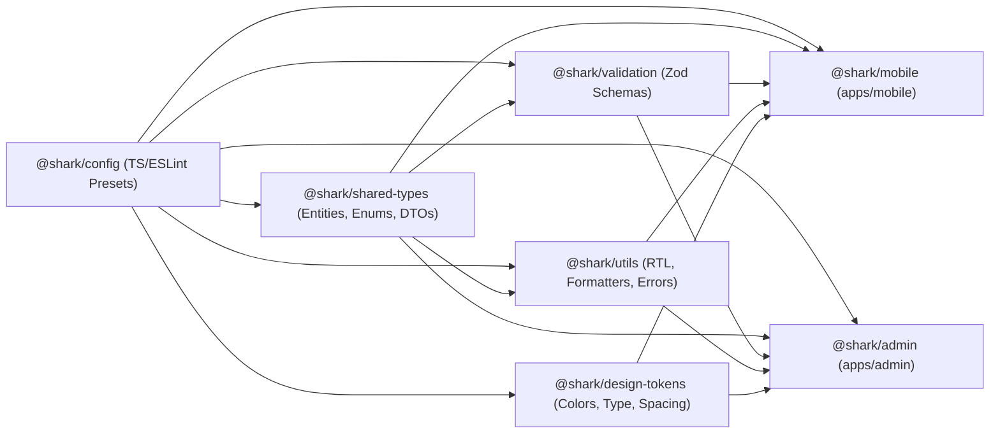
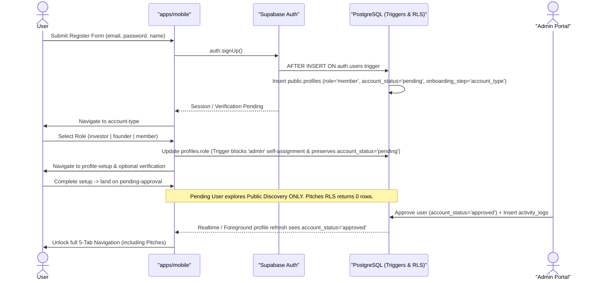
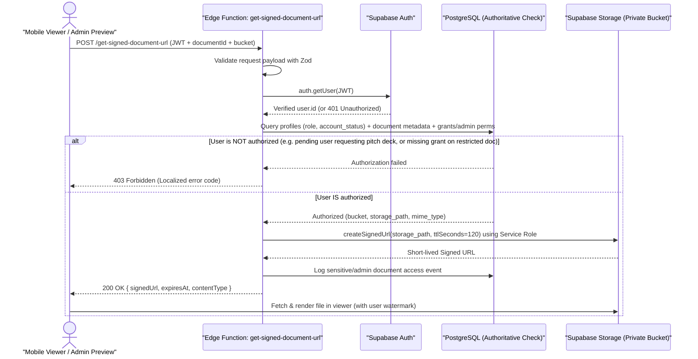

# System Architecture Document — SHARK Investment Network

> **Document Status:** Phase 1 Deliverable (Awaiting Stakeholder Review & Approval)  
> **Owner:** Agent 1 — Product Architect & Lead Planner  
> **Companion Charter:** `AGENTS.md` | **Product Spec:** `docs/PRD.md` | **Delivery Plan:** `docs/ROADMAP.md`  

---

## 1. Phase 0 Workspace Inspection & Environment Constraints

### 1.1 Observed Local Environment (Phase 0 Findings)
- **Workspace Path:** `c:\Users\MS\OneDrive\سطح المكتب\shark-investment-network`
  - Phase 0 baseline: 0 source files and not yet initialized as a Git repository (`AGENTS.md` was subsequently added as the governing engineering charter).
- **Operating System:** Windows x64
- **Installed Toolchain:**
  - Node.js `v22.18.0`
  - pnpm `10.16.1`
  - npm `11.13.0`
  - Git `2.50.1`
  - OpenJDK `21.0.13`
  - `ANDROID_HOME`: `C:\Users\MS\AppData\Local\Android\Sdk` (with `adb.exe` available)
  - `@expo/cli@54.0.5`
  - `eas-cli@23.2.0`
  - `typescript@5.9.2`
  - Python `3.13.5`
- **Not Installed Locally:**
  - `docker`
  - `supabase` CLI
  - `deno`
  - `psql`

### 1.2 Critical Environment Risks & Architectural Mitigations

| Risk Area | Root Cause | Concrete Impact | Required Mitigation |
| :--- | :--- | :--- | :--- |
| **OneDrive + Non-ASCII Arabic Folder Path (`سطح المكتب`)** | Workspace resides under OneDrive-synced Desktop path containing Arabic characters and spaces. | OneDrive file-locking conflicts on `node_modules`, `.expo`, `.next`, and Gradle caches; Windows NTFS junctions used by `pnpm` and Android NDK/CMake/Metro bundler frequently fail on non-ASCII paths and spaces. | **Recommended:** Relocate or clone the active working repo to a short ASCII path outside OneDrive (e.g., `C:\dev\shark-investment-network`). Configure `.gitignore` rigorously and pause OneDrive sync on build directories if temporary work remains here. |
| **Missing Local Supabase Stack (`docker`, `supabase`, `deno`, `psql`)** | Local workstation lacks Docker container runtime, Supabase CLI, Deno runtime, and Postgres CLI. | Cannot run `supabase start`, local PostgreSQL RLS tests, or local Deno Edge Function emulation on this machine as currently provisioned. | Either install Docker Desktop + `supabase` CLI + `deno` + `psql` before Phase 4 execution, **OR** run all DB migrations, RLS `pgTAP`/SQL tests, and Edge Function validation via a dedicated Remote Supabase Staging/Dev project + GitHub Actions CI Linux runners (`ubuntu-latest` with Supabase CLI). |
| **Windows Lacking Native iOS Build Toolchain** | Xcode and iOS Simulator require macOS. | Cannot compile native iOS binaries or run local iOS Simulator tests on Windows x64. | Use **Expo EAS Build** (`eas build --platform ios`) for cloud iOS builds/TestFlight distribution and **macOS CI runners** / physical iOS test devices in Phase 8 QA. Local development targets Android Emulator (`ANDROID_HOME`) + Expo Dev Client. |

---

## 2. High-Level System Context

SHARK Investment Network utilizes a unified **Supabase** backend serving two strict client boundaries: the bilingual **Mobile App (`@shark/mobile`)** and the internal **Admin Web Portal (`@shark/admin`)**.

```mermaid
flowchart TB
    MobileApp["Mobile App - apps/mobile (Expo React Native iOS and Android)"]
    AdminWeb["Admin Portal - apps/admin (Next.js App Router)"]

    subgraph SupabasePlatform["Supabase Backend Platform"]
        SupaAuth["Supabase Auth (JWT and Session Management)"]
        SupaPG["PostgreSQL + Row Level Security (RLS)"]
        SupaRT["Supabase Realtime (Notifications and Status Sync)"]
        SupaEdge["Supabase Edge Functions (Deno Runtime)"]
        BucketPublic["Storage: public-assets (Public Read)"]
        BucketPitch["Storage: pitch-documents (Private Bucket)"]
        BucketVerify["Storage: verification-documents (Private Bucket)"]
    end

    ExpoPush["Expo Push Service"]
    Sentry["Sentry (Error Monitoring)"]
    PostHog["PostHog (Privacy-Configured Analytics)"]

    MobileApp -->|"Anon Key + User JWT"| SupaAuth
    MobileApp -->|"RLS-Protected Queries"| SupaPG
    MobileApp -->|"Subscribed Channels"| SupaRT
    MobileApp -->|"Signed URL & Account Actions"| SupaEdge
    MobileApp -->|"Avatars & Logos"| BucketPublic
    MobileApp -->|"Short-Lived Signed URLs"| BucketPitch
    MobileApp -->|"Scoped Upload + Signed URLs"| BucketVerify
    MobileApp -->|"Scrubbed Errors"| Sentry
    MobileApp -->|"Opt-In Anonymous Telemetry"| PostHog

    AdminWeb -->|"SSR Cookie Auth"| SupaAuth
    AdminWeb -->|"Admin RLS + RPC"| SupaPG
    AdminWeb -->|"Signed URLs & Push Dispatch"| SupaEdge
    AdminWeb -->|"Server-Only Operations"| SupaPG
    AdminWeb -->|"Scrubbed Errors"| Sentry

    SupaEdge -->|"Verify Caller + Issue Signed URLs"| BucketPitch
    SupaEdge -->|"Verify Caller + Issue Signed URLs"| BucketVerify
    SupaEdge -->|"Send Push Notifications"| ExpoPush
    ExpoPush -->|"APNs / FCM Delivery"| MobileApp
```



---

## 3. Monorepo Architecture & Full Initial Folder Tree

The repository uses **pnpm workspaces** to enforce single-source-of-truth contracts across Mobile, Admin, and Backend without code duplication.

### 3.1 Workspace Packages Overview
- `apps/mobile` (`@shark/mobile`): Expo + React Native + Expo Router mobile app (Android & iOS).
- `apps/admin` (`@shark/admin`): Next.js App Router + Tailwind CSS admin dashboard.
- `packages/shared-types` (`@shark/shared-types`): Canonical TypeScript domain types, DB row interfaces, enums (`user_role`, `account_status`, `pitch_status`, `company_status`, `verification_status`), API response contracts.
- `packages/validation` (`@shark/validation`): Zod schemas for auth, onboarding, profiles, companies, pitches, document uploads, admin actions, filters, and boundary env parsing.
- `packages/design-tokens` (`@shark/design-tokens`): Framework-agnostic brand tokens (`#142B49` Navy, semantic colors, typography scales for `IBM Plex Sans Arabic` & `Inter`, 4px spacing scale, `8/12/16px` radii, shadow/elevation tokens).
- `packages/utils` (`@shark/utils`): Pure bilingual date/number/currency formatters, RTL helpers (`packages/utils/src/rtl*`), pagination cursor builders, error normalization helpers.
- `packages/config` (`@shark/config`): Shared TypeScript `tsconfig` presets, ESLint flat configs, Prettier rules.

### 3.2 Full Initial Folder Tree (Section 4)

```text
shark-investment-network/
├── AGENTS.md
├── README.md
├── package.json
├── pnpm-workspace.yaml
├── pnpm-lock.yaml
├── tsconfig.base.json
├── .env.example
├── .gitignore
├── .github/
│   └── workflows/
│       ├── ci-quality.yml                # typecheck, lint, unit tests, i18n key parity
│       ├── supabase-verify.yml           # migrations dry-run, RLS tests, Edge Function checks
│       └── eas-preview.yml               # Android/iOS EAS preview build pipeline
├── docs/
│   ├── PRD.md
│   ├── ARCHITECTURE.md
│   ├── ROADMAP.md
│   ├── DESIGN_SYSTEM.md                  # Agent 2
│   ├── DATABASE.md                       # Agent 4
│   ├── API_DOCUMENTATION.md              # Agent 4
│   ├── SECURITY.md                       # Agent 6
│   └── TESTING.md                        # Agent 6
├── packages/
│   ├── config/
│   │   ├── package.json
│   │   ├── tsconfig.base.json
│   │   ├── tsconfig.expo.json
│   │   ├── tsconfig.nextjs.json
│   │   └── eslint.base.mjs
│   ├── design-tokens/
│   │   ├── package.json
│   │   ├── tsconfig.json
│   │   └── src/
│   │       ├── index.ts
│   │       ├── colors.ts                 # #142B49 primary, WCAG AA semantic tokens
│   │       ├── typography.ts             # IBM Plex Sans Arabic, Inter
│   │       ├── spacing.ts                # 4px grid scale
│   │       ├── radii.ts                  # 8px, 12px, 16px
│   │       └── shadows.ts
│   ├── shared-types/
│   │   ├── package.json
│   │   ├── tsconfig.json
│   │   └── src/
│   │       ├── index.ts
│   │       ├── enums.ts                  # user_role, account_status, pitch_status, etc.
│   │       ├── auth.ts
│   │       ├── profiles.ts
│   │       ├── companies.ts
│   │       ├── pitches.ts
│   │       ├── documents.ts
│   │       ├── notifications.ts
│   │       ├── admin.ts
│   │       └── pagination.ts
│   ├── validation/
│   │   ├── package.json
│   │   ├── tsconfig.json
│   │   └── src/
│   │       ├── index.ts
│   │       ├── auth.schema.ts
│   │       ├── profile.schema.ts
│   │       ├── company.schema.ts
│   │       ├── pitch.schema.ts
│   │       ├── document.schema.ts
│   │       ├── admin.schema.ts
│   │       ├── search.schema.ts
│   │       └── env.schema.ts
│   └── utils/
│       ├── package.json
│       ├── tsconfig.json
│       └── src/
│           ├── index.ts
│           ├── rtl.ts                    # RTL/LTR logical helpers (Agent 3 + Agent 2)
│           ├── formatters.ts             # Locale-aware dates, currencies, compact numbers
│           ├── pagination.ts
│           ├── errors.ts
│           └── i18n-helpers.ts
├── apps/
│   ├── mobile/                           # @shark/mobile (Expo + Expo Router)
│   │   ├── package.json
│   │   ├── tsconfig.json
│   │   ├── app.config.ts
│   │   ├── eas.json
│   │   ├── .env.example
│   │   ├── assets/
│   │   │   ├── fonts/                    # IBM Plex Sans Arabic & Inter
│   │   │   └── images/
│   │   ├── app/                          # Expo Router File-Based Navigation
│   │   │   ├── _layout.tsx               # Root Providers (Query, Auth, I18n/RTL, Sentry, PostHog)
│   │   │   ├── index.tsx                 # Auth/Status Redirect Gate
│   │   │   ├── (auth)/
│   │   │   │   ├── _layout.tsx
│   │   │   │   ├── welcome.tsx
│   │   │   │   ├── login.tsx
│   │   │   │   ├── register.tsx
│   │   │   │   ├── account-type.tsx
│   │   │   │   ├── profile-setup.tsx
│   │   │   │   ├── verification.tsx
│   │   │   │   ├── pending-approval.tsx
│   │   │   │   ├── rejected.tsx
│   │   │   │   ├── suspended.tsx
│   │   │   │   ├── forgot-password.tsx
│   │   │   │   └── reset-password.tsx
│   │   │   ├── (tabs)/
│   │   │   │   ├── _layout.tsx           # 5-tab bar (Discovery, Investors, Companies, Pitches, Account)
│   │   │   │   ├── discovery.tsx         # Main landing tab
│   │   │   │   ├── investors.tsx
│   │   │   │   ├── companies.tsx
│   │   │   │   ├── pitches.tsx           # Gated to approved users
│   │   │   │   └── account.tsx
│   │   │   ├── investors/[id].tsx
│   │   │   ├── companies/[id].tsx
│   │   │   ├── pitches/
│   │   │   │   ├── [id].tsx
│   │   │   │   └── [id]/viewer.tsx       # Secure Signed URL PDF/Image viewer
│   │   │   ├── search.tsx
│   │   │   ├── sectors/[slug].tsx
│   │   │   └── account/
│   │   │       ├── edit-profile.tsx
│   │   │       ├── my-company.tsx
│   │   │       ├── my-pitches.tsx
│   │   │       ├── saved.tsx
│   │   │       ├── notifications.tsx
│   │   │       ├── settings.tsx
│   │   │       ├── language.tsx
│   │   │       ├── privacy-security.tsx
│   │   │       ├── support.tsx
│   │   │       └── delete-account.tsx
│   │   └── src/
│   │       ├── components/               # Reusable UI primitives + domain cards
│   │       ├── hooks/                    # TanStack Query hooks & auth/status orchestration
│   │       ├── repositories/             # Supabase queries (explicit columns, bounded pagination)
│   │       ├── services/                 # SecureStore, Notifications, Sentry, PostHog, SignedURLs
│   │       ├── i18n/
│   │       │   ├── index.ts
│   │       │   ├── ar.json               # Arabic (default)
│   │       │   └── en.json               # English
│   │       └── theme/                    # Adapter mapping @shark/design-tokens to RN StyleSheet
│   └── admin/                            # @shark/admin (Next.js App Router)
│       ├── package.json
│       ├── tsconfig.json
│       ├── next.config.ts
│       ├── tailwind.config.ts
│       ├── .env.example
│       ├── middleware.ts                 # Cookie session refresh & admin gate pre-check
│       └── src/
│           ├── app/
│           │   ├── layout.tsx
│           │   ├── (auth)/
│           │   │   ├── login/page.tsx
│           │   │   └── unauthorized/page.tsx
│           │   └── (dashboard)/
│           │       ├── layout.tsx        # Server-verified admin shell + RTL/LTR + RBAC nav
│           │       ├── page.tsx          # Redirects to /overview
│           │       ├── overview/page.tsx
│           │       ├── users/page.tsx
│           │       ├── investors/page.tsx
│           │       ├── companies/page.tsx
│           │       ├── verifications/page.tsx
│           │       ├── pitches/page.tsx
│           │       ├── pitch-reviews/page.tsx
│           │       ├── documents/page.tsx
│           │       ├── notifications/page.tsx
│           │       ├── admin-roles/page.tsx
│           │       ├── activity-logs/page.tsx
│           │       ├── analytics/page.tsx
│           │       └── settings/page.tsx
│           ├── actions/                  # Next.js Server Actions (admin verification + audit logs)
│           ├── components/               # Design-token UI primitives, data tables, review drawers
│           ├── hooks/                    # TanStack Query client hooks where interactive polling/filtering fits
│           ├── repositories/             # Server & client Supabase repositories
│           ├── lib/
│           │   ├── supabase/
│           │   │   ├── server.ts         # @supabase/ssr Server Client
│           │   │   ├── client.ts         # Browser Client (anon key only)
│           │   │   └── admin.ts          # Server-only Service Role client (guarded by assertAdmin)
│           │   └── auth/
│           │       └── guards.ts         # Server-side role + status + permission enforcement
│           └── i18n/
│               ├── ar.json
│               └── en.json
├── supabase/
│   ├── config.toml
│   ├── migrations/                       # Timestamped sequential SQL migrations
│   ├── seed/
│   │   └── seed.sql                      # Reference sectors, default settings, non-prod dev fixtures
│   ├── functions/
│   │   ├── _shared/                      # CORS, Auth verification, Zod helpers, Audit logger
│   │   ├── get-signed-document-url/      # Issues short-lived URLs for pitch & verification docs
│   │   ├── admin-user-action/            # Privileged user status changes, session revocation & roles
│   │   ├── admin-review-entity/          # Atomic company/verification/pitch/document review actions
│   │   ├── send-push-notification/       # Bilingual In-App + Expo Push dispatcher
│   │   └── delete-own-account/           # Store-compliant user deletion & PII anonymization
│   └── tests/                            # Automated SQL / RLS boundary tests
└── tests/                                # Cross-workspace integration, i18n parity, and E2E/load tests
```

---

## 4. Package Dependency Graph & Module Boundaries

### 4.1 Acyclic Package Dependency DAG



### 4.2 Hard Module Boundary Rules
1. **Zero Circular Dependencies:** Dependencies flow strictly downward (`apps/*` -> `packages/*` -> `@shark/shared-types` -> `@shark/config`). `packages/*` MUST NEVER import from `apps/*` or from `supabase/`.
2. **Runtime Purity in Shared Packages:** `@shark/shared-types`, `@shark/validation`, `@shark/design-tokens`, and `@shark/utils` MUST contain zero React Native imports, zero Next.js/Node-only (`fs`, `crypto`, `headers`) imports, and zero Supabase client singletons.
3. **Strict Layering Inside Apps:**
   - `app/` routes & `components/` -> may only invoke `hooks/` and `@shark/*` packages.
   - `hooks/` -> orchestrates TanStack Query, React Hook Form (`@shark/validation`), and `repositories/`.
   - `repositories/` -> sole gateway to Supabase SDK (`supabase.from(...)`, `supabase.rpc(...)`, `supabase.functions.invoke(...)`). Always projects explicit columns and enforces bounded pagination.

---

## 5. Mobile & Admin Clean Architecture Patterns

### 5.1 Mobile Architecture (`apps/mobile`)
1. **Presentation Layer (`app/`, `src/components/`):**
   - Pure UI primitives built strictly from `@shark/design-tokens` (`#142B49` Navy, `IBM Plex Sans Arabic` / `Inter`, 4px spacing grid, `8/12/16px` radii, `>= 44pt` touch targets).
   - Uses logical layout styling (`paddingStart`, `marginEnd`, `flexDirection` aware of RTL) via `packages/utils/src/rtl.ts`.
   - Zero direct `supabase` SDK calls inside JSX components.
2. **State & Query Layer (`src/hooks/`):**
   - **Server State:** `@tanstack/react-query` with deterministic query keys (`['investors', 'list', filters]`, `['pitches', 'detail', id]`). Stale times calibrated by volatility; all cached user/pitch data wiped immediately on `signOut` or `account_status` change to `rejected`/`suspended`.
   - **Auth & Status State:** Centralized `AuthContext` backed by `expo-secure-store` session persistence, listening to `onAuthStateChange` plus Realtime/foreground refresh on `profiles` row so admin approvals or suspensions reflect promptly.
   - **Form State:** `react-hook-form` + `@hookform/resolvers/zod` consuming `@shark/validation` schemas with translation-key error resolution.
3. **Repository Layer (`src/repositories/`):**
   - Typed repository methods returning validated domain DTOs (`@shark/shared-types`).
   - Enforces explicit `.select('id, full_name, avatar_url, ...')` projections—never `.select('*')`—and bounded `.limit(20)` / keyset cursor pagination.

### 5.2 Admin Dashboard Architecture (`apps/admin`)
1. **Server-First Security Model (Next.js App Router + `@supabase/ssr`):**
   - `middleware.ts` refreshes auth cookies and blocks unauthenticated requests away from `(dashboard)/*`.
   - `(dashboard)/layout.tsx` (Server Component) performs authoritative server-side verification against `profiles` and `admin_roles`, confirming `role === 'admin'` AND `account_status === 'approved'`. Unapproved or non-admin users are redirected to `/unauthorized` immediately.
   - Every Server Action / Route Handler re-runs `requireAdminPermission('module.action')` server-side before mutating state.
2. **Separation of Client & Server Keys:**
   - Browser components ONLY instantiate `createBrowserClient` with `NEXT_PUBLIC_SUPABASE_ANON_KEY`.
   - Server Actions/Route Handlers that require elevated privileges (e.g., revoking a suspended user's Auth session via `supabase.auth.admin.signOut` or dispatching mass notifications) use `src/lib/supabase/admin.ts` (`SUPABASE_SERVICE_ROLE_KEY`), exclusively imported in server-only modules (`import 'server-only'`).
3. **Atomic Auditability Pattern:**
   - Sensitive admin actions execute via PostgreSQL transactional RPCs or guarded Server Actions that atomically update target status AND insert an immutable record into `activity_logs` (capturing actor ID, action, entity type/ID, before/after diff, mandatory reason, timestamp).

---

## 6. Authentication, Authorization & Session Flow

### 6.1 Authoritative Database Lookup vs. JWT Metadata
> [!CAUTION]
> Client-modifiable `user_metadata` inside Supabase Auth JWTs MUST NEVER be used for authorization, role detection, or account approval checks. All RLS policies, Edge Functions, and Admin Server guards MUST verify authoritative state from `public.profiles` (and `public.admin_roles`) using `auth.uid()`.

### 6.2 Registration, Onboarding & Login Sequence



### 6.3 Session Lifecycle & Suspension Enforcement
- **Mobile Session Storage:** Custom adapter wrapping `expo-secure-store` (encrypted Keychain on iOS, Keystore/EncryptedSharedPreferences on Android) — never unencrypted `AsyncStorage` for JWTs.
- **Instant Suspension Cut-off:** When an admin suspends a user (`account_status = 'suspended'`), the backend invokes `admin-user-action` Edge Function to revoke refresh tokens via Auth Admin API AND updates `profiles.account_status = 'suspended'`. RLS denies all table reads/writes immediately even before JWT expiry, and mobile transitions the user to `(auth)/suspended` and purges TanStack Query cache.

---

## 7. Storage & Signed Document Access Flow

### 7.1 Bucket Isolation Policy

| Bucket Name | Visibility | Allowed Content | Upload Authorization | Read Authorization |
| :--- | :--- | :--- | :--- | :--- |
| `public-assets` | Public Read (CDN cached) | User avatars, company logos/banners (`JPG`, `PNG`, `WebP`, <= 5MB) | Authenticated owner scoped to `{entity_type}/{owner_id}/...` or Admin | Public read for active assets |
| `pitch-documents` | **PRIVATE** (No public access) | Pitch decks, financial models, cap tables (`PDF`, `PNG`, `JPG`, `PPTX`, `XLSX`, <= 25MB) | Approved Founder/operator owning the parent company/pitch (or Admin) scoped to `{company_id}/{pitch_id}/...` | **Zero direct public reads.** Short-lived Signed URLs via `get-signed-document-url` Edge Function only |
| `verification-documents` | **PRIVATE** (No public access) | User IDs, accreditation letters, commercial registrations (`PDF`, `PNG`, `JPG`, <= 10MB) | Authenticated non-suspended user uploading to `{user_id}/{request_id}/...` | **Zero direct public reads.** Owner or authorized Compliance/Super Admin via `get-signed-document-url` Edge Function only |

### 7.2 Signed URL Issuance Sequence



---

## 8. Notification Architecture

1. **Data Model:**
   - `notifications`: Stores per-user notifications (`user_id`, `category`, `title_ar`, `title_en`, `body_ar`, `body_en`, `deep_link`, `metadata`, `is_read`, `read_at`, `created_at`).
   - `device_tokens`: Stores Expo push tokens (`user_id`, `expo_push_token`, `platform`, `device_id`, `is_active`, `last_seen_at`).
2. **Delivery Channels:**
   - **In-App Inbox:** Mobile fetches paginated notifications via RLS (`user_id = auth.uid()`) and subscribes to Supabase Realtime `INSERT` events for live unread badge updates.
   - **Push Notifications (`send-push-notification` Edge Function):** Triggered either by Admin **Notifications** module (broadcast/targeted campaigns) or backend lifecycle workflows (account approved/rejected, verification status update, pitch review decision).
3. **Resilience & Hygiene:**
   - Respects user preferences stored in `profiles.notification_preferences` (except mandatory security/status alerts).
   - Processes Expo Push receipts and deactivates tokens returning `DeviceNotRegistered`.
   - Removes device push token cleanly upon user Sign Out or `delete-own-account`.

---

## 9. Internationalization (i18n) & RTL/LTR Architecture

- **Default Locale:** Arabic (`ar`, `dir="rtl"`), with English (`en`, `dir="ltr"`).
- **Mobile (`apps/mobile`):**
  - Synchronizes chosen locale in `expo-secure-store` / local storage and persists `preferred_language` in `profiles`.
  - Applies `I18nManager.allowRTL(true)` and `I18nManager.forceRTL(locale === 'ar')`; when toggling language in `account/language`, triggers deterministic React Native bundle/root reload (`Updates.reloadAsync()` in EAS builds or controlled app root remount + restart prompt in dev) so native RTL mirroring applies consistently across headers, drawers, and scroll views.
  - All UI styles use logical properties (`marginStart`, `marginEnd`, `paddingStart`, `paddingEnd`, `start`, `end`) and `packages/utils/src/rtl.ts` helpers for directional icons.
- **Admin (`apps/admin`):**
  - Root `<html>` sets `lang={locale}` and `dir={locale === 'ar' ? 'rtl' : 'ltr'}`.
  - Tailwind classes strictly prefer logical spacing/alignment (`ms-*`, `me-*`, `ps-*`, `pe-*`, `text-start`, `rtl:rotate-180`).
- **Validation Error Localization:**
  - `@shark/validation` emits stable translation error codes (e.g., `validation.email.invalid`, `validation.pitch.raise_positive`) rather than hardcoded English strings; UI layers map codes through their `ar.json` / `en.json` dictionaries.

---

## 10. Environment Variable Specification

> [!CAUTION]
> Secrets (`SUPABASE_SERVICE_ROLE_KEY`, `SENTRY_AUTH_TOKEN`, `EXPO_ACCESS_TOKEN`) MUST NEVER be prefixed with `EXPO_PUBLIC_` or `NEXT_PUBLIC_` and MUST NEVER be committed to Git. All apps validate required environment variables at startup using Zod schemas in `@shark/validation`.

### 10.1 Mobile App (`apps/mobile` — Public Client Bundle)

| Variable Name | Required | Example / Format | Purpose |
| :--- | :---: | :--- | :--- |
| `EXPO_PUBLIC_SUPABASE_URL` | Yes | `https://<ref>.supabase.co` | Supabase project REST/Auth endpoint |
| `EXPO_PUBLIC_SUPABASE_ANON_KEY` | Yes | `eyJ...` (public anon key) | Client-side Supabase SDK key (RLS-governed) |
| `EXPO_PUBLIC_APP_ENV` | Yes | `development` / `staging` / `production` | Environment tag for Sentry/PostHog & config |
| `EXPO_PUBLIC_DEFAULT_LOCALE` | Yes | `ar` | Default fallback locale (`ar` default) |
| `EXPO_PUBLIC_SENTRY_DSN` | Prod/Stg | `https://...@sentry.io/...` | Mobile crash & error reporting |
| `EXPO_PUBLIC_POSTHOG_API_KEY` | Prod/Stg | `phc_...` | Privacy-configured telemetry key |
| `EXPO_PUBLIC_POSTHOG_HOST` | Prod/Stg | `https://eu.i.posthog.com` | Regional PostHog ingest endpoint |
| `EXPO_PUBLIC_EAS_PROJECT_ID` | Yes | UUID | Expo EAS & Push notification project ID |

### 10.2 Admin Web Dashboard (`apps/admin` — Public Browser Bundle)

| Variable Name | Required | Example / Format | Purpose |
| :--- | :---: | :--- | :--- |
| `NEXT_PUBLIC_SUPABASE_URL` | Yes | `https://<ref>.supabase.co` | Supabase project URL |
| `NEXT_PUBLIC_SUPABASE_ANON_KEY` | Yes | `eyJ...` (public anon key) | Browser & SSR user-session client key |
| `NEXT_PUBLIC_APP_ENV` | Yes | `development` / `staging` / `production` | Runtime environment identifier |
| `NEXT_PUBLIC_SITE_URL` | Yes | `https://admin.sharknetwork.com` | Canonical Admin origin for auth callbacks |
| `NEXT_PUBLIC_DEFAULT_LOCALE` | Yes | `ar` | Default admin locale (`ar`) |
| `NEXT_PUBLIC_SENTRY_DSN` | Prod/Stg | `https://...@sentry.io/...` | Browser error telemetry |

### 10.3 Admin Web Dashboard (`apps/admin` — Server-Only Secrets)

| Variable Name | Required | Exposure Rule | Purpose |
| :--- | :---: | :--- | :--- |
| `SUPABASE_SERVICE_ROLE_KEY` | Yes | **Server-Only (NEVER client)** | Privileged server-side admin verification/actions after `requireAdminPermission` |
| `SENTRY_AUTH_TOKEN` | CI/Build | **CI / Build-Only** | Uploading Next.js source maps to Sentry |
| `SENTRY_ORG` | CI/Build | **CI / Build-Only** | Sentry organization slug |
| `SENTRY_PROJECT` | CI/Build | **CI / Build-Only** | Sentry Admin project slug |
| `ADMIN_ALLOWED_ORIGINS` | Prod | **Server-Only** | Strict origin validation on Server Actions / Route Handlers |

### 10.4 Supabase Edge Functions (`supabase/functions` Secrets)

| Secret Name | Required | Purpose |
| :--- | :---: | :--- |
| `SUPABASE_URL` | Yes | Internal Supabase URL inside Edge runtime |
| `SUPABASE_ANON_KEY` | Yes | Verifying caller JWTs |
| `SUPABASE_SERVICE_ROLE_KEY` | Yes | Generating Signed URLs, revoking suspended sessions, user deletion |
| `SIGNED_URL_TTL_SECONDS` | Yes | Default Signed URL expiration (`120` recommended) |
| `EXPO_ACCESS_TOKEN` | Optional/Rec | Authenticated Expo Push API access for high-reliability push dispatch |
| `APP_ENV` | Yes | Environment tagging for structured Edge logs |
| `SENTRY_DSN` | Optional | Edge Function exception capture |

---

## 11. Architectural Decision Records (ADRs)

### ADR-001: Supabase as Sole Backend Platform (No Firebase)
- **Context:** Platform requires relational integrity (users, investor profiles, companies, pitches, documents, granular RBAC, immutable audit logs), complex multi-attribute filtering, and strict row/column access boundaries.
- **Decision:** Standardize 100% on Supabase (PostgreSQL, Auth, Storage, RLS, Edge Functions, Realtime). Do not introduce Firebase Auth, Firestore, or Cloud Functions.
- **Consequences:** Relational foreign keys, transactional RPCs for audit logging, and database-enforced RLS dramatically reduce cross-tenant leak risk. Requires Docker/Supabase CLI or remote staging DB for local testing.

### ADR-002: Strict Separation of `user_role` and `account_status` in Authoritative Tables
- **Context:** Combining role and approval state (e.g., `pending_investor` vs `approved_investor`) or trusting JWT `user_metadata` introduces privilege escalation bugs.
- **Decision:** Separate `role` (`investor | founder | member | admin`) from `account_status` (`pending | approved | rejected | suspended`) as distinct PostgreSQL enums on `profiles`. Enforce default `pending` and block `admin` self-assignment via DB trigger + CHECK constraint. All RLS and Server guards evaluate authoritative DB rows.
- **Consequences:** Every new account defaults safely to `pending`; guests and pending users can be constrained cleanly to public investor/company views only.

### ADR-003: Private Storage Buckets with Edge-Function-Issued Signed URLs
- **Context:** Pitch decks, financial models, and identity/commercial verification files contain highly confidential material that must never leak via predictable public URLs or unrevoked links.
- **Decision:** Keep `pitch-documents` and `verification-documents` strictly private. Disable public/direct Storage read policies for general users and require every file access to pass through `get-signed-document-url` Edge Function, which checks DB authorization and returns a short-lived Signed URL (`60s` for verification/restricted docs, `120s` default/max for standard approved pitch docs).
- **Consequences:** Slight initial latency (~150–300ms) when opening a document viewer, offset by total control over `restricted` pitch/document permissions and auditability.

### ADR-004: pnpm Monorepo with Framework-Agnostic Shared Packages
- **Context:** Mobile (`apps/mobile`) and Admin (`apps/admin`) share identical enums, Zod validation rules, design tokens, and formatters.
- **Decision:** Structure a `pnpm` workspace with `@shark/shared-types`, `@shark/validation`, `@shark/design-tokens`, `@shark/utils`, and `@shark/config`.
- **Consequences:** Eliminates schema drift between mobile forms, admin forms, and database contracts; requires clean tsconfig/Metro resolver configuration for workspace symlinks (and mitigating OneDrive/Arabic path issues on Windows).

### ADR-005: Arabic-First (`ar`, RTL) Architecture with Translation-Key Validation
- **Context:** Primary audience operates in Arabic RTL with full English LTR parity required across every mobile screen and admin module.
- **Decision:** Set `ar` (RTL) as default locale everywhere; load `IBM Plex Sans Arabic` + `Inter`; standardize logical CSS/RN layout properties; have Zod schemas emit i18n keys resolved by centralized `ar.json` / `en.json` dictionaries.
- **Consequences:** Zero hardcoded strings and consistent RTL mirroring from Day 1, verified by automated CI parity checks (`ar.json` keys === `en.json` keys).

### ADR-006: Next.js App Router + `@supabase/ssr` + Immutable `activity_logs`
- **Context:** Admin operations handle high-risk approvals, suspensions, document restrictions, and role assignments.
- **Decision:** Build `apps/admin` on Next.js App Router using `@supabase/ssr` cookie authentication, multi-layer server verification (`middleware` + layout guard + per-action RBAC assertion), and append-only `activity_logs` enforced via RLS (INSERT-only via security-definer/server paths, zero UPDATE/DELETE policies).
- **Consequences:** Prevents client-side bypass of admin screens and guarantees tamper-resistant compliance history.

---

## 12. Unresolved Decisions & Technical Risks Register

The following items require explicit stakeholder confirmation during Phase 1 review or early Phase 4 implementation:

| ID | Topic / Question | Options & Tradeoffs | Recommended Default | Target Decision Gate |
| :--- | :--- | :--- | :--- | :--- |
| **UD-01** | **Dev Workstation Path (OneDrive + Arabic `سطح المكتب`)** | Keep current path (high risk of pnpm junction & Gradle/Metro build failures) vs. relocate working checkout to `C:\dev\shark-investment-network`. | Relocate active coding clone to `C:\dev\shark-investment-network` before Phase 2. | Before Phase 2 |
| **UD-02** | **Local vs. Remote Supabase Dev Workflow** | Install Docker Desktop + Supabase CLI + Deno + psql locally vs. run migrations/tests against a dedicated Supabase Staging/Dev project + GitHub Actions CI. | Provision dedicated Dev/Staging Supabase project + GitHub Actions CI, and optionally install Supabase CLI on Windows. | Before Phase 4 |
| **UD-03** | **iOS Build & Verification Workflow on Windows** | Cloud builds via Expo EAS Build + physical iOS device / TestFlight vs. macOS CI runner. | Use EAS Build (`eas.json`) for iOS preview/production binaries + macOS CI / TestFlight verification in Phase 8. | Before Phase 5 |
| **UD-04** | **Signup Email Verification Mechanism** | 6-digit email OTP in-app vs. email confirmation magic link deep-link (`shark://auth/callback`). | Email OTP (smoother UX across iOS/Android mail apps without universal-link fragility) or deep-link fallback. | Before Phase 4 |
| **UD-05** | **Restricted Pitch & Restricted Document Grant Mechanism** | Explicit per-user/per-pitch/per-doc `pitch_access_grants` assigned by Admin (or Founder request approved by Admin) vs. investor tier attribute. | Explicit `pitch_access_grants` table (with optional `pitch_document_id`) managed by Admin in Document/Pitch Management modules (auditable & granular). | Before Phase 4 |
| **UD-06** | **Arabic Numeral System (`123` vs `١٢٣`)** | Western Arabic digits (`0-9`) in both `ar` and `en` UIs vs. Eastern Arabic digits (`٠-٩`) in Arabic UI. | Standardize Western digits (`0-9`) for financial amounts, dates, and IDs across both locales (regional fintech norm), configurable in `@shark/utils`. | Before Phase 3 |
| **UD-07** | **PostHog Cloud Region & PDPL/GDPR Consent** | PostHog EU (`eu.i.posthog.com`) vs. US (`us.i.posthog.com`) + strict opt-in vs. opt-out consent. | Use PostHog EU hosting with anonymized user hashes, zero PII capture, and explicit privacy toggle in `account/privacy-security`. | Before Phase 5 |
| **UD-08** | **Account Deletion vs. Immutable `activity_logs`** | Hard delete `auth.users` with `ON DELETE SET NULL` + anonymized actor snapshot in `activity_logs` vs. soft-anonymization. | Hard-delete `auth.users` + PII in `profiles`, retain anonymized UUID/tombstone label in `activity_logs` (`ON DELETE SET NULL`). | Before Phase 4 |
