# DATABASE.md — SHARK Investment Network

> **Document Status:** Phase 1 Deliverable (Awaiting Stakeholder Review & Approval)  
> **Owner:** Agent 4 — Backend Engineer & Database Architect  
> **Backend Platform:** Supabase (PostgreSQL 15+, Supabase Auth, Supabase Storage, Row Level Security, Edge Functions, Realtime) — **Zero Firebase**  
> **Companion Specs:** `AGENTS.md` | `docs/PRD.md` | `docs/ARCHITECTURE.md` | `docs/SECURITY.md`

---

## 1. Architecture Overview & Canonical Design Invariants

**SHARK Investment Network** uses **Supabase PostgreSQL** as the sole authoritative relational datastore, enforcing all identity separation, confidential deal-room boundaries, bilingual (`ar` RTL default / `en` LTR) search indexing, and immutable compliance auditing directly at the database, storage, and Edge Function layers.

### 1.1 Non-Negotiable Database Invariants
1. **Supabase Auth 1:1 Linkage:** `public.profiles.id` is a `uuid` primary key and foreign key referencing `auth.users(id) ON DELETE CASCADE`. Passwords, password hashes, refresh tokens, and MFA secrets reside exclusively inside Supabase-managed `auth.*` schemas and are **never** duplicated in `public.*`.
2. **UUID Primary Keys Everywhere:** Every entity table uses `uuid` primary keys generated via `gen_random_uuid()` (except `profiles.id`, which mirrors `auth.users.id`).
3. **Strict Role vs. Account Status Separation:**
   - `user_role`: `'investor' | 'founder' | 'member' | 'admin'`
   - `account_status`: `'pending' | 'approved' | 'rejected' | 'suspended'`
   - New signups **always** initialize with `account_status = 'pending'`. Selecting `'admin'` during signup or self-updating `role` / `account_status` is blocked by PostgreSQL triggers.
   - Holding a `role` never implies `'approved'` status. Every privileged RLS policy and Edge Function evaluates live `profiles.account_status` and `admin_roles.is_active` state in PostgreSQL rather than trusting static JWT claims.
4. **Row Level Security (`FORCE ROW LEVEL SECURITY`):** Enabled and forced on all **20 tables** (`14` core entities + `6` justified supporting tables). Public Guest (`anon`) and `pending` discovery reads use strict non-PII projection views/RPCs; direct `SELECT` on `profiles` is limited to self (`id = auth.uid()`) or active authorized admins.
5. **Confidential Document Isolation:** Private deal-room decks (`pitch-documents`) and KYC/KYB files (`verification-documents`) live in private Supabase Storage buckets with zero direct public or client `SELECT` access, served strictly via short-lived (`60–120s`) Signed URLs issued by the `get-signed-document-url` Edge Function.
6. **Immutable Audit Trail:** Every sensitive administrative or moderation state transition writes an append-only row into `activity_logs` inside the same database transaction. `UPDATE` and `DELETE` operations on `activity_logs` are blocked unconditionally by RLS and triggers.
7. **Bounded Query Discipline:** Every list query projects explicit columns (never unbounded `SELECT *`), enforces bounded page sizes (`<= 50`), and relies on composite/partial/GIN indexes with cursor/keyset pagination.

### 1.2 Phase 1 Cross-Document Symbol Reconciliation
During the Phase 1 cross-document consistency review, all earlier draft variants across `PRD.md`, `ARCHITECTURE.md`, `DESIGN_SYSTEM.md`, `SECURITY.md`, and `ROADMAP.md` were unified onto the canonical identifiers below, which govern all downstream implementation (`@shark/shared-types`, `@shark/validation`, `supabase/migrations/`, `apps/mobile`, `apps/admin`):

| Domain Item | Canonical Name (Unified Across All Phase 1 Docs) | Reconciled Earlier Draft Variants |
| :--- | :--- | :--- |
| **Admin Sub-Roles Enum** | `admin_role_name`: `'super_admin'`, `'operations_admin'`, `'compliance_reviewer'`, `'content_moderator'`, `'analyst_readonly'` | `PRD.md` (`verification_officer`, `support_analyst`), `SECURITY.md` (`deal_moderator`, `support_operator`, `audit_viewer`) -> mapped cleanly onto the 5 canonical roles in Section 2.1 |
| **Push Device Registry Table** | `device_tokens` | `ARCHITECTURE.md` §8 (`push_tokens`) |
| **Pitch/Doc Access Grant Table** | `pitch_access_grants` (supports pitch-wide & document-level via nullable `pitch_document_id`) | `ARCHITECTURE.md` UD-05 / `PRD.md` (`document_access_grants`) |
| **Support & Appeal Table** | `support_requests` | `PRD.md` §4.2 (`support_tickets`) |
| **Signed URL Edge Function** | `get-signed-document-url` | `ARCHITECTURE.md` / `PRD.md` (`create-signed-document-url`) |
| **Admin Lifecycle Edge Function** | `admin-user-action` | `ARCHITECTURE.md` §3.2 (`admin-user-lifecycle`) |
| **Notification Edge Function** | `send-push-notification` | `ARCHITECTURE.md` §3.2 (`dispatch-notification`) |
| **Account Deletion Edge Function** | `delete-own-account` | `ARCHITECTURE.md` §3.2 (`delete-user-account`) |

---

## 2. Canonical PostgreSQL Enumerations

All enums live in the `public` schema and map 1:1 to TypeScript union types in `@shark/shared-types`.

### 2.1 Core Canonical Enums

```sql
-- 1. User identity role (strictly separate from account_status)
CREATE TYPE public.user_role AS ENUM (
  'investor',
  'founder',
  'member',
  'admin'
);

-- 2. User account approval & lifecycle status
CREATE TYPE public.account_status AS ENUM (
  'pending',
  'approved',
  'rejected',
  'suspended'
);

-- 3. Company publication & moderation status
CREATE TYPE public.company_status AS ENUM (
  'draft',
  'pending',
  'approved',
  'rejected',
  'suspended'
);

-- 4. Company verification badge state (independent from company_status)
CREATE TYPE public.verification_badge_status AS ENUM (
  'unverified',
  'pending',
  'verified',
  'rejected'
);

-- 5. Pitch fundraising & visibility status
CREATE TYPE public.pitch_status AS ENUM (
  'draft',
  'pending',
  'approved',
  'rejected',
  'closed',
  'restricted'
);

-- 6. KYC / KYB / Accreditation verification request status
CREATE TYPE public.verification_request_status AS ENUM (
  'pending',
  'needs_info',
  'approved',
  'rejected'
);

-- 7. Granular Admin RBAC role names
CREATE TYPE public.admin_role_name AS ENUM (
  'super_admin',
  'operations_admin',
  'compliance_reviewer',
  'content_moderator',
  'analyst_readonly'
);
```

#### Canonical Admin Role Permission Mapping
| `admin_role_name` | Default Permission Scopes (`admin_roles.permissions`) | Explicitly Prohibited |
| :--- | :--- | :--- |
| `super_admin` | `*` (Full access across all 13 modules, `roles:manage`, `settings:write`, `audit:read`) | Cannot alter own `profiles.role`/`account_status`, own `admin_roles`, or delete `activity_logs` |
| `operations_admin` | `users:read`, `users:review`, `users:suspend`, `companies:read`, `companies:review`, `pitches:read`, `notifications:send`, `support:read`, `support:manage`, `analytics:read` | Cannot manage `admin_roles` or `system_settings`; cannot act on self |
| `compliance_reviewer` | `users:read`, `users:review`, `users:suspend`, `verifications:read`, `verifications:review`, `companies:verify`, `audit:read` | Cannot manage `admin_roles`, `system_settings`, or pitch publication outside compliance |
| `content_moderator` | `investors:moderate`, `companies:read`, `companies:review`, `pitches:read`, `pitches:review`, `pitches:restrict`, `documents:moderate`, `interests:read` | Cannot verify KYC/KYB, suspend admins, or edit `admin_roles`/`system_settings` |
| `analyst_readonly` | `users:read`, `companies:read`, `pitches:read`, `audit:read`, `analytics:read`, `support:read` | Zero write/approval/restriction/export-PII permissions across all tables |

### 2.2 Supporting Domain Enums

```sql
CREATE TYPE public.language_code AS ENUM ('ar', 'en');

CREATE TYPE public.investor_type AS ENUM (
  'angel',
  'vc_fund',
  'family_office',
  'corporate_vc',
  'syndicate',
  'institutional'
);

CREATE TYPE public.funding_stage AS ENUM (
  'pre_seed',
  'seed',
  'series_a',
  'series_b',
  'growth',
  'late_stage'
);

CREATE TYPE public.investment_instrument AS ENUM (
  'equity',
  'safe',
  'convertible_note',
  'revenue_share',
  'debt',
  'other'
);

CREATE TYPE public.company_member_role AS ENUM (
  'owner',
  'co_founder',
  'executive',
  'advisor',
  'editor'
);

CREATE TYPE public.company_member_status AS ENUM (
  'invited',
  'active',
  'revoked'
);

CREATE TYPE public.pitch_document_category AS ENUM (
  'pitch_deck',
  'financial_model',
  'cap_table',
  'legal_doc',
  'traction_report',
  'other'
);

CREATE TYPE public.document_scan_status AS ENUM (
  'pending',
  'clean',
  'quarantined'
);

CREATE TYPE public.investment_interest_status AS ENUM (
  'submitted',
  'reviewing',
  'shortlisted',
  'connected',
  'declined',
  'withdrawn'
);

CREATE TYPE public.saved_entity_type AS ENUM (
  'investor',
  'company',
  'pitch'
);

CREATE TYPE public.notification_category AS ENUM (
  'account_status',
  'verification',
  'company_review',
  'pitch_review',
  'investment_interest',
  'access_grant',
  'announcement',
  'security'
);

CREATE TYPE public.verification_subject_type AS ENUM (
  'user_identity',
  'investor_accreditation',
  'company_kyb'
);

CREATE TYPE public.device_platform AS ENUM ('ios', 'android', 'web');

CREATE TYPE public.pitch_review_decision AS ENUM (
  'approved',
  'approved_restricted',
  'needs_info',
  'rejected',
  'restricted',
  'unrestricted',
  'closed'
);

CREATE TYPE public.support_request_category AS ENUM (
  'account_approval',
  'verification',
  'technical_issue',
  'appeal',
  'content_report',
  'general'
);

CREATE TYPE public.support_request_status AS ENUM (
  'open',
  'in_progress',
  'waiting_user',
  'resolved',
  'closed'
);
```

---

## 3. Initial Database Entity-Relationship Diagram (`erDiagram`)

The diagram below depicts `auth.users` (labeled `auth_users` for valid Mermaid `erDiagram` syntax) alongside all **14 core entities** and **6 justified supporting tables** (`20` tables total).

```mermaid
erDiagram
    auth_users {
        uuid id PK
        text email
        timestamptz email_confirmed_at
    }

    profiles {
        uuid id PK,FK
        text email UK
        text full_name
        user_role role
        account_status account_status
        language_code preferred_language
        uuid approved_by FK
        timestamptz deleted_at
    }

    sectors {
        uuid id PK
        text slug UK
        text name_ar
        text name_en
        boolean is_active
        timestamptz deleted_at
    }

    investors {
        uuid id PK
        uuid user_id UK,FK
        investor_type investor_type
        numeric ticket_min_usd
        numeric ticket_max_usd
        boolean is_accredited
        boolean is_featured
        timestamptz deleted_at
    }

    founders {
        uuid id PK
        uuid user_id UK,FK
        uuid primary_sector_id FK
        smallint experience_years
        boolean is_public_listed
        timestamptz deleted_at
    }

    companies {
        uuid id PK
        uuid owner_id FK
        uuid sector_id FK
        text slug UK
        text name_ar
        text name_en
        company_status status
        verification_badge_status verification_status
        boolean is_featured
        timestamptz deleted_at
    }

    company_members {
        uuid id PK
        uuid company_id FK
        uuid user_id FK
        company_member_role member_role
        company_member_status status
        uuid invited_by FK
        timestamptz deleted_at
    }

    pitches {
        uuid id PK
        uuid company_id FK
        uuid created_by FK
        uuid sector_id FK
        text title_ar
        text title_en
        pitch_status status
        numeric target_amount_usd
        boolean is_featured
        timestamptz deleted_at
    }

    pitch_documents {
        uuid id PK
        uuid pitch_id FK
        uuid company_id FK
        uuid uploaded_by FK
        pitch_document_category category
        text storage_path UK
        boolean is_restricted
        document_scan_status scan_status
        timestamptz deleted_at
    }

    pitch_reviews {
        uuid id PK
        uuid pitch_id FK
        uuid reviewer_id FK
        pitch_review_decision decision
        boolean is_internal
        timestamptz created_at
    }

    pitch_access_grants {
        uuid id PK
        uuid pitch_id FK
        uuid pitch_document_id FK
        uuid user_id FK
        uuid granted_by FK
        timestamptz expires_at
        timestamptz revoked_at
    }

    investment_interests {
        uuid id PK
        uuid pitch_id FK
        uuid company_id FK
        uuid investor_id FK
        numeric indicative_amount_usd
        investment_interest_status status
        timestamptz deleted_at
    }

    portfolio_companies {
        uuid id PK
        uuid investor_user_id FK
        uuid company_id FK
        uuid sector_id FK
        text external_name_en
        boolean is_exited
        timestamptz deleted_at
    }

    saved_items {
        uuid id PK
        uuid user_id FK
        saved_entity_type entity_type
        uuid entity_id
        timestamptz created_at
    }

    notifications {
        uuid id PK
        uuid user_id FK
        uuid sent_by FK
        notification_category category
        boolean is_read
        timestamptz created_at
        timestamptz deleted_at
    }

    device_tokens {
        uuid id PK
        uuid user_id FK
        text expo_push_token UK
        device_platform platform
        boolean is_active
    }

    verification_requests {
        uuid id PK
        uuid user_id FK
        uuid company_id FK
        uuid reviewer_id FK
        verification_subject_type subject_type
        verification_request_status status
        timestamptz deleted_at
    }

    admin_roles {
        uuid id PK
        uuid user_id FK
        admin_role_name role_name
        boolean is_active
        uuid assigned_by FK
        timestamptz deleted_at
    }

    activity_logs {
        uuid id PK
        uuid actor_id FK
        text action
        text entity_type
        uuid entity_id
        timestamptz created_at
    }

    system_settings {
        uuid id PK
        text setting_key UK
        jsonb value
        boolean is_public
        uuid updated_by FK
    }

    support_requests {
        uuid id PK
        uuid user_id FK
        uuid assigned_to FK
        support_request_category category
        support_request_status status
        timestamptz deleted_at
    }

    auth_users ||--|| profiles : "1:1 identity"
    profiles ||--o| investors : "optional investor profile"
    profiles ||--o| founders : "optional founder profile"
    profiles ||--o{ companies : "owns"
    profiles ||--o{ company_members : "member of"
    profiles ||--o{ pitches : "creates"
    profiles ||--o{ pitch_documents : "uploads"
    profiles ||--o{ pitch_reviews : "reviews"
    profiles ||--o{ pitch_access_grants : "receives or grants"
    profiles ||--o{ investment_interests : "expresses interest"
    profiles ||--o{ portfolio_companies : "lists portfolio"
    profiles ||--o{ saved_items : "bookmarks"
    profiles ||--o{ notifications : "receives or sends"
    profiles ||--o{ device_tokens : "registers devices"
    profiles ||--o{ verification_requests : "submits or reviews"
    profiles ||--o{ admin_roles : "holds admin scope"
    profiles ||--o{ activity_logs : "performs audited actions"
    profiles ||--o{ system_settings : "updates config"
    profiles ||--o{ support_requests : "submits or handles"

    sectors ||--o{ founders : "primary focus"
    sectors ||--o{ companies : "categorizes"
    sectors ||--o{ pitches : "categorizes"
    sectors ||--o{ portfolio_companies : "categorizes"

    companies ||--o{ company_members : "has team operators"
    companies ||--o{ pitches : "raises via"
    companies ||--o{ pitch_documents : "owns storage scope"
    companies ||--o{ investment_interests : "receives"
    companies ||--o{ portfolio_companies : "referenced by"
    companies ||--o{ verification_requests : "verified via KYB"

    pitches ||--o{ pitch_documents : "contains files"
    pitches ||--o{ pitch_reviews : "undergoes reviews"
    pitches ||--o{ pitch_access_grants : "grants restricted access"
    pitches ||--o{ investment_interests : "attracts interest"

    pitch_documents ||--o{ pitch_access_grants : "optional doc-level grant"
```



---

## 4. Table Inventory, Supporting Table Justifications & Soft-Deletion Policy

### 4.1 Complete 20-Table Classification

| # | Table | Category | Soft Delete (`deleted_at`) | Justification (Supporting Tables Only) |
| :---: | :--- | :--- | :---: | :--- |
| 1 | `profiles` | Core (1/14) | Yes (`deleted_at`) | Core entity |
| 2 | `investors` | Core (2/14) | Yes (`deleted_at`) | Core entity |
| 3 | `founders` | Core (3/14) | Yes (`deleted_at`) | Core entity |
| 4 | `companies` | Core (4/14) | Yes (`deleted_at`) | Core entity |
| 5 | `company_members` | Core (5/14) | Yes (`deleted_at`) | Core entity |
| 6 | `pitches` | Core (6/14) | Yes (`deleted_at`) | Core entity |
| 7 | `pitch_documents` | Core (7/14) | Yes (`deleted_at`) | Core entity |
| 8 | `investment_interests` | Core (8/14) | Yes (`deleted_at`) | Core entity |
| 9 | `portfolio_companies` | Core (9/14) | Yes (`deleted_at`) | Core entity |
| 10 | `saved_items` | Core (10/14) | No (Hard delete bookmark) | Core entity |
| 11 | `notifications` | Core (11/14) | Yes (`deleted_at`) | Core entity |
| 12 | `verification_requests` | Core (12/14) | Yes (`deleted_at`) | Core entity |
| 13 | `admin_roles` | Core (13/14) | Yes (`deleted_at`) | Core entity |
| 14 | `activity_logs` | Core (14/14) | **No (Immutable)** | Core entity (append-only audit log) |
| 15 | `sectors` | Supporting (1/6) | Yes (`deleted_at`) | **Required:** Standardizes bilingual (`name_ar`, `name_en`, `slug`) taxonomy across Discovery chips, `sectors/[slug]`, Investor/Company/Pitch filters, and Admin Module 13 Sector CRUD without string drift. |
| 16 | `device_tokens` | Supporting (2/6) | No (`is_active` / Hard delete) | **Required:** Persists per-device Expo push tokens (`ios`/`android`) for `send-push-notification`, supports multi-device users, handles `DeviceNotRegistered` deactivation, and enables immediate wipe on logout/suspension/deletion. |
| 17 | `pitch_reviews` | Supporting (3/6) | **No (Append-only history)** | **Required:** Powers Admin Module 7 (**Pitch Review**) multi-round moderation history, structured compliance checklists, founder-visible "Request additional information" notes (`is_internal = false`), and confidential moderator notes (`is_internal = true`). |
| 18 | `pitch_access_grants` | Supporting (4/6) | No (`revoked_at` audit) | **Required:** Enforces granular, time-bounded, revocable clearance when `pitches.status = 'restricted'` or `pitch_documents.is_restricted = true`, checked live inside `can_view_pitch()` and `get-signed-document-url`. |
| 19 | `system_settings` | Supporting (5/6) | No (Global key-value) | **Required:** Persists runtime platform configuration & feature flags for Admin Module 13 (**System Settings**): registration gate, maintenance banner (`ar`/`en`), upload limits, and Signed URL TTL bounds. |
| 20 | `support_requests` | Supporting (6/6) | Yes (`deleted_at`) | **Required:** Powers Mobile `account/support` and `rejected`/`suspended` appeal ticket submission, categorization, and Admin triage tracking. |

### 4.2 Soft-Deletion Strategy & Global `updated_at` Trigger
- **Why Soft Delete (`deleted_at timestamptz NULL`):** Prevents accidental data loss or broken foreign references across active deal workflows (`companies`, `pitches`, `verification_requests`, `investment_interests`, `notifications`), while allowing partial unique indexes (`WHERE deleted_at IS NULL`) so slugs or memberships can be safely recreated after archival.
- **Why Hard Delete / Revocation on Select Tables:**
  - `saved_items`: Idempotent user toggle (`INSERT` / `DELETE`) with zero compliance retention requirement.
  - `device_tokens`: Push tokens are ephemeral device credentials that must be purged immediately upon sign-out or account deletion.
  - `pitch_access_grants`: Uses `revoked_at` + `revoked_by` instead of `deleted_at` so compliance teams retain proof of when access was granted and revoked.
  - `activity_logs` and `pitch_reviews`: Strictly append-only (`DELETE` denied for all actors).
- **Global `updated_at` Trigger Function:** Attached `BEFORE UPDATE` on every mutable table containing an `updated_at` column:

```sql
CREATE OR REPLACE FUNCTION public.set_updated_at()
RETURNS trigger
LANGUAGE plpgsql
AS $$
BEGIN
  NEW.updated_at := now();
  RETURN NEW;
END;
$$;
```

---

## 5. Complete Table-by-Table Schema Specification

> **Shared Conventions:**  
> - All `timestamptz` columns store UTC.  
> - `search_text` generated columns use `public.normalize_arabic_text(...)` (defined in Section 7.2) to support diacritic-insensitive Arabic + case-insensitive English trigram matching.  
> - Every URL column enforces `^https://` via `CHECK` constraint to block `javascript:` or plaintext `http:` injection.

### 5.1 `profiles` (Core #1)
1:1 identity and status table synchronized from `auth.users`. Direct client `SELECT` is restricted to self or active admins; public discovery consumes `public_investors_directory`.

| Column | PostgreSQL Type | Null | Default | Constraints / Notes |
| :--- | :--- | :---: | :--- | :--- |
| `id` | `uuid` | NOT NULL | — | `PRIMARY KEY`, `REFERENCES auth.users(id) ON DELETE CASCADE` |
| `email` | `text` | NOT NULL | — | `UNIQUE` (case-insensitive functional unique index on `lower(email)` where `deleted_at IS NULL`); private PII |
| `phone` | `text` | NULL | `NULL` | `CHECK (phone IS NULL OR phone ~ '^\+[1-9][0-9]{6,14}$')`; private PII |
| `full_name` | `text` | NOT NULL | — | `CHECK (char_length(btrim(full_name)) BETWEEN 2 AND 120)` |
| `full_name_ar` | `text` | NULL | `NULL` | `CHECK (full_name_ar IS NULL OR char_length(btrim(full_name_ar)) BETWEEN 2 AND 120)` |
| `full_name_en` | `text` | NULL | `NULL` | `CHECK (full_name_en IS NULL OR char_length(btrim(full_name_en)) BETWEEN 2 AND 120)` |
| `headline_ar` | `text` | NULL | `NULL` | `CHECK (headline_ar IS NULL OR char_length(headline_ar) <= 160)` |
| `headline_en` | `text` | NULL | `NULL` | `CHECK (headline_en IS NULL OR char_length(headline_en) <= 160)` |
| `bio_ar` | `text` | NULL | `NULL` | `CHECK (bio_ar IS NULL OR char_length(bio_ar) <= 2000)` |
| `bio_en` | `text` | NULL | `NULL` | `CHECK (bio_en IS NULL OR char_length(bio_en) <= 2000)` |
| `avatar_path` | `text` | NULL | `NULL` | Object path in `public-assets` (`avatars/{user_id}/{uuid}.{ext}`) |
| `country_code` | `char(2)` | NULL | `NULL` | `CHECK (country_code IS NULL OR country_code ~ '^[A-Z]{2}$')` |
| `city_ar` | `text` | NULL | `NULL` | `CHECK (city_ar IS NULL OR char_length(city_ar) <= 80)` |
| `city_en` | `text` | NULL | `NULL` | `CHECK (city_en IS NULL OR char_length(city_en) <= 80)` |
| `preferred_language` | `public.language_code` | NOT NULL | `'ar'` | Default Arabic (`ar`, RTL) |
| `role` | `public.user_role` | NOT NULL | `'member'` | Trigger prevents `'admin'` self-assignment |
| `account_status` | `public.account_status` | NOT NULL | `'pending'` | Trigger forces `'pending'` on signup & blocks self-updates |
| `onboarding_completed` | `boolean` | NOT NULL | `false` | Tracks mobile onboarding wizard completion |
| `onboarding_step` | `text` | NOT NULL | `'account_type'` | `CHECK (onboarding_step IN ('account_type','profile_setup','verification','completed'))` |
| `interest_sector_ids` | `uuid[]` | NOT NULL | `'{}'` | Preferred `sectors.id` values |
| `notification_preferences` | `jsonb` | NOT NULL | `'{"push":true,"email":true,"announcements":true}'::jsonb` | `CHECK (jsonb_typeof(notification_preferences) = 'object')` |
| `analytics_opt_in` | `boolean` | NOT NULL | `false` | Privacy consent flag for PostHog |
| `rejection_reason` | `text` | NULL | `NULL` | Admin-only write; visible to self, hidden from peers/guests |
| `suspension_reason` | `text` | NULL | `NULL` | Admin-only write; visible to self, hidden from peers/guests |
| `approved_at` | `timestamptz` | NULL | `NULL` | Trigger-protected; admin/server-set only |
| `approved_by` | `uuid` | NULL | `NULL` | `REFERENCES public.profiles(id) ON DELETE SET NULL` |
| `rejected_at` | `timestamptz` | NULL | `NULL` | Trigger-protected |
| `rejected_by` | `uuid` | NULL | `NULL` | `REFERENCES public.profiles(id) ON DELETE SET NULL` |
| `suspended_at` | `timestamptz` | NULL | `NULL` | Trigger-protected |
| `suspended_by` | `uuid` | NULL | `NULL` | `REFERENCES public.profiles(id) ON DELETE SET NULL` |
| `last_active_at` | `timestamptz` | NULL | `NULL` | Updated via session heartbeat |
| `search_text` | `text` | NOT NULL | `GENERATED ALWAYS` | Normalized bilingual `full_name*` + `headline*` |
| `created_at` | `timestamptz` | NOT NULL | `now()` | Immutable creation time |
| `updated_at` | `timestamptz` | NOT NULL | `now()` | Maintained by `set_updated_at()` |
| `deleted_at` | `timestamptz` | NULL | `NULL` | Soft deletion marker |

---

### 5.2 `investors` (Core #2)
1:1 investor profile extension linked to `profiles` where `role = 'investor'`.

| Column | PostgreSQL Type | Null | Default | Constraints / Notes |
| :--- | :--- | :---: | :--- | :--- |
| `id` | `uuid` | NOT NULL | `gen_random_uuid()` | `PRIMARY KEY` |
| `user_id` | `uuid` | NOT NULL | — | `UNIQUE`, `REFERENCES public.profiles(id) ON DELETE CASCADE` |
| `investor_type` | `public.investor_type` | NOT NULL | `'angel'` | Angel, VC Fund, Family Office, etc. |
| `firm_name_ar` | `text` | NULL | `NULL` | `CHECK (firm_name_ar IS NULL OR char_length(firm_name_ar) <= 120)` |
| `firm_name_en` | `text` | NULL | `NULL` | `CHECK (firm_name_en IS NULL OR char_length(firm_name_en) <= 120)` |
| `title_ar` | `text` | NULL | `NULL` | `CHECK (title_ar IS NULL OR char_length(title_ar) <= 100)` |
| `title_en` | `text` | NULL | `NULL` | `CHECK (title_en IS NULL OR char_length(title_en) <= 100)` |
| `thesis_ar` | `text` | NULL | `NULL` | `CHECK (thesis_ar IS NULL OR char_length(thesis_ar) <= 2500)` |
| `thesis_en` | `text` | NULL | `NULL` | `CHECK (thesis_en IS NULL OR char_length(thesis_en) <= 2500)` |
| `focus_sector_ids` | `uuid[]` | NOT NULL | `'{}'` | Array of `sectors.id` |
| `preferred_stages` | `public.funding_stage[]` | NOT NULL | `'{}'` | Target investment stages |
| `ticket_min_usd` | `numeric(14,2)` | NULL | `NULL` | `CHECK (ticket_min_usd IS NULL OR ticket_min_usd >= 0)` |
| `ticket_max_usd` | `numeric(14,2)` | NULL | `NULL` | `CHECK (ticket_max_usd IS NULL OR (ticket_min_usd IS NULL OR ticket_max_usd >= ticket_min_usd))` |
| `currency_code` | `char(3)` | NOT NULL | `'USD'` | `CHECK (currency_code ~ '^[A-Z]{3}$')` |
| `geography_focus` | `text[]` | NOT NULL | `'{}'` | Target ISO country/region codes (`SA`, `AE`, `MENA`) |
| `website_url` | `text` | NULL | `NULL` | `CHECK (website_url IS NULL OR website_url ~ '^https://')` |
| `linkedin_url` | `text` | NULL | `NULL` | `CHECK (linkedin_url IS NULL OR linkedin_url ~ '^https://')` |
| `is_accredited` | `boolean` | NOT NULL | `false` | Admin-verified only; protected by trigger; hidden from guests |
| `accreditation_verified_at` | `timestamptz` | NULL | `NULL` | Admin-verified timestamp |
| `is_featured` | `boolean` | NOT NULL | `false` | Admin Module 3 toggle; protected by trigger |
| `is_public_listed` | `boolean` | NOT NULL | `true` | Allows approved investor directory opt-in/out |
| `portfolio_count` | `integer` | NOT NULL | `0` | `CHECK (portfolio_count >= 0)`; synced by trigger on `portfolio_companies` |
| `search_text` | `text` | NOT NULL | `GENERATED ALWAYS` | Normalized `firm_name*` + `title*` + `thesis*` |
| `created_at` | `timestamptz` | NOT NULL | `now()` | — |
| `updated_at` | `timestamptz` | NOT NULL | `now()` | Maintained by `set_updated_at()` |
| `deleted_at` | `timestamptz` | NULL | `NULL` | Soft deletion marker |

---

### 5.3 `founders` (Core #3)
1:1 founder profile extension linked to `profiles` where `role = 'founder'`.

| Column | PostgreSQL Type | Null | Default | Constraints / Notes |
| :--- | :--- | :---: | :--- | :--- |
| `id` | `uuid` | NOT NULL | `gen_random_uuid()` | `PRIMARY KEY` |
| `user_id` | `uuid` | NOT NULL | — | `UNIQUE`, `REFERENCES public.profiles(id) ON DELETE CASCADE` |
| `job_title_ar` | `text` | NULL | `NULL` | `CHECK (job_title_ar IS NULL OR char_length(job_title_ar) <= 100)` |
| `job_title_en` | `text` | NULL | `NULL` | `CHECK (job_title_en IS NULL OR char_length(job_title_en) <= 100)` |
| `experience_years` | `smallint` | NULL | `NULL` | `CHECK (experience_years IS NULL OR experience_years BETWEEN 0 AND 70)` |
| `previous_exits_count` | `smallint` | NOT NULL | `0` | `CHECK (previous_exits_count >= 0)` |
| `founder_bio_ar` | `text` | NULL | `NULL` | `CHECK (founder_bio_ar IS NULL OR char_length(founder_bio_ar) <= 2000)` |
| `founder_bio_en` | `text` | NULL | `NULL` | `CHECK (founder_bio_en IS NULL OR char_length(founder_bio_en) <= 2000)` |
| `linkedin_url` | `text` | NULL | `NULL` | `CHECK (linkedin_url IS NULL OR linkedin_url ~ '^https://')` |
| `primary_sector_id` | `uuid` | NULL | `NULL` | `REFERENCES public.sectors(id) ON DELETE SET NULL` |
| `is_public_listed` | `boolean` | NOT NULL | `true` | Public attribution control on approved companies |
| `created_at` | `timestamptz` | NOT NULL | `now()` | — |
| `updated_at` | `timestamptz` | NOT NULL | `now()` | Maintained by `set_updated_at()` |
| `deleted_at` | `timestamptz` | NULL | `NULL` | Soft deletion marker |

---

### 5.4 `companies` (Core #4)
Core startup/company entity. Publication (`status`) and verification badge (`verification_status`) are independently governed.

| Column | PostgreSQL Type | Null | Default | Constraints / Notes |
| :--- | :--- | :---: | :--- | :--- |
| `id` | `uuid` | NOT NULL | `gen_random_uuid()` | `PRIMARY KEY` |
| `owner_id` | `uuid` | NOT NULL | — | `REFERENCES public.profiles(id) ON DELETE RESTRICT` |
| `slug` | `text` | NOT NULL | — | `CHECK (slug ~ '^[a-z0-9]+(?:-[a-z0-9]+)*$')`; partial `UNIQUE WHERE deleted_at IS NULL` |
| `name_ar` | `text` | NULL | `NULL` | `CHECK (NULLIF(btrim(name_ar),'') IS NOT NULL OR NULLIF(btrim(name_en),'') IS NOT NULL)` |
| `name_en` | `text` | NULL | `NULL` | Paired bilingual check with `name_ar` |
| `tagline_ar` | `text` | NULL | `NULL` | `CHECK (tagline_ar IS NULL OR char_length(tagline_ar) <= 180)` |
| `tagline_en` | `text` | NULL | `NULL` | `CHECK (tagline_en IS NULL OR char_length(tagline_en) <= 180)` |
| `description_ar` | `text` | NULL | `NULL` | `CHECK (description_ar IS NULL OR char_length(description_ar) <= 4000)` |
| `description_en` | `text` | NULL | `NULL` | `CHECK (description_en IS NULL OR char_length(description_en) <= 4000)` |
| `logo_path` | `text` | NULL | `NULL` | Object path in `public-assets` (`companies/{company_id}/logo_{uuid}.{ext}`) |
| `banner_path` | `text` | NULL | `NULL` | Object path in `public-assets` |
| `sector_id` | `uuid` | NOT NULL | — | `REFERENCES public.sectors(id) ON DELETE RESTRICT` |
| `secondary_sector_ids` | `uuid[]` | NOT NULL | `'{}'` | Optional secondary sectors |
| `stage` | `public.funding_stage` | NOT NULL | `'pre_seed'` | Company lifecycle stage |
| `founded_year` | `smallint` | NULL | `NULL` | `CHECK (founded_year IS NULL OR founded_year BETWEEN 1900 AND 2100)` |
| `country_code` | `char(2)` | NOT NULL | — | `CHECK (country_code ~ '^[A-Z]{2}$')` |
| `city_ar` | `text` | NULL | `NULL` | — |
| `city_en` | `text` | NULL | `NULL` | — |
| `team_size_band` | `text` | NULL | `NULL` | `CHECK (team_size_band IS NULL OR team_size_band IN ('1-10','11-50','51-200','201-500','500+'))` |
| `website_url` | `text` | NULL | `NULL` | `CHECK (website_url IS NULL OR website_url ~ '^https://')` |
| `linkedin_url` | `text` | NULL | `NULL` | `CHECK (linkedin_url IS NULL OR linkedin_url ~ '^https://')` |
| `registration_number` | `text` | NULL | `NULL` | Commercial registration ref; **hidden from public views** |
| `status` | `public.company_status` | NOT NULL | `'draft'` | Trigger blocks non-admin self-approval |
| `verification_status` | `public.verification_badge_status` | NOT NULL | `'unverified'` | Trigger blocks non-admin setting `'verified'` |
| `is_featured` | `boolean` | NOT NULL | `false` | Admin Module 4 toggle; trigger-protected |
| `rejection_reason` | `text` | NULL | `NULL` | Hidden from public views; visible to operators & admins |
| `admin_feedback` | `text` | NULL | `NULL` | Used for "Request Additional Info" feedback |
| `approved_at` | `timestamptz` | NULL | `NULL` | Trigger-protected |
| `approved_by` | `uuid` | NULL | `NULL` | `REFERENCES public.profiles(id) ON DELETE SET NULL` |
| `verified_at` | `timestamptz` | NULL | `NULL` | Trigger-protected |
| `verified_by` | `uuid` | NULL | `NULL` | `REFERENCES public.profiles(id) ON DELETE SET NULL` |
| `search_text` | `text` | NOT NULL | `GENERATED ALWAYS` | Normalized bilingual `name*` + `tagline*` |
| `created_at` | `timestamptz` | NOT NULL | `now()` | — |
| `updated_at` | `timestamptz` | NOT NULL | `now()` | Maintained by `set_updated_at()` |
| `deleted_at` | `timestamptz` | NULL | `NULL` | Soft deletion marker |

---

### 5.5 `company_members` (Core #5)
Links additional approved co-founders, executives, or editors to a company without hardcoding single-user access.

| Column | PostgreSQL Type | Null | Default | Constraints / Notes |
| :--- | :--- | :---: | :--- | :--- |
| `id` | `uuid` | NOT NULL | `gen_random_uuid()` | `PRIMARY KEY` |
| `company_id` | `uuid` | NOT NULL | — | `REFERENCES public.companies(id) ON DELETE CASCADE` |
| `user_id` | `uuid` | NOT NULL | — | `REFERENCES public.profiles(id) ON DELETE CASCADE` |
| `member_role` | `public.company_member_role` | NOT NULL | `'editor'` | `owner`, `co_founder`, `executive`, `advisor`, `editor` |
| `title_ar` | `text` | NULL | `NULL` | — |
| `title_en` | `text` | NULL | `NULL` | — |
| `status` | `public.company_member_status` | NOT NULL | `'invited'` | `invited`, `active`, `revoked` |
| `can_manage_pitches` | `boolean` | NOT NULL | `false` | Granular operator capability |
| `can_manage_documents` | `boolean` | NOT NULL | `false` | Granular operator capability |
| `invited_by` | `uuid` | NULL | `NULL` | `REFERENCES public.profiles(id) ON DELETE SET NULL` |
| `joined_at` | `timestamptz` | NULL | `NULL` | Set when status becomes `'active'` |
| `created_at` | `timestamptz` | NOT NULL | `now()` | — |
| `updated_at` | `timestamptz` | NOT NULL | `now()` | Maintained by `set_updated_at()` |
| `deleted_at` | `timestamptz` | NULL | `NULL` | Partial `UNIQUE (company_id, user_id) WHERE deleted_at IS NULL` |

---

### 5.6 `pitches` (Core #6)
Fundraising opportunities and deal-room metadata. Strictly inaccessible to `anon` (Guests) and `pending` / `rejected` / `suspended` accounts.

| Column | PostgreSQL Type | Null | Default | Constraints / Notes |
| :--- | :--- | :---: | :--- | :--- |
| `id` | `uuid` | NOT NULL | `gen_random_uuid()` | `PRIMARY KEY` |
| `company_id` | `uuid` | NOT NULL | — | `REFERENCES public.companies(id) ON DELETE CASCADE` |
| `created_by` | `uuid` | NOT NULL | — | `REFERENCES public.profiles(id) ON DELETE RESTRICT` |
| `sector_id` | `uuid` | NOT NULL | — | `REFERENCES public.sectors(id) ON DELETE RESTRICT` |
| `title_ar` | `text` | NULL | `NULL` | `CHECK (NULLIF(btrim(title_ar),'') IS NOT NULL OR NULLIF(btrim(title_en),'') IS NOT NULL)` |
| `title_en` | `text` | NULL | `NULL` | Paired bilingual check with `title_ar` |
| `summary_ar` | `text` | NULL | `NULL` | `CHECK (summary_ar IS NULL OR char_length(summary_ar) <= 600)` |
| `summary_en` | `text` | NULL | `NULL` | `CHECK (summary_en IS NULL OR char_length(summary_en) <= 600)` |
| `problem_ar` | `text` | NULL | `NULL` | — |
| `problem_en` | `text` | NULL | `NULL` | — |
| `solution_ar` | `text` | NULL | `NULL` | — |
| `solution_en` | `text` | NULL | `NULL` | — |
| `market_opportunity_ar` | `text` | NULL | `NULL` | — |
| `market_opportunity_en` | `text` | NULL | `NULL` | — |
| `traction_metrics` | `jsonb` | NOT NULL | `'{}'::jsonb` | `CHECK (jsonb_typeof(traction_metrics) = 'object')` |
| `use_of_funds_ar` | `text` | NULL | `NULL` | — |
| `use_of_funds_en` | `text` | NULL | `NULL` | — |
| `funding_stage` | `public.funding_stage` | NOT NULL | — | Target deal stage |
| `instrument` | `public.investment_instrument` | NOT NULL | `'equity'` | `equity`, `safe`, `convertible_note`, `revenue_share`, etc. |
| `target_amount_usd` | `numeric(14,2)` | NOT NULL | — | `CHECK (target_amount_usd > 0)` |
| `min_ticket_usd` | `numeric(14,2)` | NULL | `NULL` | `CHECK (min_ticket_usd IS NULL OR (min_ticket_usd > 0 AND min_ticket_usd <= target_amount_usd))` |
| `pre_money_valuation_usd` | `numeric(16,2)` | NULL | `NULL` | `CHECK (pre_money_valuation_usd IS NULL OR pre_money_valuation_usd > 0)` |
| `equity_offered_pct` | `numeric(5,2)` | NULL | `NULL` | `CHECK (equity_offered_pct IS NULL OR (equity_offered_pct > 0 AND equity_offered_pct <= 100))` |
| `currency_code` | `char(3)` | NOT NULL | `'USD'` | `CHECK (currency_code ~ '^[A-Z]{3}$')` |
| `closing_date` | `date` | NULL | `NULL` | Expected deal close date |
| `status` | `public.pitch_status` | NOT NULL | `'draft'` | `draft`, `pending`, `approved`, `rejected`, `closed`, `restricted` |
| `is_featured` | `boolean` | NOT NULL | `false` | Admin-only toggle; protected by trigger |
| `rejection_reason` | `text` | NULL | `NULL` | Set on `rejected`; visible to company operators & admins |
| `submitted_at` | `timestamptz` | NULL | `NULL` | Updated on `draft -> pending` |
| `approved_at` | `timestamptz` | NULL | `NULL` | Trigger-protected; admin-set only |
| `approved_by` | `uuid` | NULL | `NULL` | `REFERENCES public.profiles(id) ON DELETE SET NULL` |
| `closed_at` | `timestamptz` | NULL | `NULL` | Set when transitioned to `'closed'` |
| `restricted_at` | `timestamptz` | NULL | `NULL` | Set when transitioned to `'restricted'` |
| `restricted_by` | `uuid` | NULL | `NULL` | `REFERENCES public.profiles(id) ON DELETE SET NULL` |
| `search_text` | `text` | NOT NULL | `GENERATED ALWAYS` | Normalized bilingual `title*` + `summary*` |
| `created_at` | `timestamptz` | NOT NULL | `now()` | — |
| `updated_at` | `timestamptz` | NOT NULL | `now()` | Maintained by `set_updated_at()` |
| `deleted_at` | `timestamptz` | NULL | `NULL` | Soft deletion marker |

---

### 5.7 `pitch_documents` (Core #7)
Catalog of confidential pitch decks, financial models, and cap tables residing in the private `pitch-documents` bucket.

| Column | PostgreSQL Type | Null | Default | Constraints / Notes |
| :--- | :--- | :---: | :--- | :--- |
| `id` | `uuid` | NOT NULL | `gen_random_uuid()` | `PRIMARY KEY` |
| `pitch_id` | `uuid` | NOT NULL | — | `REFERENCES public.pitches(id) ON DELETE CASCADE` |
| `company_id` | `uuid` | NOT NULL | — | `REFERENCES public.companies(id) ON DELETE CASCADE` (validated by trigger to match `pitches.company_id`) |
| `uploaded_by` | `uuid` | NOT NULL | — | `REFERENCES public.profiles(id) ON DELETE RESTRICT` |
| `category` | `public.pitch_document_category` | NOT NULL | `'pitch_deck'` | `pitch_deck`, `financial_model`, `cap_table`, `legal_doc`, etc. |
| `title_ar` | `text` | NULL | `NULL` | — |
| `title_en` | `text` | NULL | `NULL` | — |
| `file_name` | `text` | NOT NULL | — | Sanitized display filename (`<= 255` chars, no path separators) |
| `storage_bucket` | `text` | NOT NULL | `'pitch-documents'` | `CHECK (storage_bucket = 'pitch-documents')` |
| `storage_path` | `text` | NOT NULL | — | `UNIQUE`; canonical `{company_id}/{pitch_id}/{uuid}.{ext}` |
| `mime_type` | `text` | NOT NULL | — | `CHECK (mime_type IN ('application/pdf','application/vnd.openxmlformats-officedocument.presentationml.presentation','application/vnd.openxmlformats-officedocument.spreadsheetml.sheet','image/png','image/jpeg'))` |
| `file_size_bytes` | `bigint` | NOT NULL | — | `CHECK (file_size_bytes > 0 AND file_size_bytes <= 26214400)` (25 MB limit) |
| `checksum_sha256` | `text` | NULL | `NULL` | `CHECK (checksum_sha256 IS NULL OR checksum_sha256 ~ '^[a-f0-9]{64}$')` |
| `is_restricted` | `boolean` | NOT NULL | `false` | Requires explicit `pitch_access_grants` entry when `true` |
| `restriction_reason` | `text` | NULL | `NULL` | Admin-only reason |
| `restricted_at` | `timestamptz` | NULL | `NULL` | Trigger-protected; admin-set |
| `restricted_by` | `uuid` | NULL | `NULL` | `REFERENCES public.profiles(id) ON DELETE SET NULL` |
| `scan_status` | `public.document_scan_status` | NOT NULL | `'pending'` | `pending`, `clean`, `quarantined`; Signed URL denied if `'quarantined'` |
| `is_active` | `boolean` | NOT NULL | `true` | Allows admin disabling without erasing audit history |
| `sort_order` | `integer` | NOT NULL | `0` | Display order inside pitch detail |
| `created_at` | `timestamptz` | NOT NULL | `now()` | — |
| `updated_at` | `timestamptz` | NOT NULL | `now()` | Maintained by `set_updated_at()` |
| `deleted_at` | `timestamptz` | NULL | `NULL` | Soft deletion marker |

---

### 5.8 `investment_interests` (Core #8)
Structured investment interest expressions submitted by `approved` investors toward accessible pitches (non-transactional — MVP excludes payments/escrow).

| Column | PostgreSQL Type | Null | Default | Constraints / Notes |
| :--- | :--- | :---: | :--- | :--- |
| `id` | `uuid` | NOT NULL | `gen_random_uuid()` | `PRIMARY KEY` |
| `pitch_id` | `uuid` | NOT NULL | — | `REFERENCES public.pitches(id) ON DELETE CASCADE` |
| `company_id` | `uuid` | NOT NULL | — | `REFERENCES public.companies(id) ON DELETE CASCADE` |
| `investor_id` | `uuid` | NOT NULL | — | `REFERENCES public.profiles(id) ON DELETE CASCADE` |
| `indicative_amount_usd` | `numeric(14,2)` | NULL | `NULL` | `CHECK (indicative_amount_usd IS NULL OR indicative_amount_usd > 0)` |
| `message` | `text` | NULL | `NULL` | `CHECK (message IS NULL OR char_length(message) <= 2000)` |
| `status` | `public.investment_interest_status` | NOT NULL | `'submitted'` | `submitted`, `reviewing`, `shortlisted`, `connected`, `declined`, `withdrawn` |
| `founder_notes` | `text` | NULL | `NULL` | Internal company-operator notes (hidden from investor via RLS/view or separate field) |
| `reviewed_at` | `timestamptz` | NULL | `NULL` | Set when founder updates response status |
| `withdrawn_at` | `timestamptz` | NULL | `NULL` | Set when investor withdraws interest |
| `created_at` | `timestamptz` | NOT NULL | `now()` | — |
| `updated_at` | `timestamptz` | NOT NULL | `now()` | Maintained by `set_updated_at()` |
| `deleted_at` | `timestamptz` | NULL | `NULL` | Partial `UNIQUE (pitch_id, investor_id) WHERE status <> 'withdrawn' AND deleted_at IS NULL` |

---

### 5.9 `portfolio_companies` (Core #9)
Investor portfolio track record supporting both on-platform `companies` references and external historical investments.

| Column | PostgreSQL Type | Null | Default | Constraints / Notes |
| :--- | :--- | :---: | :--- | :--- |
| `id` | `uuid` | NOT NULL | `gen_random_uuid()` | `PRIMARY KEY` |
| `investor_user_id` | `uuid` | NOT NULL | — | `REFERENCES public.profiles(id) ON DELETE CASCADE` |
| `company_id` | `uuid` | NULL | `NULL` | `REFERENCES public.companies(id) ON DELETE SET NULL` |
| `external_name_ar` | `text` | NULL | `NULL` | `CHECK (company_id IS NOT NULL OR NULLIF(btrim(external_name_ar),'') IS NOT NULL OR NULLIF(btrim(external_name_en),'') IS NOT NULL)` |
| `external_name_en` | `text` | NULL | `NULL` | Paired check with `company_id` / `external_name_ar` |
| `logo_path` | `text` | NULL | `NULL` | Optional path in `public-assets` |
| `sector_id` | `uuid` | NULL | `NULL` | `REFERENCES public.sectors(id) ON DELETE SET NULL` |
| `investment_stage` | `public.funding_stage` | NULL | `NULL` | Stage at entry |
| `investment_year` | `smallint` | NULL | `NULL` | `CHECK (investment_year IS NULL OR investment_year BETWEEN 1970 AND 2100)` |
| `website_url` | `text` | NULL | `NULL` | `CHECK (website_url IS NULL OR website_url ~ '^https://')` |
| `summary_ar` | `text` | NULL | `NULL` | `CHECK (summary_ar IS NULL OR char_length(summary_ar) <= 500)` |
| `summary_en` | `text` | NULL | `NULL` | `CHECK (summary_en IS NULL OR char_length(summary_en) <= 500)` |
| `is_exited` | `boolean` | NOT NULL | `false` | — |
| `is_public` | `boolean` | NOT NULL | `true` | Controls visibility on public investor detail |
| `sort_order` | `integer` | NOT NULL | `0` | — |
| `created_at` | `timestamptz` | NOT NULL | `now()` | — |
| `updated_at` | `timestamptz` | NOT NULL | `now()` | Maintained by `set_updated_at()` |
| `deleted_at` | `timestamptz` | NULL | `NULL` | Soft deletion marker |

---

### 5.10 `saved_items` (Core #10)
Approved-user bookmarks across investors, companies, and accessible pitches.

| Column | PostgreSQL Type | Null | Default | Constraints / Notes |
| :--- | :--- | :---: | :--- | :--- |
| `id` | `uuid` | NOT NULL | `gen_random_uuid()` | `PRIMARY KEY` |
| `user_id` | `uuid` | NOT NULL | — | `REFERENCES public.profiles(id) ON DELETE CASCADE` |
| `entity_type` | `public.saved_entity_type` | NOT NULL | — | `'investor'`, `'company'`, `'pitch'` |
| `entity_id` | `uuid` | NOT NULL | — | Validated by `BEFORE INSERT` trigger `validate_saved_item_target()` |
| `notes` | `text` | NULL | `NULL` | `CHECK (notes IS NULL OR char_length(notes) <= 500)` |
| `created_at` | `timestamptz` | NOT NULL | `now()` | `UNIQUE (user_id, entity_type, entity_id)` |

---

### 5.11 `notifications` (Core #11)
Bilingual per-user in-app notifications backed by Supabase Realtime.

| Column | PostgreSQL Type | Null | Default | Constraints / Notes |
| :--- | :--- | :---: | :--- | :--- |
| `id` | `uuid` | NOT NULL | `gen_random_uuid()` | `PRIMARY KEY` |
| `user_id` | `uuid` | NOT NULL | — | `REFERENCES public.profiles(id) ON DELETE CASCADE` |
| `sent_by` | `uuid` | NULL | `NULL` | `REFERENCES public.profiles(id) ON DELETE SET NULL` (Admin or `NULL` for system) |
| `category` | `public.notification_category` | NOT NULL | — | `account_status`, `verification`, `company_review`, `pitch_review`, etc. |
| `title_ar` | `text` | NOT NULL | — | `CHECK (char_length(btrim(title_ar)) BETWEEN 1 AND 160)` |
| `title_en` | `text` | NOT NULL | — | `CHECK (char_length(btrim(title_en)) BETWEEN 1 AND 160)` |
| `body_ar` | `text` | NOT NULL | — | `CHECK (char_length(btrim(body_ar)) BETWEEN 1 AND 1000)` |
| `body_en` | `text` | NOT NULL | — | `CHECK (char_length(btrim(body_en)) BETWEEN 1 AND 1000)` |
| `deep_link` | `text` | NULL | `NULL` | Validated relative route (e.g., `/pitches/{uuid}`, `/account/my-company`) |
| `entity_type` | `text` | NULL | `NULL` | Target entity context |
| `entity_id` | `uuid` | NULL | `NULL` | Target entity UUID |
| `metadata` | `jsonb` | NOT NULL | `'{}'::jsonb` | Non-PII routing payload |
| `is_read` | `boolean` | NOT NULL | `false` | Only field user may mutate via RLS/trigger |
| `read_at` | `timestamptz` | NULL | `NULL` | Set alongside `is_read = true` |
| `created_at` | `timestamptz` | NOT NULL | `now()` | — |
| `deleted_at` | `timestamptz` | NULL | `NULL` | Soft deletion marker |

---

### 5.12 `verification_requests` (Core #12)
KYC identity, investor accreditation, and company KYB verification queue referencing private files in `verification-documents`.

| Column | PostgreSQL Type | Null | Default | Constraints / Notes |
| :--- | :--- | :---: | :--- | :--- |
| `id` | `uuid` | NOT NULL | `gen_random_uuid()` | `PRIMARY KEY` |
| `user_id` | `uuid` | NOT NULL | — | `REFERENCES public.profiles(id) ON DELETE CASCADE` |
| `company_id` | `uuid` | NULL | `NULL` | `REFERENCES public.companies(id) ON DELETE CASCADE` (`CHECK ((subject_type = 'company_kyb') = (company_id IS NOT NULL))`) |
| `subject_type` | `public.verification_subject_type` | NOT NULL | — | `user_identity`, `investor_accreditation`, `company_kyb` |
| `status` | `public.verification_request_status` | NOT NULL | `'pending'` | `pending`, `needs_info`, `approved`, `rejected` |
| `storage_bucket` | `text` | NOT NULL | `'verification-documents'` | `CHECK (storage_bucket = 'verification-documents')` |
| `document_paths` | `jsonb` | NOT NULL | `'[]'::jsonb` | `CHECK (jsonb_typeof(document_paths) = 'array')` — array of `{ path, file_name, mime_type, file_size_bytes, scan_status }` |
| `submission_notes` | `text` | NULL | `NULL` | Applicant message |
| `reviewer_id` | `uuid` | NULL | `NULL` | `REFERENCES public.profiles(id) ON DELETE SET NULL` |
| `review_notes` | `text` | NULL | `NULL` | Applicant-visible admin feedback (for `needs_info` / `rejected`) |
| `internal_notes` | `text` | NULL | `NULL` | **Admin-only compliance note** (column-level `SELECT` revoked from non-admins; or mirrored to admin view only) |
| `reviewed_at` | `timestamptz` | NULL | `NULL` | — |
| `created_at` | `timestamptz` | NOT NULL | `now()` | — |
| `updated_at` | `timestamptz` | NOT NULL | `now()` | Maintained by `set_updated_at()` |
| `deleted_at` | `timestamptz` | NULL | `NULL` | Soft deletion marker |

---

### 5.13 `admin_roles` (Core #13)
Granular RBAC sub-role and permission scope assignments for accounts with `profiles.role = 'admin'`.

| Column | PostgreSQL Type | Null | Default | Constraints / Notes |
| :--- | :--- | :---: | :--- | :--- |
| `id` | `uuid` | NOT NULL | `gen_random_uuid()` | `PRIMARY KEY` |
| `user_id` | `uuid` | NOT NULL | — | `REFERENCES public.profiles(id) ON DELETE CASCADE` |
| `role_name` | `public.admin_role_name` | NOT NULL | — | `super_admin`, `operations_admin`, `compliance_reviewer`, `content_moderator`, `analyst_readonly` |
| `permissions` | `text[]` | NOT NULL | `'{}'` | Fine-grained scopes (`users:review`, `verifications:review`, `pitches:restrict`, etc.) |
| `is_active` | `boolean` | NOT NULL | `true` | Partial `UNIQUE (user_id) WHERE is_active = true AND deleted_at IS NULL` |
| `assigned_by` | `uuid` | NULL | `NULL` | `REFERENCES public.profiles(id) ON DELETE SET NULL` |
| `revoked_by` | `uuid` | NULL | `NULL` | `REFERENCES public.profiles(id) ON DELETE SET NULL` |
| `revoked_at` | `timestamptz` | NULL | `NULL` | — |
| `notes` | `text` | NULL | `NULL` | Admin assignment justification |
| `created_at` | `timestamptz` | NOT NULL | `now()` | — |
| `updated_at` | `timestamptz` | NOT NULL | `now()` | Maintained by `set_updated_at()` |
| `deleted_at` | `timestamptz` | NULL | `NULL` | Soft deletion marker |

---

### 5.14 `activity_logs` (Core #14)
Immutable, append-only audit trail for all sensitive admin actions, access grants, document restrictions, and settings mutations.

| Column | PostgreSQL Type | Null | Default | Constraints / Notes |
| :--- | :--- | :---: | :--- | :--- |
| `id` | `uuid` | NOT NULL | `gen_random_uuid()` | `PRIMARY KEY` |
| `actor_id` | `uuid` | NULL | `NULL` | `REFERENCES public.profiles(id) ON DELETE SET NULL` |
| `actor_role` | `public.user_role` | NULL | `NULL` | Snapshot at action time |
| `actor_admin_role` | `public.admin_role_name` | NULL | `NULL` | Snapshot of admin sub-role |
| `action` | `text` | NOT NULL | — | e.g., `'user.approved'`, `'user.suspended'`, `'pitch.restricted'`, `'system_settings.updated'` |
| `entity_type` | `text` | NOT NULL | — | Target table/domain identifier |
| `entity_id` | `uuid` | NULL | `NULL` | Target entity UUID |
| `previous_state` | `jsonb` | NULL | `NULL` | Redacted pre-mutation snapshot (zero tokens/Signed URLs/passwords) |
| `new_state` | `jsonb` | NULL | `NULL` | Redacted post-mutation snapshot |
| `reason` | `text` | NULL | `NULL` | Mandatory in RPC/Edge Functions for reject, suspend, restrict, revoke |
| `metadata` | `jsonb` | NOT NULL | `'{}'::jsonb` | Additional context (e.g., anonymized tombstone if actor later erased) |
| `request_id` | `text` | NULL | `NULL` | Correlation ID from Next.js / Edge Function |
| `ip_hash` | `text` | NULL | `NULL` | Salted SHA-256 hash of requester IP |
| `created_at` | `timestamptz` | NOT NULL | `now()` | Append timestamp (`UPDATE`/`DELETE` forbidden) |

---

### 5.15 `sectors` (Supporting #1 / 15)
*Justification:* Required for bilingual Discovery category chips, `sectors/[slug]`, Investor/Company/Pitch filtering, and Admin Module 13 taxonomy management.

| Column | PostgreSQL Type | Null | Default | Constraints / Notes |
| :--- | :--- | :---: | :--- | :--- |
| `id` | `uuid` | NOT NULL | `gen_random_uuid()` | `PRIMARY KEY` |
| `slug` | `text` | NOT NULL | — | `CHECK (slug ~ '^[a-z0-9]+(?:-[a-z0-9]+)*$')`; partial `UNIQUE WHERE deleted_at IS NULL` |
| `name_ar` | `text` | NOT NULL | — | `CHECK (char_length(btrim(name_ar)) BETWEEN 2 AND 80)` |
| `name_en` | `text` | NOT NULL | — | `CHECK (char_length(btrim(name_en)) BETWEEN 2 AND 80)` |
| `description_ar` | `text` | NULL | `NULL` | — |
| `description_en` | `text` | NULL | `NULL` | — |
| `icon_name` | `text` | NULL | `NULL` | Lucide icon identifier (`@shark/design-tokens`) |
| `sort_order` | `integer` | NOT NULL | `0` | Display ordering |
| `is_active` | `boolean` | NOT NULL | `true` | Controls public visibility without breaking historical FKs |
| `created_at` | `timestamptz` | NOT NULL | `now()` | — |
| `updated_at` | `timestamptz` | NOT NULL | `now()` | Maintained by `set_updated_at()` |
| `deleted_at` | `timestamptz` | NULL | `NULL` | Soft deletion marker |

---

### 5.16 `device_tokens` (Supporting #2 / 16)
*Justification:* Required for Expo Notifications across iOS/Android devices, invalid token cleanup, and instant purge on sign-out/suspension/account deletion.

| Column | PostgreSQL Type | Null | Default | Constraints / Notes |
| :--- | :--- | :---: | :--- | :--- |
| `id` | `uuid` | NOT NULL | `gen_random_uuid()` | `PRIMARY KEY` |
| `user_id` | `uuid` | NOT NULL | — | `REFERENCES public.profiles(id) ON DELETE CASCADE` |
| `expo_push_token` | `text` | NOT NULL | — | `UNIQUE`, `CHECK (expo_push_token ~ '^(ExponentPushToken|ExpoPushToken)\[[^\]]+\]$')` |
| `platform` | `public.device_platform` | NOT NULL | — | `'ios'`, `'android'`, `'web'` |
| `device_id` | `text` | NULL | `NULL` | App-scoped device identifier |
| `app_version` | `text` | NULL | `NULL` | Useful for push diagnostics |
| `locale` | `public.language_code` | NOT NULL | `'ar'` | Used to render localized push payloads |
| `is_active` | `boolean` | NOT NULL | `true` | Deactivated on `DeviceNotRegistered` receipt or sign-out |
| `last_seen_at` | `timestamptz` | NOT NULL | `now()` | — |
| `created_at` | `timestamptz` | NOT NULL | `now()` | — |
| `updated_at` | `timestamptz` | NOT NULL | `now()` | Maintained by `set_updated_at()` |

---

### 5.17 `pitch_reviews` (Supporting #3 / 17)
*Justification:* Required for Admin Module 7 (**Pitch Review**) audit history, structured compliance checklists, and multi-round "Request additional information" feedback to founders.

| Column | PostgreSQL Type | Null | Default | Constraints / Notes |
| :--- | :--- | :---: | :--- | :--- |
| `id` | `uuid` | NOT NULL | `gen_random_uuid()` | `PRIMARY KEY` |
| `pitch_id` | `uuid` | NOT NULL | — | `REFERENCES public.pitches(id) ON DELETE CASCADE` |
| `reviewer_id` | `uuid` | NOT NULL | — | `REFERENCES public.profiles(id) ON DELETE RESTRICT` |
| `decision` | `public.pitch_review_decision` | NOT NULL | — | `approved`, `approved_restricted`, `needs_info`, `rejected`, `restricted`, `unrestricted`, `closed` |
| `checklist` | `jsonb` | NOT NULL | `'{}'::jsonb` | Structured review criteria scores/checks |
| `feedback_ar` | `text` | NULL | `NULL` | Actionable feedback in Arabic |
| `feedback_en` | `text` | NULL | `NULL` | Actionable feedback in English |
| `internal_notes` | `text` | NULL | `NULL` | Moderator notes when `is_internal = true` |
| `is_internal` | `boolean` | NOT NULL | `false` | If `true`, RLS hides entire row from company operators |
| `created_at` | `timestamptz` | NOT NULL | `now()` | Append-only review log |

---

### 5.18 `pitch_access_grants` (Supporting #4 / 18)
*Justification:* Required for fine-grained, time-bounded, revocable investor access when `pitches.status = 'restricted'` or `pitch_documents.is_restricted = true`.

| Column | PostgreSQL Type | Null | Default | Constraints / Notes |
| :--- | :--- | :---: | :--- | :--- |
| `id` | `uuid` | NOT NULL | `gen_random_uuid()` | `PRIMARY KEY` |
| `pitch_id` | `uuid` | NOT NULL | — | `REFERENCES public.pitches(id) ON DELETE CASCADE` |
| `pitch_document_id` | `uuid` | NULL | `NULL` | `REFERENCES public.pitch_documents(id) ON DELETE CASCADE` (`NULL` = full pitch grant; non-`NULL` = specific restricted doc grant) |
| `user_id` | `uuid` | NOT NULL | — | `REFERENCES public.profiles(id) ON DELETE CASCADE` |
| `granted_by` | `uuid` | NOT NULL | — | `REFERENCES public.profiles(id) ON DELETE RESTRICT` |
| `reason` | `text` | NULL | `NULL` | — |
| `expires_at` | `timestamptz` | NULL | `NULL` | Optional automatic access expiry |
| `revoked_at` | `timestamptz` | NULL | `NULL` | Soft revocation timestamp preserving access audit history |
| `revoked_by` | `uuid` | NULL | `NULL` | `REFERENCES public.profiles(id) ON DELETE SET NULL` |
| `created_at` | `timestamptz` | NOT NULL | `now()` | — |
| `updated_at` | `timestamptz` | NOT NULL | `now()` | Maintained by `set_updated_at()` |

> **Unique Active Grant Index:** `CREATE UNIQUE INDEX uq_pitch_access_grants_active ON public.pitch_access_grants (pitch_id, COALESCE(pitch_document_id, '00000000-0000-0000-0000-000000000000'::uuid), user_id) WHERE revoked_at IS NULL;`

---

### 5.19 `system_settings` (Supporting #5 / 19)
*Justification:* Required for Admin Module 13 (**System Settings**) to manage runtime feature flags, upload limits, Signed URL TTLs, and maintenance banners without app releases.

| Column | PostgreSQL Type | Null | Default | Constraints / Notes |
| :--- | :--- | :---: | :--- | :--- |
| `id` | `uuid` | NOT NULL | `gen_random_uuid()` | `PRIMARY KEY` |
| `setting_key` | `text` | NOT NULL | — | `UNIQUE`, `CHECK (setting_key ~ '^[a-z0-9_]+(\.[a-z0-9_]+)*$')` |
| `value` | `jsonb` | NOT NULL | — | Typed runtime JSON config (never stores API keys or secrets) |
| `description_ar` | `text` | NULL | `NULL` | — |
| `description_en` | `text` | NULL | `NULL` | — |
| `is_public` | `boolean` | NOT NULL | `false` | Allows safe non-secret flags (e.g., `maintenance_banner`) via public RPC |
| `updated_by` | `uuid` | NULL | `NULL` | `REFERENCES public.profiles(id) ON DELETE SET NULL` |
| `created_at` | `timestamptz` | NOT NULL | `now()` | — |
| `updated_at` | `timestamptz` | NOT NULL | `now()` | Maintained by `set_updated_at()` |

---

### 5.20 `support_requests` (Supporting #6 / 20)
*Justification:* Required for Mobile `account/support` tickets and `rejected` / `suspended` user appeal submissions tracked by Operations Admins.

| Column | PostgreSQL Type | Null | Default | Constraints / Notes |
| :--- | :--- | :---: | :--- | :--- |
| `id` | `uuid` | NOT NULL | `gen_random_uuid()` | `PRIMARY KEY` |
| `user_id` | `uuid` | NULL | `NULL` | `REFERENCES public.profiles(id) ON DELETE SET NULL` |
| `contact_email` | `text` | NULL | `NULL` | Used when user is unauthenticated or deleted |
| `category` | `public.support_request_category` | NOT NULL | `'general'` | `account_approval`, `verification`, `technical_issue`, `appeal`, `content_report`, `general` |
| `subject` | `text` | NOT NULL | — | `CHECK (char_length(btrim(subject)) BETWEEN 3 AND 160)` |
| `message` | `text` | NOT NULL | — | `CHECK (char_length(btrim(message)) BETWEEN 10 AND 4000)` |
| `status` | `public.support_request_status` | NOT NULL | `'open'` | `open`, `in_progress`, `waiting_user`, `resolved`, `closed` |
| `assigned_to` | `uuid` | NULL | `NULL` | `REFERENCES public.profiles(id) ON DELETE SET NULL` |
| `admin_response` | `text` | NULL | `NULL` | Sanitized admin reply visible to requester |
| `resolved_at` | `timestamptz` | NULL | `NULL` | — |
| `created_at` | `timestamptz` | NOT NULL | `now()` | — |
| `updated_at` | `timestamptz` | NOT NULL | `now()` | Maintained by `set_updated_at()` |
| `deleted_at` | `timestamptz` | NULL | `NULL` | Soft deletion marker |

---

## 6. Auth Synchronization, Trigger Guardrails & Anti-Tampering

Because PostgreSQL RLS evaluates permissions at the **row** level rather than the **column** level, database triggers provide mandatory column-level tamper prevention.

### 6.1 Auth Signup & Email Sync (`handle_new_user`)
- Attached `AFTER INSERT ON auth.users`.
- Inspects `NEW.raw_user_meta_data->>'role'` ONLY against `('investor', 'founder', 'member')`. Any `'admin'` or unrecognized value falls back to `'member'`.
- **Unconditionally forces** `account_status = 'pending'`, `approved_at = NULL`, `approved_by = NULL`, ignoring any client-supplied status fields.
- A paired `AFTER UPDATE OF email ON auth.users` trigger keeps `public.profiles.email` synchronized whenever a user verifies an email change.

```sql
CREATE OR REPLACE FUNCTION public.handle_new_user()
RETURNS trigger
LANGUAGE plpgsql
SECURITY DEFINER
SET search_path = public, auth, pg_temp
AS $$
DECLARE
  v_requested_role text;
  v_safe_role public.user_role := 'member';
  v_lang public.language_code := 'ar';
  v_full_name text;
BEGIN
  v_requested_role := lower(coalesce(NEW.raw_user_meta_data->>'role', 'member'));
  IF v_requested_role IN ('investor', 'founder', 'member') THEN
    v_safe_role := v_requested_role::public.user_role;
  END IF;

  IF lower(coalesce(NEW.raw_user_meta_data->>'preferred_language', 'ar')) = 'en' THEN
    v_lang := 'en';
  END IF;

  v_full_name := coalesce(
    nullif(btrim(NEW.raw_user_meta_data->>'full_name'), ''),
    nullif(btrim(split_part(coalesce(NEW.email, ''), '@', 1)), ''),
    'SHARK Member'
  );

  INSERT INTO public.profiles (
    id, email, full_name, role, account_status, preferred_language, onboarding_step
  ) VALUES (
    NEW.id,
    lower(NEW.email),
    left(v_full_name, 120),
    v_safe_role,
    'pending',
    v_lang,
    'account_type'
  );

  RETURN NEW;
END;
$$;
```

### 6.2 Column-Level Protection Triggers

| Trigger Function | Table & Timing | Protected Columns & Enforcement Rules |
| :--- | :--- | :--- |
| `guard_profile_sensitive_columns()` | `BEFORE UPDATE ON public.profiles` | **Non-admin / non-`service_role` callers:** Rejects (`RAISE EXCEPTION USING ERRCODE = '42501'`) any modification to `id`, `email`, `account_status`, `rejection_reason`, `suspension_reason`, `approved_at`, `approved_by`, `rejected_at`, `rejected_by`, `suspended_at`, `suspended_by`, `deleted_at`. Allows changing `role` **only** between `('investor','founder','member')` while `OLD.account_status = 'pending'` and `OLD.onboarding_completed = false` (blocks `'admin'` selection completely).<br>**Admin callers (`is_active_admin('users:review')`):** Blocks modifying **own** `role`, `account_status`, `approved_*`, `suspended_*` (`NEW.id = auth.uid()`). |
| `guard_investor_founder_columns()` | `BEFORE UPDATE ON public.investors`, `founders` | Blocks non-admin callers from mutating `user_id`, `is_accredited`, `accreditation_verified_at`, `is_featured`, or `portfolio_count`. |
| `guard_company_and_pitch_integrity()` | `BEFORE UPDATE ON public.companies`, `pitches` | **Companies:** Non-admins cannot mutate `verification_status`, `verified_at`, `verified_by`, `is_featured`, `approved_at`, `approved_by`, or set `status` to `'approved'` / `'rejected'` / `'suspended'`. Operators may only transition `draft -> pending` or `rejected -> pending`.<br>**Pitches:** Non-admins cannot mutate `is_featured`, `approved_at`, `approved_by`, `restricted_at`, `restricted_by`, or jump `status` to `'approved'`, `'rejected'`, or `'restricted'`. Operators may only transition `draft -> pending`, `rejected -> pending`, or `approved -> closed` (and `restricted -> closed`). |
| `guard_admin_roles_integrity()` | `BEFORE INSERT OR UPDATE OR DELETE ON public.admin_roles` | Allows only `service_role` or `is_active_admin('roles:manage')` (`super_admin`). Blocks self-assignment/self-modification (`COALESCE(NEW.user_id, OLD.user_id) = auth.uid()`) and blocks deactivating/deleting the last remaining active `super_admin`. |
| `guard_notification_update()` | `BEFORE UPDATE ON public.notifications` | Allows authenticated owners (`user_id = auth.uid()`) to change **only** `is_read`, `read_at`, and `deleted_at`; rejects edits to `title_*`, `body_*`, `category`, `deep_link`, `metadata`, or `sent_by`. |
| `validate_saved_item_target()` | `BEFORE INSERT ON public.saved_items` | Verifies `entity_id` exists, `deleted_at IS NULL`, and meets visibility (`account_status = 'approved'` for investors, `status = 'approved'` for companies, `can_view_pitch(entity_id)` for pitches). |
| `prevent_activity_logs_mutation()` | `BEFORE UPDATE OR DELETE ON public.activity_logs` | Unconditionally raises `insufficient_privilege` (`42501`) for all roles. **Controlled FK exception:** permits PostgreSQL's internal `ON DELETE SET NULL` referential update **only** when `OLD.actor_id IS NOT NULL AND NEW.actor_id IS NULL AND (to_jsonb(NEW) - 'actor_id') = (to_jsonb(OLD) - 'actor_id') AND NOT EXISTS (SELECT 1 FROM public.profiles p WHERE p.id = OLD.actor_id)` so store-compliant `delete-own-account` hard deletion succeeds without enabling any row tampering. |

```sql
CREATE OR REPLACE FUNCTION public.guard_profile_sensitive_columns()
RETURNS trigger
LANGUAGE plpgsql
SECURITY DEFINER
SET search_path = public, auth, pg_temp
AS $$
DECLARE
  v_is_service boolean := (current_setting('role', true) = 'service_role');
  v_is_admin boolean := public.is_active_admin('users:review');
BEGIN
  IF v_is_service THEN
    RETURN NEW;
  END IF;

  -- Nobody (not even an admin) may self-approve, self-suspend, self-promote, or alter audit timestamps on own profile
  IF NEW.id = auth.uid() AND (
    NEW.account_status IS DISTINCT FROM OLD.account_status
    OR (
      NEW.role IS DISTINCT FROM OLD.role
      AND NOT (
        OLD.account_status = 'pending'
        AND OLD.onboarding_completed = false
        AND NEW.role IN ('investor', 'founder', 'member')
      )
    )
  ) THEN
    RAISE EXCEPTION 'Cannot self-modify role or account_status' USING ERRCODE = '42501';
  END IF;

  IF NOT v_is_admin OR NEW.id = auth.uid() THEN
    IF NEW.id IS DISTINCT FROM OLD.id
      OR NEW.email IS DISTINCT FROM OLD.email
      OR NEW.account_status IS DISTINCT FROM OLD.account_status
      OR NEW.rejection_reason IS DISTINCT FROM OLD.rejection_reason
      OR NEW.suspension_reason IS DISTINCT FROM OLD.suspension_reason
      OR NEW.approved_at IS DISTINCT FROM OLD.approved_at
      OR NEW.approved_by IS DISTINCT FROM OLD.approved_by
      OR NEW.rejected_at IS DISTINCT FROM OLD.rejected_at
      OR NEW.rejected_by IS DISTINCT FROM OLD.rejected_by
      OR NEW.suspended_at IS DISTINCT FROM OLD.suspended_at
      OR NEW.suspended_by IS DISTINCT FROM OLD.suspended_by
      OR NEW.deleted_at IS DISTINCT FROM OLD.deleted_at
    THEN
      RAISE EXCEPTION 'Insufficient privilege to update protected profile columns' USING ERRCODE = '42501';
    END IF;
  END IF;

  RETURN NEW;
END;
$$;
```

---

## 7. Indexing, Bilingual Search & Cursor Pagination Scalability Plan

### 7.1 Initial Scale Targets & Query Budget
- **Initial Growth Profile:** `10,000` users (`profiles`), `1,000` companies (`companies`), ~`2,000–5,000` pitches (`pitches`), ~`50,000–250,000` notifications & audit logs.
- **Query Budget:** Every directory, search, inbox, and admin table query must execute via index scans (`< 15 ms` P95 in DB) with **zero sequential full-table scans** on active datasets, explicit column projections, and `LIMIT <= 50`.

### 7.2 Arabic Normalization & Bilingual Search Infrastructure
Required PostgreSQL extensions: `pg_trgm` and `unaccent`.

```sql
CREATE EXTENSION IF NOT EXISTS pg_trgm;
CREATE EXTENSION IF NOT EXISTS unaccent;

CREATE OR REPLACE FUNCTION public.normalize_arabic_text(input text)
RETURNS text
LANGUAGE sql
IMMUTABLE
STRICT
AS $$
  SELECT btrim(
    regexp_replace(
      translate(
        -- Strip Arabic diacritics (tashkeel) and tatweel
        regexp_replace(lower(input), '[\u064B-\u065F\u0670\u0640]', '', 'g'),
        'أإآىة',
        'ااايه'
      ),
      '\s+',
      ' ',
      'g'
    )
  );
$$;
```

### 7.3 Core Index Catalog

| Table | Index Name | Type & Definition | Purpose / Target Query |
| :--- | :--- | :--- | :--- |
| `profiles` | `uq_profiles_active_email` | `UNIQUE (lower(email)) WHERE deleted_at IS NULL` | Fast case-insensitive email lookup & uniqueness |
| `profiles` | `idx_profiles_status_role_cursor` | `BTREE (account_status, role, created_at DESC, id DESC) WHERE deleted_at IS NULL` | Admin User Management queue & keyset pagination |
| `profiles` | `idx_profiles_search_trgm` | `GIN (search_text gin_trgm_ops) WHERE deleted_at IS NULL` | Bilingual Arabic/English fuzzy name/headline search |
| `investors` | `idx_investors_public_cursor` | `BTREE (is_featured DESC, created_at DESC, id DESC) INCLUDE (user_id, investor_type, ticket_min_usd, ticket_max_usd) WHERE deleted_at IS NULL AND is_public_listed = true` | Discovery & Investors directory keyset pagination |
| `investors` | `idx_investors_sectors_gin` | `GIN (focus_sector_ids) WHERE deleted_at IS NULL` | Sector chip & multi-sector overlap (`&&`) filter |
| `investors` | `idx_investors_stages_gin` | `GIN (preferred_stages) WHERE deleted_at IS NULL` | Stage filter (`&&`) |
| `investors` | `idx_investors_search_trgm` | `GIN (search_text gin_trgm_ops) WHERE deleted_at IS NULL` | Bilingual firm/thesis search |
| `companies` | `uq_companies_active_slug` | `UNIQUE (slug) WHERE deleted_at IS NULL` | Canonical slug lookup & deep links |
| `companies` | `idx_companies_approved_cursor` | `BTREE (is_featured DESC, approved_at DESC, id DESC) WHERE deleted_at IS NULL AND status = 'approved'` | Partial index for Discovery & Companies directory (guest/user) |
| `companies` | `idx_companies_filter_sector_verif` | `BTREE (sector_id, verification_status, stage, country_code) WHERE deleted_at IS NULL AND status = 'approved'` | Multi-filter Companies directory |
| `companies` | `idx_companies_admin_queue` | `BTREE (status, created_at DESC, id DESC) WHERE deleted_at IS NULL` | Admin Company Management queue |
| `companies` | `idx_companies_search_trgm` | `GIN (search_text gin_trgm_ops) WHERE deleted_at IS NULL` | Bilingual company name/tagline search |
| `company_members` | `uq_company_members_active` | `UNIQUE (company_id, user_id) WHERE deleted_at IS NULL` | Prevents duplicate active memberships |
| `company_members` | `idx_company_members_user_active` | `BTREE (user_id, company_id) WHERE status = 'active' AND deleted_at IS NULL` | Fast `is_company_operator()` RLS lookup |
| `pitches` | `idx_pitches_approved_cursor` | `BTREE (is_featured DESC, approved_at DESC, id DESC) WHERE deleted_at IS NULL AND status = 'approved'` | Partial index for approved Pitches feed |
| `pitches` | `idx_pitches_filter_sector_stage` | `BTREE (sector_id, funding_stage, instrument, target_amount_usd) WHERE deleted_at IS NULL AND status IN ('approved','restricted')` | Pitches filter sheet |
| `pitches` | `idx_pitches_company_status` | `BTREE (company_id, status, created_at DESC) WHERE deleted_at IS NULL` | Founder `account/my-pitches` & Admin queue |
| `pitches` | `idx_pitches_search_trgm` | `GIN (search_text gin_trgm_ops) WHERE deleted_at IS NULL` | Approved-user bilingual pitch search |
| `pitch_documents` | `idx_pitch_docs_pitch_active` | `BTREE (pitch_id, sort_order, created_at) WHERE deleted_at IS NULL AND is_active = true` | Pitch detail attachments list |
| `pitch_access_grants` | `uq_pitch_access_grants_active` | `UNIQUE (pitch_id, COALESCE(pitch_document_id, '00000000-0000-0000-0000-000000000000'::uuid), user_id) WHERE revoked_at IS NULL` | Fast `can_view_pitch()` & grant uniqueness |
| `pitch_access_grants` | `idx_pitch_grants_user_active` | `BTREE (user_id, pitch_id, expires_at) WHERE revoked_at IS NULL` | Sub-millisecond RLS grant check |
| `investment_interests` | `uq_interest_pitch_investor_active` | `UNIQUE (pitch_id, investor_id) WHERE status <> 'withdrawn' AND deleted_at IS NULL` | Prevents duplicate active soft-commits |
| `investment_interests` | `idx_interest_pitch_created` | `BTREE (pitch_id, created_at DESC, id DESC) WHERE deleted_at IS NULL` | Company founder interest inbox |
| `saved_items` | `idx_saved_items_user_type_cursor` | `BTREE (user_id, entity_type, created_at DESC, id DESC)` | `account/saved` tabbed cursor pagination |
| `notifications` | `idx_notifications_inbox_cursor` | `BTREE (user_id, created_at DESC, id DESC) WHERE deleted_at IS NULL` | `account/notifications` cursor feed |
| `notifications` | `idx_notifications_unread_count` | `BTREE (user_id) WHERE is_read = false AND deleted_at IS NULL` | Fast unread badge count |
| `verification_requests` | `idx_verif_queue_cursor` | `BTREE (status, subject_type, created_at ASC, id ASC) WHERE deleted_at IS NULL` | FIFO Admin compliance SLA queue |
| `admin_roles` | `uq_admin_roles_active_user` | `UNIQUE (user_id) WHERE is_active = true AND deleted_at IS NULL` | Enforces 1 active admin role per user + instant RLS join |
| `activity_logs` | `idx_activity_logs_cursor` | `BTREE (created_at DESC, id DESC)` | Admin Module 11 Audit Explorer keyset feed |
| `activity_logs` | `idx_activity_logs_entity` | `BTREE (entity_type, entity_id, created_at DESC)` | Entity history timeline |
| `activity_logs` | `idx_activity_logs_actor` | `BTREE (actor_id, created_at DESC) WHERE actor_id IS NOT NULL` | Admin actor filter |
| `device_tokens` | `idx_device_tokens_user_active` | `BTREE (user_id) WHERE is_active = true` | Fast push dispatch fanout |
| `support_requests` | `idx_support_status_cursor` | `BTREE (status, created_at DESC, id DESC) WHERE deleted_at IS NULL` | Admin support queue |

### 7.4 Cursor / Keyset Pagination Specification (Zero `OFFSET` Scans)
To maintain constant `O(log N)` query latency as `activity_logs`, `notifications`, `pitches`, `companies`, and `investors` grow, **client and admin paginated feeds MUST use tuple keyset cursors** instead of `OFFSET`:

1. **Cursor Envelope (`@shark/shared-types`):**
   - Opaque base64url-encoded JSON cursor matching the active sort order, e.g. `{ "featured": true, "ts": "2026-11-19T12:00:00.000Z", "id": "uuid" }`.
   - Page size capped server-side via Zod (`limit: 1..50`, default `20`). Queries fetch `limit + 1` rows to compute `hasNextPage` without running expensive `COUNT(*)` over filtered datasets.
2. **Canonical SQL Keyset Pattern (Example: Approved Pitches Feed):**
```sql
SELECT
  pt.id, pt.company_id, pt.sector_id, pt.title_ar, pt.title_en,
  pt.summary_ar, pt.summary_en, pt.funding_stage, pt.instrument,
  pt.target_amount_usd, pt.is_featured, pt.approved_at
FROM public.pitches pt
JOIN public.companies c ON c.id = pt.company_id
WHERE pt.deleted_at IS NULL
  AND c.deleted_at IS NULL
  AND c.status = 'approved'
  AND pt.status = 'approved'
  AND (
    $1::timestamptz IS NULL
    OR (pt.is_featured, pt.approved_at, pt.id) < ($2::boolean, $1::timestamptz, $3::uuid)
  )
ORDER BY pt.is_featured DESC, pt.approved_at DESC, pt.id DESC
LIMIT LEAST(COALESCE($4::integer, 20), 50) + 1;
```
3. **Admin Data Tables (`apps/admin`):** Use keyset pagination on `activity_logs`, `users`, `companies`, `pitches`, and `verifications`, optionally exposing an estimated total via `pg_class.reltuples` or bounded cached count RPCs rather than full unindexed `COUNT(*)` on every filter change.

---

## 8. Row Level Security (RLS) Helpers, Projection Views & Policy Matrix

### 8.1 Canonical `SECURITY DEFINER` Helper Functions
All helpers define `SECURITY DEFINER`, `STABLE` (never `IMMUTABLE` because live account/grant state changes immediately), and `SET search_path = public, auth, pg_temp`. Execution is revoked from `PUBLIC` and granted explicitly only to `authenticated` (and `anon` solely where required by safe public RPCs).

```sql
-- 1. Live check: caller profile exists, is not soft-deleted, and is approved
CREATE OR REPLACE FUNCTION public.is_approved_user()
RETURNS boolean
LANGUAGE sql
STABLE
SECURITY DEFINER
SET search_path = public, auth, pg_temp
AS $$
  SELECT EXISTS (
    SELECT 1
    FROM public.profiles p
    WHERE p.id = auth.uid()
      AND p.deleted_at IS NULL
      AND p.account_status = 'approved'
  );
$$;

-- 2. Live check: caller exists, is not soft-deleted, and is NOT suspended
CREATE OR REPLACE FUNCTION public.is_not_suspended()
RETURNS boolean
LANGUAGE sql
STABLE
SECURITY DEFINER
SET search_path = public, auth, pg_temp
AS $$
  SELECT EXISTS (
    SELECT 1
    FROM public.profiles p
    WHERE p.id = auth.uid()
      AND p.deleted_at IS NULL
      AND p.account_status <> 'suspended'
  );
$$;

-- 3. Triple-gate Admin check: live profile (admin + approved) + active admin_roles + scope
CREATE OR REPLACE FUNCTION public.is_active_admin(required_scope text DEFAULT NULL)
RETURNS boolean
LANGUAGE sql
STABLE
SECURITY DEFINER
SET search_path = public, auth, pg_temp
AS $$
  SELECT EXISTS (
    SELECT 1
    FROM public.profiles p
    JOIN public.admin_roles ar ON ar.user_id = p.id
    WHERE p.id = auth.uid()
      AND p.deleted_at IS NULL
      AND p.role = 'admin'
      AND p.account_status = 'approved'
      AND ar.deleted_at IS NULL
      AND ar.is_active = true
      AND (
        required_scope IS NULL
        OR ar.role_name = 'super_admin'
        OR required_scope = ANY(ar.permissions)
      )
  );
$$;

-- 4. Company ownership or active verified team membership
CREATE OR REPLACE FUNCTION public.is_company_operator(target_company_id uuid)
RETURNS boolean
LANGUAGE sql
STABLE
SECURITY DEFINER
SET search_path = public, auth, pg_temp
AS $$
  SELECT public.is_approved_user()
    AND EXISTS (
      SELECT 1
      FROM public.companies c
      WHERE c.id = target_company_id
        AND c.deleted_at IS NULL
        AND c.status <> 'suspended'
        AND (
          c.owner_id = auth.uid()
          OR EXISTS (
            SELECT 1
            FROM public.company_members cm
            WHERE cm.company_id = c.id
              AND cm.user_id = auth.uid()
              AND cm.deleted_at IS NULL
              AND cm.status = 'active'
          )
        )
    );
$$;

-- 5. Confidential pitch visibility (approved company required for external viewers; grants checked for restricted)
CREATE OR REPLACE FUNCTION public.can_view_pitch(target_pitch_id uuid)
RETURNS boolean
LANGUAGE sql
STABLE
SECURITY DEFINER
SET search_path = public, auth, pg_temp
AS $$
  SELECT EXISTS (
    SELECT 1
    FROM public.pitches pt
    JOIN public.companies c ON c.id = pt.company_id
    WHERE pt.id = target_pitch_id
      AND pt.deleted_at IS NULL
      AND c.deleted_at IS NULL
      AND (
        public.is_active_admin('pitches:read')
        OR public.is_company_operator(pt.company_id)
        OR (
          pt.status = 'approved'
          AND c.status = 'approved'
          AND public.is_approved_user()
        )
        OR (
          pt.status = 'restricted'
          AND c.status = 'approved'
          AND public.is_approved_user()
          AND EXISTS (
            SELECT 1
            FROM public.pitch_access_grants pag
            WHERE pag.pitch_id = pt.id
              AND pag.pitch_document_id IS NULL
              AND pag.user_id = auth.uid()
              AND pag.revoked_at IS NULL
              AND (pag.expires_at IS NULL OR pag.expires_at > now())
          )
        )
      )
  );
$$;

-- 6. Document-level confidential authorization (used by RLS + Edge Function)
CREATE OR REPLACE FUNCTION public.can_view_pitch_document(target_document_id uuid)
RETURNS boolean
LANGUAGE sql
STABLE
SECURITY DEFINER
SET search_path = public, auth, pg_temp
AS $$
  SELECT EXISTS (
    SELECT 1
    FROM public.pitch_documents pd
    WHERE pd.id = target_document_id
      AND pd.deleted_at IS NULL
      AND pd.is_active = true
      AND (
        public.is_active_admin('pitches:read')
        OR public.is_company_operator(pd.company_id)
        OR (
          public.can_view_pitch(pd.pitch_id)
          AND (
            pd.is_restricted = false
            OR EXISTS (
              SELECT 1
              FROM public.pitch_access_grants pag
              WHERE pag.pitch_id = pd.pitch_id
                AND (pag.pitch_document_id IS NULL OR pag.pitch_document_id = pd.id)
                AND pag.user_id = auth.uid()
                AND pag.revoked_at IS NULL
                AND (pag.expires_at IS NULL OR pag.expires_at > now())
            )
          )
        )
      )
  );
$$;
```

### 8.2 Non-PII Public Projection Views (`anon` & `pending` Isolation)
Because RLS filters rows rather than columns, **direct `SELECT` on `public.profiles` is denied to `anon` and peer users**. Guests and `pending` users read public investor and company directories exclusively via explicit non-PII projection views/RPCs (`security_invoker = false` tightly scoped read-only):

1. **`public_investors_directory`** (Projects: `investor_id`, `user_id`, `full_name`, `full_name_ar`, `full_name_en`, `headline_ar`, `headline_en`, `bio_ar`, `bio_en`, `avatar_path`, `country_code`, `city_ar`, `city_en`, `investor_type`, `firm_name_ar`, `firm_name_en`, `title_ar`, `title_en`, `thesis_ar`, `thesis_en`, `focus_sector_ids`, `preferred_stages`, `ticket_min_usd`, `ticket_max_usd`, `currency_code`, `geography_focus`, `website_url`, `linkedin_url`, `is_featured`, `portfolio_count`, `approved_at` — **ZERO** `email`, `phone`, `rejection_reason`, `suspension_reason`, `is_accredited`). Filters `WHERE p.role = 'investor' AND p.account_status = 'approved' AND p.deleted_at IS NULL AND i.is_public_listed = true AND i.deleted_at IS NULL`.
2. **`public_companies_directory`** (Projects: `id`, `slug`, `name_ar`, `name_en`, `tagline_ar`, `tagline_en`, `description_ar`, `description_en`, `logo_path`, `banner_path`, `sector_id`, `secondary_sector_ids`, `stage`, `founded_year`, `country_code`, `city_ar`, `city_en`, `team_size_band`, `website_url`, `linkedin_url`, `verification_status`, `is_featured`, `approved_at` — **ZERO** `registration_number`, `rejection_reason`, `admin_feedback`). Filters `WHERE c.status = 'approved' AND c.deleted_at IS NULL`.

### 8.3 Comprehensive RLS Policy Matrix (All 20 Tables)

| # | Table | `anon` (Guest) | `pending` / `rejected` / `suspended` | `approved` `member` / `investor` / `founder` | Company `owner` / `member` (`is_company_operator`) | `admin` (`is_active_admin(scope)`) |
| :---: | :--- | :--- | :--- | :--- | :--- | :--- |
| 1 | `profiles` | **DENY** (use `public_investors_directory`) | `SELECT`/`UPDATE` **self ONLY** if `is_not_suspended()` (trigger blocks sensitive cols); `suspended` **DENY** | `SELECT`/`UPDATE` **self ONLY** (safe cols only; peers use public views) | Same as `approved` | `SELECT` (`users:read`), `UPDATE` (`users:review`, `target != self`) |
| 2 | `investors` | **DENY** (use `public_investors_directory`) | `SELECT`/`INSERT`/`UPDATE` **self** (`role='investor'`, `is_not_suspended()`) | `SELECT` (`is_public_listed` & owner `approved`) OR self; `INSERT`/`UPDATE` self | Same as `approved` | `SELECT` (`users:read`), `UPDATE` (`investors:moderate`) |
| 3 | `founders` | **DENY** | `SELECT`/`INSERT`/`UPDATE` **self** (`role='founder'`, `is_not_suspended()`) | `SELECT` (owner `approved` & `is_public_listed`) OR self; `INSERT`/`UPDATE` self | Same as `approved` | `SELECT`/`UPDATE` (`users:read` / `users:review`) |
| 4 | `companies` | **DENY** direct (use `public_companies_directory`) | **DENY** direct (use `public_companies_directory`) | `SELECT` where `status = 'approved'` & `deleted_at IS NULL`; `INSERT` if `role='founder'` (`owner_id = auth.uid()`) | `SELECT` all own statuses; `UPDATE` safe cols (`draft`/`pending`/`rejected`) | `SELECT` (`companies:read`), `UPDATE` (`companies:review` / `companies:verify`) |
| 5 | `company_members` | **DENY** | **DENY** | `SELECT` **self** (`user_id = auth.uid()`) | `SELECT` team; `INSERT`/`UPDATE`/`DELETE` (`companies.owner_id = auth.uid()` only) | `SELECT`/`UPDATE` (`companies:read` / `companies:review`) |
| 6 | `pitches` | **DENY** | **DENY** | `SELECT` via `can_view_pitch(id)` (`approved` or granted `restricted`) | `SELECT`/`INSERT`/`UPDATE` own company (`draft`/`pending`/close); `DELETE` only if `draft` | `SELECT` (`pitches:read`), `UPDATE` (`pitches:review` / `pitches:restrict`) |
| 7 | `pitch_documents` | **DENY** | **DENY** | `SELECT` metadata via `can_view_pitch_document(id)` (file bytes via Edge Function only) | `SELECT`/`INSERT`/`UPDATE`/`DELETE` (metadata while pitch editable; file via Edge Function) | `SELECT` (`pitches:read`), `UPDATE` (`documents:moderate` / `pitches:restrict`) |
| 8 | `investment_interests` | **DENY** | **DENY** | `investor`: `SELECT`/`INSERT`/`UPDATE` (withdraw) own rows where `can_view_pitch(pitch_id)` | `SELECT`/`UPDATE` (response status) on own company pitches | `SELECT` (`interests:read`) |
| 9 | `portfolio_companies` | **DENY** (public projection view if listed) | **DENY** | `SELECT` where `is_public=true` & owner `approved`; `investor` `CRUD` own rows | Same as `approved` | `SELECT`/`UPDATE` (`investors:moderate`) |
| 10 | `saved_items` | **DENY** | **DENY** | `SELECT`/`INSERT`/`DELETE` **self only** (`user_id = auth.uid()`) | Same as `approved` | `SELECT` (`analytics:read`) if needed; default self-only |
| 11 | `notifications` | **DENY** | `SELECT`/`UPDATE` (`is_read` only) **self** if `is_not_suspended()` | `SELECT`/`UPDATE` (`is_read` only)/`DELETE` **self** | Same as `approved` | `SELECT` (`notifications:send` summary); `INSERT` via `service_role`/RPC only |
| 12 | `verification_requests` | **DENY** | `SELECT`/`INSERT` **self** (`is_not_suspended()`, `status='pending'`) | `SELECT`/`INSERT` **self** (excluding `internal_notes` col) | `SELECT`/`INSERT` for own `company_kyb` | `SELECT` (`verifications:read`), `UPDATE` (`verifications:review`, `user_id != auth.uid()`) |
| 13 | `admin_roles` | **DENY** | **DENY** | **DENY** | **DENY** | `SELECT` own active row or (`roles:read`); `INSERT`/`UPDATE`/`DELETE` `super_admin` (`roles:manage`, `target != self`) |
| 14 | `activity_logs` | **DENY** | **DENY** | **DENY** | **DENY** | `SELECT` (`audit:read` / `super_admin`); `INSERT` `service_role`/`SECURITY DEFINER` RPCs ONLY; **`UPDATE`/`DELETE` DENIED ALL** |
| 15 | `sectors` | `SELECT` (`is_active = true` & `deleted_at IS NULL`) | `SELECT` (`is_active = true`) | `SELECT` (`is_active = true`) | `SELECT` (`is_active = true`) | `SELECT` all; `INSERT`/`UPDATE`/`DELETE` (`settings:write`) |
| 16 | `device_tokens` | **DENY** | `CRUD` **self** if `is_not_suspended()` (`DELETE` always allowed self) | `CRUD` **self only** (`user_id = auth.uid()`) | Same as `approved` | Server `service_role` dispatch only |
| 17 | `pitch_reviews` | **DENY** | **DENY** | **DENY** | `SELECT` own pitches ONLY where `is_internal = false` | `SELECT` (`pitches:read`), `INSERT` (`pitches:review`, `reviewer_id = auth.uid()`, not pitch owner); `UPDATE`/`DELETE` **DENIED** |
| 18 | `pitch_access_grants` | **DENY** | **DENY** | `SELECT` **self** (`user_id = auth.uid()` & `revoked_at IS NULL`) | `SELECT`/`INSERT`/`UPDATE` (revoke) on own company pitches | `SELECT`/`INSERT`/`UPDATE` (`pitches:restrict`); `DELETE` **DENIED** |
| 19 | `system_settings` | **DENY** direct (public flags via RPC) | **DENY** direct | **DENY** direct | **DENY** direct | `SELECT` (`settings:read`), `INSERT`/`UPDATE` (`settings:write` / `super_admin`); `DELETE` **DENIED** |
| 20 | `support_requests` | **DENY** | `SELECT`/`INSERT` **self** (`user_id = auth.uid()`) | `SELECT`/`INSERT` **self** | Same as `approved` | `SELECT` (`support:read`), `UPDATE` (`support:manage`) |

---

## 9. Supabase Storage Buckets & Signed URL Contracts

### 9.1 Storage Buckets Configuration

| Bucket Name | Public Flag | Max File Size | Allowed MIME Types (`image/svg+xml` & macro Office docs BANNED) | Path Naming Convention |
| :--- | :---: | :---: | :--- | :--- |
| `public-assets` | `true` | **5 MB** (`5242880` bytes) | `image/jpeg`, `image/png`, `image/webp` | `avatars/{user_id}/{uuid}.{ext}`<br>`companies/{company_id}/{uuid}.{ext}` |
| `pitch-documents` | **`false` (PRIVATE)** | **25 MB** (`26214400` bytes) | `application/pdf`, `application/vnd.openxmlformats-officedocument.presentationml.presentation`, `application/vnd.openxmlformats-officedocument.spreadsheetml.sheet`, `image/png`, `image/jpeg` | `{company_id}/{pitch_id}/{uuid}.{ext}` |
| `verification-documents` | **`false` (PRIVATE)** | **10 MB** (`10485760` bytes) | `application/pdf`, `image/jpeg`, `image/png` | `{user_id}/{request_id}/{uuid}.{ext}` |

### 9.2 Storage `storage.objects` RLS Policies
1. **`public-assets`:**
   - `SELECT`: Public read (`bucket_id = 'public-assets'`).
   - `INSERT` / `UPDATE` / `DELETE`: Authenticated non-suspended users ONLY inside `avatars/{auth.uid()}/...`, OR approved company operators inside `companies/{company_id}/...` where `public.is_company_operator(split_part(name, '/', 2)::uuid)`.
2. **`pitch-documents` (Strict Private):**
   - `SELECT`: **DENIED** for `anon` and `authenticated`. All reads go exclusively through `get-signed-document-url` (`service_role` after DB authorization).
   - `INSERT` / `DELETE`: Permitted only to `public.is_company_operator(split_part(name, '/', 1)::uuid)` with valid UUID path segments (`^[0-9a-f-]{36}/[0-9a-f-]{36}/[0-9a-f-]{36}\.[a-z0-9]+$`).
3. **`verification-documents` (Strict Private):**
   - `SELECT`: **DENIED** for `anon` and `authenticated`. Reads require `get-signed-document-url`.
   - `INSERT`: Permitted only to `public.is_not_suspended()` inside `{auth.uid()}/...` with valid UUID segments.

---

## 10. Supabase Edge Functions Catalog & Contracts

All Edge Functions execute on Supabase Deno runtime using `supabase/functions/_shared/` utilities for strict CORS allowlisting, Zod `.strict()` schema parsing, `supabaseAuth.auth.getUser()` verification, live PostgreSQL authorization checks, sliding-window rate limiting, and localized client-safe error envelopes (`{ error: { code, messageKey, requestId } }`).

| Edge Function | Caller Boundary | Authorization & Rate Limit | Request Payload (Zod) | Response & Side Effects |
| :--- | :--- | :--- | :--- | :--- |
| **`get-signed-document-url`** | Mobile (`pitches/[id]/viewer`), Admin (`/verifications`, `/pitch-reviews`, `/documents`) | Live `getUser()`, `is_not_suspended()`, plus `can_view_pitch_document()` (for `pitch-documents`) OR owner/`is_active_admin('verifications:read')` (for `verification-documents`). Rejects `scan_status = 'quarantined'`. **20 req/min/user**. | `{ bucket: 'pitch-documents' \| 'verification-documents', documentId: uuid }` | Mints Signed URL via `service_role` (`ttl: 60s` for verification/restricted docs, `120s` for standard approved pitch docs). Returns `{ signedUrl, expiresAt, contentType, fileName }` with `Cache-Control: no-store`. Audits admin & restricted doc views to `activity_logs`. |
| **`admin-user-action`** | Admin Server Actions (`/users`, `/admin-roles`) | Triple-gate Admin verification (`users:review`, `users:suspend`, or `roles:manage`), `targetUserId !== actorId`. **60 req/min/admin**. | `{ action: 'approve' \| 'reject' \| 'suspend' \| 'reactivate' \| 'change_role' \| 'assign_admin_role', targetUserId: uuid, role?: user_role, adminRole?: admin_role_name, permissions?: string[], reason?: string }` | Atomically updates `profiles` / `admin_roles`, writes `activity_logs`, triggers `send-push-notification`, and on `'suspend'` / `'reject'` / role revocation calls `auth.admin.signOut(targetUserId, 'global')` + deactivates `device_tokens`. |
| **`admin-review-entity`** | Admin Server Actions (`/companies`, `/verifications`, `/pitches`, `/pitch-reviews`, `/documents`) | Triple-gate Admin verification (`companies:review`, `companies:verify`, `pitches:review`, `pitches:restrict`, `documents:moderate`), blocks acting on own company/pitch. | `{ entityType: 'company' \| 'verification_request' \| 'pitch' \| 'pitch_document', entityId: uuid, decision: string, reason?: string, feedbackAr?: string, feedbackEn?: string, checklist?: object, isInternal?: boolean }` | Runs atomic PostgreSQL state update + inserts `pitch_reviews` (when pitch) + writes redacted snapshot to `activity_logs` + dispatches localized notification to owner. |
| **`send-push-notification`** | Admin (`/notifications`) & internal server workflows | Triple-gate Admin (`notifications:send`) OR internal service secret (`x-internal-service-key`). | `{ targetMode: 'user_ids' \| 'role' \| 'sector' \| 'all_approved', userIds?: uuid[], role?: user_role, sectorId?: uuid, category: notification_category, titleAr: string, titleEn: string, bodyAr: string, bodyEn: string, deepLink?: string }` | Inserts rows into `notifications` in bounded batches (`<= 500`), queries active `device_tokens`, dispatches to Expo Push API respecting `notification_preferences`, deactivates `DeviceNotRegistered` tokens, logs broadcast to `activity_logs`. |
| **`delete-own-account`** | Mobile (`account/delete-account`) | Authenticated user (`getUser()`), requires fresh password re-auth / confirmation token, **blocks active admins** until revoked by another `super_admin`. **3 req/day/user**. | `{ confirmationPhrase: string, currentPassword: string }` | Verifies password via Auth sign-in, blocks if user owns active multi-member company requiring transfer (or archives solo draft companies), deletes owned storage objects & `device_tokens` & `saved_items`, scrubs PII, deletes `auth.users` (triggering `profiles` cascade + preserving anonymized `activity_logs`). |

---

## 11. Migration, Seeding, Database Testing & Tradeoffs Register

### 11.1 Ordered Phase 4 Migration Plan (`supabase/migrations/`)
1. `0001_extensions_and_enums.sql` — `pgcrypto`, `pg_trgm`, `unaccent`, `normalize_arabic_text()`, and all 23 enums.
2. `0002_core_tables.sql` — `sectors`, `profiles`, `investors`, `founders`, `companies`, `company_members`.
3. `0003_deal_flow_and_governance_tables.sql` — `pitches`, `pitch_documents`, `pitch_reviews`, `pitch_access_grants`, `investment_interests`, `portfolio_companies`, `saved_items`.
4. `0004_ops_notifications_and_audit_tables.sql` — `notifications`, `device_tokens`, `verification_requests`, `admin_roles`, `activity_logs`, `system_settings`, `support_requests`.
5. `0005_indexes_and_search.sql` — All composite, partial, GIN array, and `gin_trgm_ops` indexes.
6. `0006_triggers_and_guards.sql` — `set_updated_at()`, `handle_new_user()`, `guard_profile_sensitive_columns()`, `guard_investor_founder_columns()`, `guard_company_and_pitch_integrity()`, `guard_admin_roles_integrity()`, `guard_notification_update()`, `validate_saved_item_target()`, `prevent_activity_logs_mutation()`.
7. `0007_rls_helpers_views_and_policies.sql` — `SECURITY DEFINER` helpers, `public_investors_directory`, `public_companies_directory`, `FORCE ROW LEVEL SECURITY` + all 20-table RLS policies.
8. `0008_storage_buckets_and_policies.sql` — Bucket definitions + `storage.objects` RLS lockdown.

### 11.2 Seeding & Benchmark Plan (`supabase/seed/`)
- **Production-Safe Reference Seed (`seed_reference.sql`):** Idempotent `INSERT ... ON CONFLICT DO NOTHING` for baseline bilingual `sectors` (FinTech, HealthTech, SaaS, Logistics, EdTech, CleanTech, E-Commerce, PropTech, AI/DeepTech, Consumer) and default `system_settings` keys (`registration.enabled`, `maintenance.banner`, `uploads.max_bytes`, `signed_url.ttl_seconds`).
- **Dev & Scale Test Seed (`seed_dev_scale.sql` — strictly non-production):** Generates synthetic `10,000` users (`approved` + `pending` + `rejected` + `suspended`), `1,000` companies (`approved`/`verified`, `pending`, `draft`), `1,500` pitches (`approved`, `restricted`, `pending`, `draft`), and `50,000` audit/notification rows for Phase 8 `EXPLAIN (ANALYZE, BUFFERS)` query plan and k6 load validation.

### 11.3 Database Verification Strategy (`supabase/tests/`)
- Automated `pgTAP` + integration tests verifying every scenario `SEC-01` through `SEC-11` from `docs/SECURITY.md`:
  - Guest PII isolation and non-leakage on `public_*_directory` views.
  - Signup `role = 'admin'` override and `account_status = 'pending'` enforcement.
  - `pending`, `rejected`, and `suspended` immediate revocation on live DB checks.
  - Cross-tenant IDOR isolation across companies, pitches, verification requests, interests, and notifications.
  - `pitch_access_grants` active/expired/revoked checks on `restricted` pitches & documents.
  - Trigger enforcement blocking self-approval (`profiles`, `companies`, `pitches`), `admin_roles` self-escalation, and `activity_logs` `UPDATE`/`DELETE`.
  - `EXPLAIN (ANALYZE, BUFFERS)` CI assertions verifying keyset pagination and bilingual `pg_trgm` searches use index scans without `Seq Scan` on the `10,000`-user / `1,000`-company dataset.

### 11.4 Schema Tradeoffs & Technical Risks

| Risk / Tradeoff | Design Choice Made | Mitigation / Rationale |
| :--- | :--- | :--- |
| **Polymorphic `saved_items` (`entity_type` + `entity_id`)** | Single bookmark table using trigger validation instead of 3 nullable FK columns (`investor_id`, `company_id`, `pitch_id`). | Simplifies unified `account/saved` cursor pagination across entity types; `validate_saved_item_target()` ensures target existence & permission while client/repo gracefully handles deleted/suspended targets. |
| **Account Deletion (`delete-own-account`) vs. Immutable `activity_logs`** | Keep `activity_logs.actor_id` FK `ON DELETE SET NULL` with a strict narrow FK-cascade clause inside `prevent_activity_logs_mutation()`. | Preserves full referential integrity AND blocks all arbitrary `UPDATE`/`DELETE` statements while allowing App Store/Play Store compliant hard deletion of `auth.users` + `profiles`. |
| **Column-Level PII Leakage via RLS** | Direct `SELECT` on `profiles` denied to `anon`/peers; `verification_requests.internal_notes` excluded from applicant views; directory reads routed via `public_investors_directory` & `public_companies_directory`. | Eliminates accidental leakage of `email`, `phone`, `rejection_reason`, `registration_number`, or compliance `internal_notes` via PostgREST queries. |
| **Generated `search_text` Maintenance Overhead** | `GENERATED ALWAYS AS (...) STORED` + `GIN (gin_trgm_ops)` on `profiles`, `investors`, `companies`, `pitches`. | Modest write overhead on `INSERT`/`UPDATE` in exchange for fast Arabic-normalized + English substring/fuzzy search without external search engines (Algolia/Typesense) in MVP. |
| **Local Toolchain Constraint (No Docker/Supabase CLI locally)** | Observed in `ARCHITECTURE.md` §1.1 (Windows workspace under OneDrive + Arabic path). | Execute Phase 4 SQL migrations, `pgTAP` RLS tests, and Deno Edge Function checks against a dedicated Supabase Staging project and Linux CI (`ubuntu-latest`) runners, and relocate active dev checkout to an ASCII path (`C:\dev\shark-investment-network`). |
