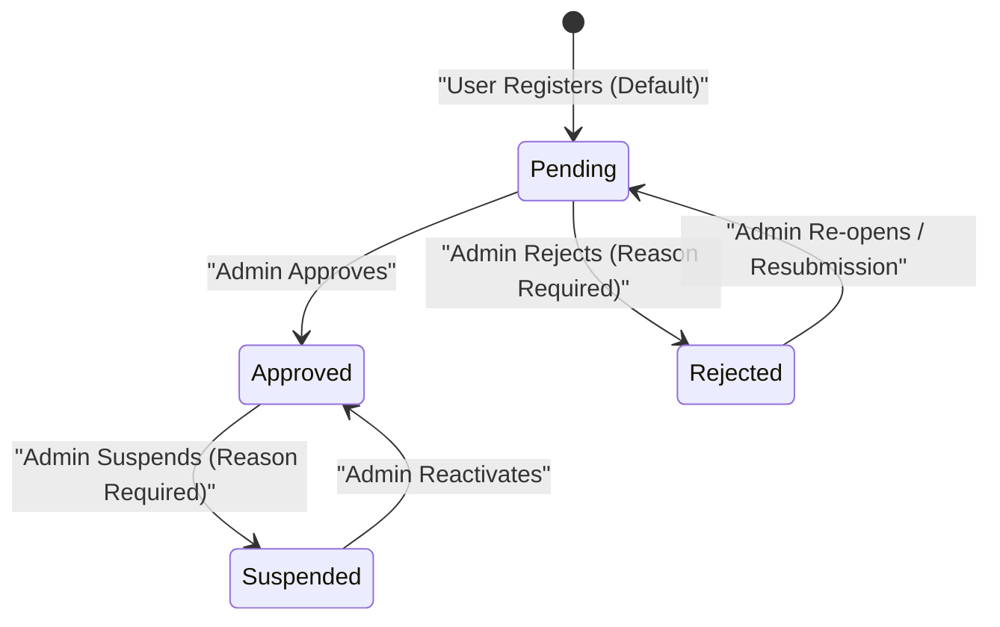
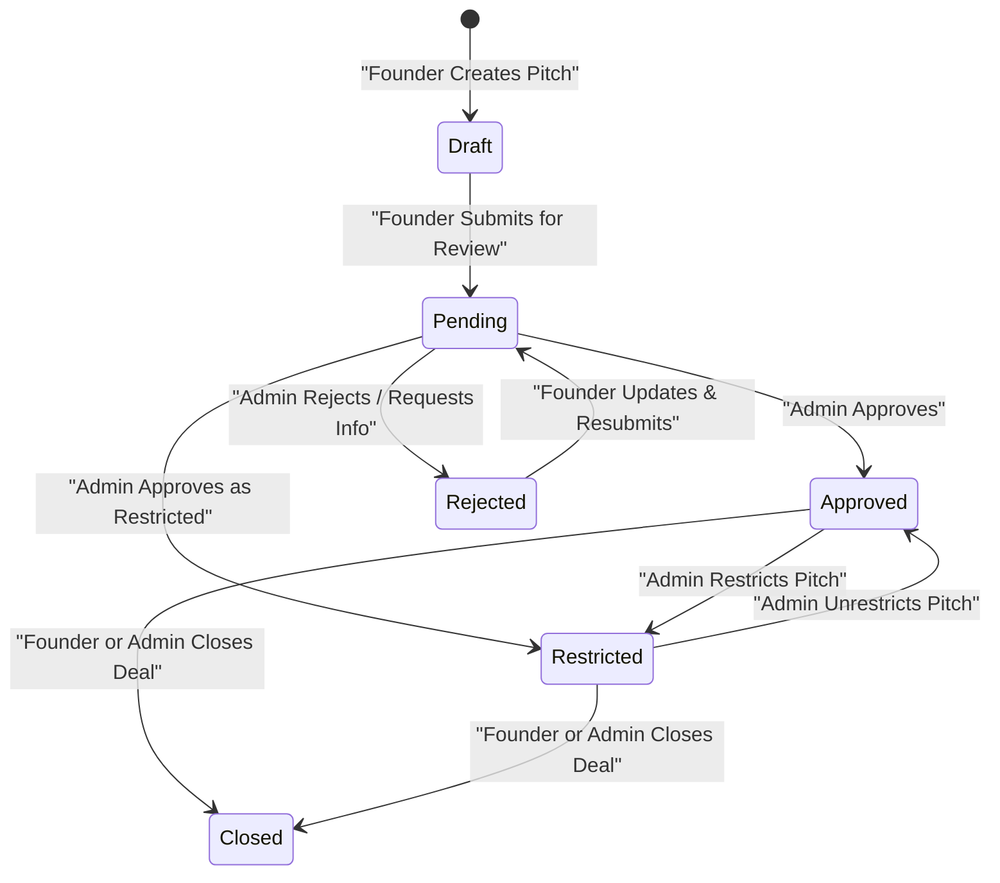

# Product Requirements Document (PRD) — SHARK Investment Network

> **Document Status:** Phase 1 Deliverable (Awaiting Stakeholder Review & Approval)  
> **Owner:** Agent 1 — Product Architect & Lead Planner  
> **Platform Scope:** Mobile App (`apps/mobile` — Android & iOS), Admin Web Dashboard (`apps/admin`), Backend (`supabase/`), Shared Monorepo (`packages/*`)  
> **Default Language:** Arabic (`ar`, RTL) with full bilingual English (`en`, LTR) parity  

---

## 1. Executive Summary & Product Vision

### 1.1 Vision & Mission
**SHARK Investment Network** is a curated, bilingual (Arabic-first RTL and English LTR) investment networking platform built to connect vetted investors, startup founders, established companies, and ecosystem members in a high-trust digital environment. Unlike open social networks where unverified profiles and sensitive pitch materials circulate without control, SHARK enforces strict separation between user registration, role selection, and administrative approval—ensuring confidential deal rooms, pitch decks, and verification records remain strictly protected.

### 1.2 Initial Product Growth Targets vs. Capacity Disclaimer
> [!IMPORTANT]
> The platform is designed around initial product growth targets of **1,000 companies**, **10,000 registered users**, native **Android and iOS mobile applications**, and a dedicated **Admin web dashboard**.  
> **Capacity Disclaimer:** These figures represent **initial product growth targets**, NOT guaranteed simultaneous traffic or concurrency capacity. Actual system throughput, database query latency, storage egress, and Edge Function concurrency MUST be empirically validated through automated load, soak, and stress testing in Phase 8 prior to production launch.

### 1.3 Core Platform Stack (Architectural Commitment)
- **Mobile Application (`@shark/mobile`):** React Native, Expo, Expo Router, TypeScript (`strict`), Lucide (`lucide-react-native`), React Hook Form, Zod, TanStack Query, Expo Notifications, Sentry, PostHog (privacy-configured).
- **Admin Dashboard (`@shark/admin`):** Next.js App Router, TypeScript (`strict`), Tailwind CSS, Lucide (`lucide-react`), React Hook Form, Zod, TanStack Query (where appropriate), `@supabase/ssr`, Sentry.
- **Backend Platform (`supabase/`):** Supabase (PostgreSQL, Auth, Storage, Row Level Security, Edge Functions, Realtime). Firebase is explicitly excluded.
- **Shared Monorepo (`packages/*`):** pnpm workspaces containing `@shark/shared-types`, `@shark/validation`, `@shark/design-tokens`, `@shark/utils`, and `@shark/config`.

---

## 2. Core Domain Model & Access Control Invariants

The integrity of SHARK Investment Network depends on strict separation between **Identity Role**, **Account Status**, **Company Lifecycle & Verification**, and **Pitch Lifecycle**.

### 2.1 Roles vs. Account Statuses (Non-Negotiable Invariant)
1. **User Role (`user_role`):**
   - `investor` — Capital allocator (angel investor, VC partner, family office, institutional scout).
   - `founder` — Startup founder or company representative seeking capital or strategic visibility.
   - `member` — Ecosystem participant (operator, advisor, corporate partner, domain expert).
   - `admin` — Platform operator/moderator with access to `apps/admin` governed by granular admin permissions.
2. **Account Status (`account_status`):**
   - `pending` — Default state for every newly registered user.
   - `approved` — Reviewed and approved by an authorized platform admin.
   - `rejected` — Application declined by admin with documented reason.
   - `suspended` — Previously active account revoked due to policy violation, security concern, or administrative hold.
3. **Invariant Rules:**
   - **Open Registration, Gated Approval:** Anyone may register an account, and every new account MUST initialize with `account_status = 'pending'`.
   - **No Self-Selected Admin:** Users may choose `investor`, `founder`, or `member` during onboarding. `admin` CANNOT be self-selected at signup or profile setup; it may only be assigned by an authorized super-admin through a server-enforced Admin workflow.
   - **Role Never Grants Approval:** Selecting `investor`, `founder`, or `member` never automatically transitions `account_status` to `approved`.
   - **Public Discovery Boundary:** Guests (unauthenticated visitors) and `pending` users may explore **approved public investor profiles and approved public company profiles ONLY**. They MUST NEVER access private contact/investment details, verification records, pitch listings, or restricted pitches/documents.
   - **Pitch Access Boundary:** Only users with `account_status = 'approved'` (across `member`, `founder`, `investor`, `admin`) may browse `approved` pitches. Access to `restricted` pitches or restricted investment documents requires explicit authorization beyond standard approval.

### 2.2 Entity Lifecycle State Machines

| Entity | Lifecycle Field | Allowed Values | Transition Authority | Visibility Rules |
| :--- | :--- | :--- | :--- | :--- |
| **User Account** | `account_status` | `pending`, `approved`, `rejected`, `suspended` | System initializes `pending`; authorized `admin` transitions all other states | Only `approved` public investor profiles appear in public directory |
| **Company** | `company_status` | `draft`, `pending`, `approved`, `rejected`, `suspended` | Founder/owner creates `draft` & submits `pending`; `admin` transitions `approved`, `rejected`, `suspended` | Only `approved` companies appear in public Discovery & Companies directory; owner sees own `draft`/`pending`/`rejected` |
| **Company Verification** | `verification_status` | `unverified`, `pending`, `verified`, `rejected` | Owner uploads docs (`pending`); Verification Admin sets `verified` or `rejected` | Public badge displays `verified` state only; underlying verification documents are strictly private |
| **Pitch** | `pitch_status` | `draft`, `pending`, `approved`, `rejected`, `closed`, `restricted` | Founder creates `draft`, submits `pending`, or marks `closed`; `admin` transitions `approved`, `rejected`, `restricted`, `closed` | `approved` pitches visible to all `approved` users; `restricted` pitches visible only to explicitly authorized investors/admins; `draft`/`pending`/`rejected` visible only to owning founder & admins |
| **Pitch Document** | `is_restricted` | `false` (standard), `true` (restricted) | Owner uploads; `admin` can flag/restrict any investment document (`is_restricted = true`) | Stored in private `pitch-documents` bucket; served only via short-lived Signed URLs after server authorization |

### 2.3 High-Level Entity Lifecycle Diagram

---

## 3. User Personas & Access Matrix

### 3.1 Persona Definitions

#### Persona 1: Guest (Unauthenticated Visitor)
- **Profile:** Prospective investor, founder, or industry observer evaluating SHARK before creating an account.
- **Goals:** Understand platform credibility, browse verified/approved investor and company profiles, switch language (`ar`/`en`), register smoothly.
- **Allowed Actions:** View `welcome`, `login`, `register`, `forgot-password`; browse approved public **Discovery** highlights (investors & companies only), **Investors** directory & public `investors/[id]`, **Companies** directory & public `companies/[id]`, public `sectors/[slug]`, and public `search` (scoped strictly to approved investors and companies).
- **Denied Actions:** Viewing any pitches (`Pitches` tab, `pitches/[id]`, `pitches/[id]/viewer`), saving bookmarks, editing profiles, uploading documents, receiving personalized notifications.

#### Persona 2: Pending / Rejected / Suspended User
- **Profile:** Registered user awaiting admin vetting (`pending`), declined (`rejected`), or held (`suspended`).
- **Goals:** Track application status, update verification materials if requested, explore approved public investor/company profiles while waiting (`pending`), contact support or appeal.
- **Allowed Actions:**
  - `pending`: View `pending-approval`, explore approved public investor & company profiles ONLY, update own profile/verification documents (if onboarding incomplete or info requested), change language, access support, delete account.
  - `rejected`: View `rejected` screen with admin feedback, access support, delete account (cannot access approved pitches or private network features).
  - `suspended`: View `suspended` screen with notice and support/appeal link; active access revoked immediately across sessions.
- **Denied Actions:** Accessing pitches, viewing restricted investment documents, publishing a company or pitch, bookmarking/interacting with private network workflows.

#### Persona 3: Approved Investor (`role = 'investor'`, `account_status = 'approved'`)
- **Profile:** Active angel investor, VC principal, family office representative, or corporate venture lead.
- **Goals:** Discover high-quality startups and approved pitches filtered by sector/stage/ticket size, review company verification badges, inspect pitch decks securely in-app, save promising deals, manage investor profile visibility.
- **Allowed Actions:** Full access to approved Discovery, Investors, Companies, and Pitches; view `approved` pitches and download/view standard pitch documents via Signed URLs; view `restricted` pitches/documents where explicitly granted clearance; manage saved items, notifications, and own investor profile.
- **Denied Actions:** Creating/editing companies or pitches owned by others; accessing ungranted `restricted` documents; accessing `verification-documents` of other entities; accessing Admin Portal.

#### Persona 4: Approved Founder (`role = 'founder'`, `account_status = 'approved'`)
- **Profile:** Startup founder or executive raising funding or showcasing an innovative company.
- **Goals:** Establish an approved company profile, obtain `verified` company status, publish structured investment pitches with confidential pitch decks, track review feedback, discover relevant investors.
- **Allowed Actions:** All standard approved-user discovery & pitch browsing (subject to restricted doc rules), create/edit own Company (`account/my-company`), upload company verification documents (`verification-documents`), create/edit/submit/close own Pitches (`account/my-pitches`), upload confidential pitch attachments (`pitch-documents`), view admin review feedback.
- **Denied Actions:** Approving own company/pitch/verification; viewing another company's `verification-documents` or `draft`/`pending`/`rejected` pitches; viewing ungranted `restricted` documents.

#### Persona 5: Approved Member (`role = 'member'`, `account_status = 'approved'`)
- **Profile:** Ecosystem operator, domain advisor, mentor, or institutional observer approved onto the network.
- **Goals:** Follow sector activity, browse approved companies, investors, and approved public-network pitches, bookmark entities of interest, maintain professional profile.
- **Allowed Actions:** Explore approved Investors, Companies, Pitches (excluding `restricted` deals/documents unless explicitly granted), manage bookmarks, notifications, and own member profile.
- **Denied Actions:** Accessing `restricted` pitches/documents without explicit grant; managing companies/pitches unless authorized; accessing Admin functions.

#### Persona 6: Platform Admin (`role = 'admin'`, `account_status = 'approved'`)
- **Profile:** Platform leadership, compliance/verification officers, deal-flow moderators, and support analysts operating `apps/admin`.
- **Sub-Roles (via Admin Roles & Permissions module, `admin_role_name`):**
  - `super_admin` — Full control across all 13 modules, including admin role assignment and `system_settings`.
  - `operations_admin` — User approval/rejection/suspension, company review, notifications dispatch, and support triage.
  - `compliance_reviewer` — User KYC/accreditation approval, Company Verification review, verification document inspection, and audit review.
  - `content_moderator` — Company moderation, Pitch Review, Document restriction, Investor directory moderation.
  - `analyst_readonly` — Read-only operational views, activity logs inspection, and analytics (zero mutation permissions).
- **Invariant:** Every sensitive admin action writes an immutable entry to `activity_logs`.

### 3.2 Consolidated Permission Matrix

| Capability | Guest | Pending | Rejected / Suspended | Approved Member | Approved Founder | Approved Investor | Platform Admin (Scoped) |
| :--- | :---: | :---: | :---: | :---: | :---: | :---: | :---: |
| Switch Language (`ar` / `en`) | Yes | Yes | Yes | Yes | Yes | Yes | Yes |
| Explore Approved Public Investors | Yes (Public fields) | Yes (Public fields) | No (Blocked to status screen) | Yes | Yes | Yes | Yes |
| Explore Approved Public Companies | Yes (Public fields) | Yes (Public fields) | No | Yes | Yes | Yes | Yes |
| Search Public Investors & Companies | Yes | Yes | No | Yes | Yes | Yes | Yes |
| View Approved Pitches List & Details | **No** | **No** | **No** | Yes | Yes | Yes | Yes |
| View Standard Pitch Docs (Signed URL) | **No** | **No** | **No** | Yes | Yes | Yes | Yes |
| View Restricted Pitch / Restricted Docs | **No** | **No** | **No** | Grant Only | Own / Grant Only | Grant Only | Yes (Authorized) |
| Create/Edit Own Company & Verification Docs | No | Own Verification Docs Only | No | No | Yes | No | Admin Override |
| Create/Edit/Submit Own Pitches | No | No | No | No | Yes | No | Admin Override |
| Save / Bookmark Entities | No | No | No | Yes | Yes | Yes | Yes |
| Receive In-App & Push Notifications | No | Status Updates Only | Status Updates Only | Yes | Yes | Yes | Yes |
| Access Admin Web Dashboard (`apps/admin`) | **No** | **No** | **No** | **No** | **No** | **No** | **Yes** |

---

## 4. Functional Requirements — Mobile Application (`apps/mobile`)

All mobile screens MUST support Arabic (`ar`, RTL, default) and English (`en`, LTR), enforce `>= 44pt` touch targets, render localized error/empty/loading states, and contain zero hardcoded user-facing strings.

### 4.1 Authentication & Onboarding Stack

| Route / Screen | Purpose & User Story | Functional & Validation Requirements | Routing & Edge Cases |
| :--- | :--- | :--- | :--- |
| **`welcome`** | First impression for unauthenticated users | Brand hero (`#142B49` Navy), bilingual value proposition, instant `ar`/`en` toggle, primary CTA ("Create Account"), secondary CTA ("Sign In"), tertiary CTA ("Explore Public Network" -> Guest Discovery). | Remembers chosen locale locally; skips automatically when valid authenticated session exists. |
| **`login`** | Email & password sign-in | Email (RFC format) & password inputs via React Hook Form + Zod (`@shark/validation`), show/hide password toggle, link to `forgot-password`, localized auth error handling (invalid credentials, rate limit). | On success, inspects `profiles`: if incomplete onboarding -> `account-type` / `profile-setup`; else routes by `account_status` (`pending-approval`, `rejected`, `suspended`, or `(tabs)`). |
| **`register`** | Open self-registration | Full name (`ar`/`en` or primary display name), email, password (min 10 chars — 14 chars + TOTP MFA for admins, mixed complexity enforced via Zod), confirm password, explicit Privacy Policy & Terms acceptance checkbox. | Forces `account_status = 'pending'` server-side via DB trigger. Never exposes `admin` role option. Handles duplicate email gracefully without enumeration leak where appropriate. |
| **`account-type`** | Role selection after registration | Presents selectable cards for **Investor** (`investor`), **Founder** (`founder`), and **Member** (`member`) with clear capability descriptions. Explicitly states approval is required after registration. | `admin` option MUST NOT exist in UI or validation enum for self-selection; server trigger/RPC rejects any attempt to set `admin`. |
| **`profile-setup`** | Role-tailored initial profile completion | Common fields: avatar upload (`public-assets`, <= 5MB JPG/PNG/WebP), country, city, headline, bio, preferred language, sector interests (multi-select). Role-specific fields: Investor (investor type, stage focus, ticket min/max currency); Founder (job title, startup summary); Member (expertise, affiliation). | Supports draft saving locally or step progression; submits cleanly to Supabase with Zod validation. |
| **`verification`** | Optional or required identity/credential submission | Upload supporting verification documents (ID/passport, accreditation letter, or commercial doc) to **private** `verification-documents` bucket (`PDF`, `JPG`, `PNG`, <= 10MB). Allows "Submit Verification" or "Skip for Now" (if role permits, clearly indicating unverified status). | Files uploaded to `{user_id}/...` prefix only; never generates public URL; displays upload progress and checksum/MIME validation errors. |
| **`pending-approval`** | Waiting screen for `account_status = 'pending'` | Displays pending review status banner, submitted role badge, timestamp, CTA **"Explore Approved Public Profiles"** (enters restricted public Discovery/Investors/Companies mode with Pitches hidden/locked), CTA to upload/update verification docs if requested, pull-to-refresh status check, Sign Out button. | Listens to realtime/refreshed profile changes; if admin approves -> automatically transitions to full `(tabs)` main app; if rejected/suspended -> redirects immediately. |
| **`rejected`** | Declined application screen | Displays rejection notice, sanitized admin rejection reason (`rejection_reason`), guidance for next steps, CTA to contact support (`support` modal/flow) or delete account (`delete-account`), Sign Out button. | Blocks all protected tabs and queries. |
| **`suspended`** | Account suspension screen | Displays suspension notice, effective notice, appeal/support contact route, Sign Out button. | Forces immediate sign-out or clears cached sensitive TanStack Query cache on status transition to `suspended`. |
| **`forgot-password`** | Password reset request | Email input with Zod validation; triggers Supabase Auth reset email with deep-link redirect (`shark://reset-password`). | Displays generic confirmation message ("If an account exists, reset instructions were sent") to prevent email enumeration. |
| **`reset-password`** | Set new password from deep-link | Captures recovery session token from universal/deep link, password + confirm password inputs with strength rules, submits update via Supabase Auth. | Handles expired/invalid recovery links with clear retry path back to `forgot-password`. |

### 4.2 Main 5-Tab Navigation & Core Sub-Screens

> [!NOTE]
> **Navigation Behavior by Account State:**
> - **Approved Users (`approved`):** Full access to all 5 tabs: **Discovery**, **Investors**, **Companies**, **Pitches**, **Account**.
> - **Guests & Pending Users:** May explore **Discovery** (investors & companies sections only), **Investors**, and **Companies**. Attempting to tap the **Pitches** tab or any pitch route renders a clear gated authorization prompt ("Available to Approved Members — Sign In / Pending Review") and NEVER fetches `pitches` or `pitch_documents` rows.

#### Tab 1: Discovery (`(tabs)/discovery` — Main Landing Screen)
- **Purpose:** Curated entry point showcasing the breadth of the approved network.
- **Sections:**
  1. Top header with brand mark, global Search bar trigger (navigates to `search`), and notification bell with unread badge (authenticated users only).
  2. Sector Quick-Browse horizontal chips (`sectors/[slug]`) dynamically loaded from active `sectors`.
  3. **Featured Approved Investors** carousel/grid (public fields: avatar, name, firm/title, verified/featured badge, sector focus, ticket range).
  4. **Featured Approved Companies** carousel/grid (public fields: logo, name, tagline, sector, stage, `verified` badge).
  5. **Featured Approved Pitches** section — **ONLY queried and rendered when `account_status === 'approved'`**. Hidden completely for Guests and `pending` users (replaced with informational banner inviting registration/approval).
- **Performance:** Uses explicit column projections and bounded pagination (max 10–20 featured items per strip); zero `SELECT *`.

#### Tab 2: Investors (`(tabs)/investors` & `investors/[id]`)
- **Directory (`(tabs)/investors`):**
  - Paginated list (cursor/keyset or bounded range, 20 items/page) of `profiles` joined with `investors` (via `public_investors_directory` projection view for non-PII public reads) where `role = 'investor'` and `account_status = 'approved'`.
  - Filter sheet: Sector focus, target stage (Pre-Seed, Seed, Series A, Growth), ticket range, country, investor type.
  - Sort options: Featured / Recently Approved / Alphabetical.
  - Bilingual empty state with "Reset Filters" action.
- **Detail (`investors/[id]`):**
  - **Public Fields (visible to Guests, Pending, Approved):** Full name, avatar, investor type, firm/organization, city/country, bio (`ar`/`en`), investment thesis, preferred sectors, target stages, indicative ticket range.
  - **Restricted/Approved-Only Fields (if present, e.g., portfolio highlights or approved contact channels):** Gated by RLS column/table separation so Guests/Pending users never receive private metadata over the wire.
  - **Actions:** Bookmark/Save (`approved` users only), Share public profile link.

#### Tab 3: Companies (`(tabs)/companies` & `companies/[id]`)
- **Directory (`(tabs)/companies`):**
  - Paginated list of companies where `company_status = 'approved'`.
  - Filter sheet: Sector, company stage, country, `verification_status = 'verified'` toggle.
  - Visual distinction for `verified` badge (`@shark/design-tokens` semantic success/verified badge).
- **Detail (`companies/[id]`):**
  - **Public Fields (visible to Guests, Pending, Approved):** Logo, cover/banner, company name (`ar`/`en`), tagline, sector, stage, founding year, headquarters country/city, headcount band, company overview, website/public social links, verification status badge (`verified` vs `unverified` — never exposing verification files!).
  - **Approved-Only Section:** Active `approved` pitches associated with the company (each linking to `pitches/[id]`). Hidden completely for Guests and `pending` users.
  - **Actions:** Bookmark/Save (`approved` users only).

#### Tab 4: Pitches (`(tabs)/pitches`, `pitches/[id]`, `pitches/[id]/viewer`)
- **Directory (`(tabs)/pitches`):**
  - Accessible exclusively to users with `account_status = 'approved'`.
  - Displays paginated `approved` pitches (and `restricted` pitches ONLY if the current user has an explicit grant or is the owning founder/authorized admin).
  - Filters: Sector, funding stage, target raise min/max, instrument type (Equity, SAFE, Convertible Note, Revenue Share), sort (Newest, Featured, Closing Soon).
  - Cards show: Pitch title, company name & logo, verification badge, sector tag, target raise, stage, concise summary, bookmark icon.
- **Detail (`pitches/[id]`):**
  - Header with pitch status badge (`approved`, `restricted`, `closed`, etc. when owner/admin), company card link (`companies/[id]`), bookmark button.
  - Structured sections: Executive Summary, Problem & Solution, Market Opportunity, Traction & Key Metrics, Use of Funds, Deal Terms Summary (target raise, min ticket, instrument, timeline).
  - **Confidential Disclaimer Banner** reminding viewers that pitch content is confidential and tracked.
  - **Attachments / Pitch Documents List:** Lists `pitch_documents` associated with the pitch (filename, category e.g., Pitch Deck / Financial Model / Cap Table, file size, `restricted` lock indicator).
  - Tapping a document navigates to `pitches/[id]/viewer` if authorized; if a document has `is_restricted = true` and the user lacks an active `pitch_access_grants` entry, displays a clear locked state explaining restricted access.
- **Document Viewer (`pitches/[id]/viewer`):**
  - Requests a short-lived Signed URL from Supabase Edge Function `get-signed-document-url` (never stores permanent URLs).
  - Renders PDF pages or high-resolution images inside an in-app viewer with zoom/pan, page indicator, loading spinner, localized error/retry state, and subtle user-identifying watermark/confidentiality banner (`email` / timestamp) over the viewport.
  - Automatically refreshes Signed URL if expired during long reading sessions (if user still authorized).

#### Tab 5: Account (`(tabs)/account` & Account Sub-Screens)
- **Hub (`(tabs)/account`):**
  - Displays user avatar, full name, role badge (`investor`, `founder`, `member`, `admin`), `account_status` badge, `verification_status` indicator (if applicable).
  - Role-aware menu links:
    - Always available (authenticated): Edit Profile, Notifications, Language, Privacy & Security, Support, Delete Account, Sign Out.
    - Founder / Approved Company Owner: **My Company** (`account/my-company`), **My Pitches** (`account/my-pitches`).
    - Approved Users: **Saved Items** (`account/saved`), **Settings** (`account/settings`).
    - Guest fallback: Prompts user to Sign In or Register, plus Language and Support links.
- **Account Sub-Screens:**
  1. **`account/edit-profile`:** Update profile fields, bilingual bio, avatar upload (`public-assets`), sector preferences, investor metadata (if `investor`). Role field is read-only.
  2. **`account/my-company`:** Create or edit founder's company (`draft` -> submit for `pending` approval), view admin review notes if `rejected`, upload/resubmit verification documents into `verification-documents` to request `verified` status, track both `company_status` and `verification_status`.
  3. **`account/my-pitches`:** List founder's own pitches across all statuses (`draft`, `pending`, `approved`, `rejected`, `closed`, `restricted`); create/edit pitch wizard (metadata + upload attachments to private `pitch-documents` bucket); submit `draft` to `pending`; view admin review feedback / requests for info; mark `approved` pitch as `closed`.
  4. **`account/saved`:** Tabbed view of bookmarked **Investors**, **Companies**, and **Pitches** with optimistic unsave and graceful handling if an entity was later suspended/closed/rejected.
  5. **`account/notifications`:** Paginated in-app notifications list with unread highlight, category icons, mark individual/all as read, deep-link tap navigation (e.g., to `account/my-pitches`, `account/my-company`, or `pitches/[id]`).
  6. **`account/settings`:** Notification channel preferences (push alerts for approval updates, pitch updates, admin announcements), local cache reset, app build version.
  7. **`account/language`:** Explicit selector between **العربية (Arabic — RTL)** and **English (LTR)**; updates local storage + user's `preferred_language` column in `profiles` and smoothly re-renders/reloads layout direction.
  8. **`account/privacy-security`:** Change password (requires current password verification or re-auth), Sign Out of All Sessions, toggle PostHog telemetry consent, view Privacy Policy & Terms of Service.
  9. **`account/support`:** FAQs (bilingual), support contact channels, structured support/appeal ticket submission form (`support_requests` table) with category (Account Approval, Verification, Technical Issue, Appeal, Report Content).
  10. **`account/delete-account`:** Store-compliant (Apple App Store & Google Play) self-service account deletion workflow. Explains consequences (permanent profile revocation, removal of active sessions/push tokens, anonymization/deletion of personal data while preserving immutable compliance/audit references), requires explicit confirmation phrase + password re-authentication, calls Edge Function `delete-own-account`.

### 4.3 Global Search & Sector Discovery Sub-Screens
- **`search`:**
  - Single bilingual search bar supporting Arabic normalization (alef/taa marbuta/diacritics tolerant via Postgres trigram/TSVector) and English full-text search.
  - Tabbed result scopes: **All**, **Investors**, **Companies**, and (ONLY for `approved` users) **Pitches**.
  - Bounded results (top 20 per scope + pagination), debounced input (300ms), recent local searches list (clearable), empty state suggestions.
- **`sectors/[slug]`:**
  - Localized sector header (name `ar`/`en`, description, icon/color token).
  - Scoped tabs/sections for Approved Investors investing in this sector, Approved Companies operating in this sector, and (ONLY for `approved` users) Approved Pitches in this sector.

---

## 5. Functional Requirements — Admin Web Dashboard (`apps/admin`)

The Admin Dashboard is a standalone Next.js App Router web application strictly locked down to authenticated users whose `profiles.role = 'admin'` and `profiles.account_status = 'approved'`, with module-level and action-level RBAC enforced server-side. Every sensitive mutation MUST record an entry in `activity_logs`.

### 5.1 Complete 13-Module Specification

| # | Module | Route | Core Capabilities & Functional Requirements | Required Audit & Notification Triggers |
| :---: | :--- | :--- | :--- | :--- |
| **1** | **Overview** | `/overview` | Real-time/fresh KPI summary cards (Pending Users, Pending Companies, Pending Verifications, Pending Pitches, Approved Investors/Companies/Pitches totals); prioritized SLA moderation queues; recent `activity_logs` feed; quick links to review screens. | Read-only (no mutation audit needed). |
| **2** | **User Management** | `/users` | Searchable, filterable, paginated table (`role`, `account_status`, registration date, country); User detail view with verification docs (Signed URLs); actions: **Approve**, **Reject** (mandatory reason), **Suspend** (mandatory reason + session invalidation), **Reactivate**, **Assign Authorized Role** (`investor`/`founder`/`member`/`admin`, gated by `super_admin` for `admin`). | Logs `user.approved`, `user.rejected`, `user.suspended`, `user.reactivated`, `user.role_changed` to `activity_logs`; dispatches bilingual notification to user. |
| **3** | **Investor Management** | `/investors` | Curated view of all investor accounts & `investors`; filter by investor type, sector, stage, status; edit/normalize investor directory metadata; toggle **Featured Investor** badge on Discovery; manage profile visibility. | Logs `investor.featured_toggled`, `investor.profile_updated`. |
| **4** | **Company Management** | `/companies` | Paginated directory & moderation queue of companies across `draft`, `pending`, `approved`, `rejected`, `suspended`; view company details & founder ownership; actions: **Approve**, **Reject** (reason), **Request Additional Info** (sends structured prompt to founder), **Suspend**, **Reactivate**, toggle Featured Company. | Logs `company.approved`, `company.rejected`, `company.info_requested`, `company.suspended`, `company.featured_toggled`; notifies founder. |
| **5** | **Company Verification** | `/verifications` | Dedicated queue for `verification_status = 'pending'` (and historical `verified`/`rejected`); side-by-side inspection of company metadata and uploaded legal/commercial documents from `verification-documents` via short-lived Signed URLs; actions: **Verify Company**, **Reject Verification** (reason), **Request Additional Documents**. | Logs `verification.viewed`, `verification.verified`, `verification.rejected`, `verification.info_requested`; notifies founder. |
| **6** | **Pitch Management** | `/pitches` | Master directory across all pitch statuses (`draft`, `pending`, `approved`, `rejected`, `closed`, `restricted`); multi-filter by sector, stage, target raise, company, status; actions: **Restrict Pitch** (`restricted`), **Unrestrict Pitch** (`approved`), **Close Pitch**, toggle Featured Pitch, manage investor grant list for `restricted` pitches. | Logs `pitch.restricted`, `pitch.unrestricted`, `pitch.closed`, `pitch.grant_updated`; notifies founder where appropriate. |
| **7** | **Pitch Review** | `/pitch-reviews` | Focused moderation workbench for `pitch_status = 'pending'`; structured compliance & completeness review checklist; inline preview of pitch attachments via Signed URLs; actions: **Approve Pitch**, **Approve as Restricted**, **Reject Pitch** (structured reason), **Request Additional Info** (moves back with actionable feedback). | Logs `pitch.approved`, `pitch.approved_restricted`, `pitch.rejected`, `pitch.info_requested`; notifies founder. |
| **8** | **Document Management** | `/documents` | Unified inventory of `pitch-documents` & `verification-documents` metadata (file name, MIME type, byte size, owner, parent entity, restriction status, scan/moderation flag); actions: **Restrict Investment Document** (`restricted`), **Unrestrict Document**, manage document-level access grants, **Archive/Disable** violating document, preview via Signed URL. | Logs `document.restricted`, `document.unrestricted`, `document.accessed_by_admin`, `document.disabled`. |
| **9** | **Notifications** | `/notifications` | Compose & dispatch bilingual (`ar` + `en`) announcements or targeted alerts (target all approved users, specific role, specific sector, or specific user IDs); select channels (In-App + Push); view dispatch history, recipient counts, and delivery status. | Logs `notification.broadcast_sent` / `notification.targeted_sent`. |
| **10** | **Admin Roles & Permissions** | `/admin-roles` | Manage `admin` role definitions (`super_admin`, `operations_admin`, `compliance_reviewer`, `content_moderator`, `analyst_readonly`), view granular permission matrix per module/action, grant/revoke admin sub-roles for existing `admin` accounts (`super_admin` only, cannot self-demote last `super_admin`). | Logs `admin_role.assigned`, `admin_role.revoked`, `admin_permission.updated`. |
| **11** | **Activity Logs** | `/activity-logs` | Immutable, append-only audit log explorer; filter by actor, action type, entity type, entity ID, date range; inspect structured metadata/diff JSON; export filtered CSV report (for authorized roles). Zero edit/delete capability in UI or backend. | Read-only (logs CSV export event `audit_log.exported`). |
| **12** | **Analytics** | `/analytics` | Growth & operational dashboards: user registration funnel (`pending` -> `approved`), active companies & verification rate, pitch submission-to-approval turnaround SLA, sector distribution (investors vs companies vs pitches), top viewed profiles/pitches (aggregated, privacy-safe). | Read-only. |
| **13** | **System Settings** | `/settings` | Runtime platform configuration stored in `system_settings`: registration enabled toggle, maintenance banner (`ar`/`en`), sector taxonomy CRUD (slug, `name_ar`, `name_en`, active state, sort order), upload file size & MIME limits, Signed URL TTL bounds, support channels. | Logs `system_settings.updated`, `sector.created`, `sector.updated` with before/after snapshot. |

---

## 6. End-to-End Critical User Journeys

### Journey 1: New Investor Onboarding, Pending Gate & Admin Approval
1. **Guest Browse:** User downloads app (defaults to Arabic RTL), taps "Explore Public Network" on `welcome`, browses approved investors and companies on `discovery` / `investors` / `companies`. Tapping `Pitches` displays an account-required gate.
2. **Registration:** User taps Register -> completes `register` form -> Supabase Auth creates user + DB trigger creates `profiles` with `account_status = 'pending'`.
3. **Onboarding:** User selects `investor` on `account-type`, completes `profile-setup` (uploads avatar to `public-assets`, selects target sectors & ticket size), optionally uploads accreditation PDF on `verification` (`verification-documents`).
4. **Pending State:** User lands on `pending-approval`. They can still view approved public investor & company profiles, but `pitches` and private data remain strictly denied at both RLS and UI levels.
5. **Admin Approval:** `compliance_reviewer` (or `operations_admin`) opens `apps/admin` -> User Management -> inspects user profile & Signed URL of accreditation document -> clicks **Approve** -> Server action updates `account_status = 'approved'`, writes `activity_logs`, triggers `send-push-notification` (bilingual push + in-app).
6. **Unlocked Access:** User receives push notification, re-opens app -> routed directly into full 5-tab `(tabs)` experience with access to approved pitches.

### Journey 2: Founder Company Verification, Pitch Submission & Secure Document Viewing
1. **Company Setup:** Approved Founder navigates to `account/my-company`, fills company details (`draft`), uploads logo (`public-assets`) and commercial registration PDF (`verification-documents`), submits for review (`company_status = 'pending'`, `verification_status = 'pending'`).
2. **Admin Review & Verification:** Admin approves company in Company Management and verifies legal docs in Company Verification (`company_status = 'approved'`, `verification_status = 'verified'`). Company now appears publicly with a `Verified` badge.
3. **Pitch Creation:** Founder opens `account/my-pitches` -> creates pitch -> uploads Pitch Deck PDF & Financial Model XLSX to private `pitch-documents` bucket -> submits (`pitch_status = 'pending'`).
4. **Pitch Moderation:** Admin reviews pitch in **Pitch Review** (inspecting files via Signed URLs), approves pitch (`pitch_status = 'approved'`), optionally marks Financial Model as `restricted`.
5. **Investor Consumption:** Approved Investor finds pitch in `pitches` tab -> opens `pitches/[id]` -> taps Pitch Deck (`standard`) -> `pitches/[id]/viewer` requests Signed URL from Edge Function -> views watermarked PDF seamlessly. Tapping restricted Financial Model shows locked indicator unless investor holds explicit access clearance.

### Journey 3: Request Additional Info & Rejection Recovery
1. **Incomplete Submission:** Founder submits pitch missing use-of-funds breakdown.
2. **Admin Action:** Admin selects **Request Additional Info** (or **Reject**) with mandatory Arabic/English feedback note -> pitch moves to `rejected` (with feedback flag) -> `activity_logs` recorded -> founder notified.
3. **Correction & Resubmission:** Founder taps notification -> lands on `account/my-pitches` -> reads specific feedback -> updates pitch & uploads revised deck -> resubmits (`pending`) for re-review.

### Journey 4: Account Suspension & Self-Service Account Deletion
1. **Suspension:** Admin detects policy violation -> suspends user in `/users` with mandatory reason -> `account_status = 'suspended'`, active refresh tokens revoked via Admin Auth API, `activity_logs` written. On next mobile interaction or token refresh, mobile app clears sensitive cache and routes user to `suspended` screen.
2. **Account Deletion:** User navigates to `account/delete-account`, reviews impact summary, re-authenticates, confirms deletion -> Edge Function `delete-own-account` removes push tokens (`device_tokens`), anonymizes PII/profile fields or deletes auth identity cleanly while preserving anonymized referential integrity for `activity_logs`, then signs user out to `welcome`.

---

## 7. Non-Functional Requirements

### 7.1 Bilingual & Localization (Arabic Default RTL / English LTR)
- **Default Locale:** Arabic (`ar`) with full Right-to-Left (`RTL`) layout mirroring; English (`en`) with Left-to-Right (`LTR`) layout parity.
- **Zero Hardcoded UI Strings:** Every visible label, button, navigation title, empty state, validation message, error toast, email/push template, and accessibility hint MUST resolve from centralized `ar` and `en` dictionaries.
- **Typography:** `IBM Plex Sans Arabic` for Arabic text and `Inter` for English text (via `@shark/design-tokens`).
- **Dates & Numbers:** Formatted via locale-aware `Intl.DateTimeFormat` / `Intl.NumberFormat` utilities in `@shark/utils` (financial currency/metrics standardization documented in ADR/unresolved decisions).
- **Directional Icons:** Chevrons, back arrows, progress indicators, and carousels mirror cleanly between RTL and LTR.

### 7.2 Security & Privacy
- **Authoritative Backend Enforcement:** Every authorization decision MUST execute in PostgreSQL RLS, triggers, Edge Functions, or Next.js Server Actions. Frontend checks are UX-only.
- **Zero Client Secrets:** `SUPABASE_SERVICE_ROLE_KEY`, admin secrets, and signing keys MUST NEVER appear in `apps/mobile` or `NEXT_PUBLIC_*` bundles.
- **Private Storage Isolation:** `pitch-documents` and `verification-documents` buckets MUST have public access disabled and RLS blocking direct URL enumeration. All views go through short-lived Signed URLs (`60–120` seconds TTL; `60s` for verification/restricted docs, `120s` max for standard approved pitch docs) issued after server-side permission checks.
- **Auditability:** All admin state mutations, role assignments, document restrictions, and settings edits MUST append to `activity_logs`.
- **Telemetry Privacy:** PostHog on mobile MUST be privacy-configured (no capturing form inputs, passwords, personal emails, financial values, or document URLs; respects user opt-out in `account/privacy-security`). Sentry MUST scrub authorization headers and PII before transmission.

### 7.3 Scalability, Performance & Availability
- **Query Discipline:** Mandatory explicit column projections (no unbounded `SELECT *`), bounded pagination (`limit` capped server-side/client-side, cursor/keyset preferred on feeds/logs), and Postgres indexes matching filter/sort predicates.
- **Validation Against Targets:** System architecture MUST support testing up to the **1,000 companies / 10,000 users** product target profile via synthetic seed data and k6/load verification in Phase 8 without claiming guaranteed concurrency ahead of test execution.
- **Resilient Mobile UX:** Graceful offline/poor-connectivity banners, TanStack Query stale-while-revalidate caching (never persisting restricted document URLs offline), optimistic UI with rollback only for safe idempotent actions (e.g., bookmarks).

### 7.4 Accessibility & Design Compliance
- **Contrast:** All text and interactive elements meet **WCAG AA** (`>= 4.5:1` normal text, `>= 3:1` large text & UI graphics) across `@shark/design-tokens` (`#142B49` Navy primary).
- **Touch Targets:** Minimum `44pt x 44pt` hit areas on all mobile interactive elements.
- **Screen Readers & Keyboard:** Full `accessibilityLabel` / `accessibilityRole` in `ar` and `en` on mobile; semantic landmarks, ARIA attributes, and keyboard tab navigation on Admin Web.

---

## 8. MVP Scope Boundaries & Explicit Out-of-Scope Items

To deliver a focused, security-hardened Phase 1–8 release without scope creep, the following are **explicitly OUT OF SCOPE for MVP**:
1. **Financial Transactions & Escrow:** No payment gateways, subscription billing, capital transfers, SPV administration, or equity settlement.
2. **Real-Time 1:1 Chat / Video Deal Rooms:** No built-in instant messaging or WebRTC video calling inside MVP (platform focuses on discovery, vetted profiles, structured pitches, structured `investment_interests` soft-commit signals, and secure document review).
3. **Automated Third-Party KYC/KYB APIs:** Company and user verification is performed manually by trained Admins via the **Company Verification** and **User Management** modules using uploaded private documents.
4. **AI Pitch Scoring / Automated Valuations:** No LLM-based pitch grading or automated financial modeling.
5. **Public Web Marketing Portal / Public Web Catalog:** Web scope in MVP is strictly the **Admin Dashboard (`apps/admin`)**; investor/founder discovery lives on **Mobile (`apps/mobile`)**.
6. **Multi-Tenancy / White-Label Instances:** Single unified SHARK Investment Network instance.

---

## 9. Key Performance Indicators (KPIs) & Release Targets

| Category | Metric | Initial Product Target / Gate | Measurement Source |
| :--- | :--- | :--- | :--- |
| **Growth Targets** | Onboarded Companies | 1,000 companies (growth target; validate scale in tests) | Admin Analytics / `companies` |
| **Growth Targets** | Registered Users | 10,000 users (growth target; validate scale in tests) | Admin Analytics / `profiles` |
| **Activation Funnel** | Registration -> Profile Setup Completion | >= 75% completion within 48h | PostHog (anonymized funnel) / DB metrics |
| **Trust & Moderation** | Median User & Company Review SLA | <= 24 business hours (operational goal) | `activity_logs` timestamp deltas |
| **Verification Quality** | Company Verification Rate | Track % `verified` among `approved` companies | Admin Analytics |
| **Security Gate** | Unauthorized Cross-Tenant / RLS Leaks | **0** allowed in automated & penetration tests | Phase 8 QA Security Suite |
| **Stability** | Mobile Crash-Free Sessions | >= 99.5% | Sentry |
| **Localization** | Hardcoded UI Strings / Broken RTL Screens | **0** across all mobile & admin screens | Phase 8 Bilingual & RTL Audit |
