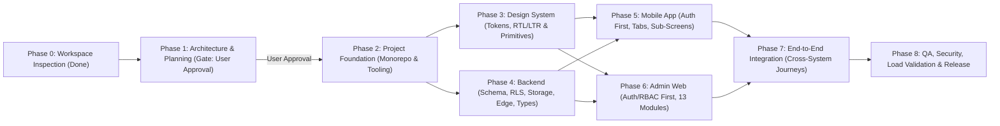

# Delivery Roadmap & Implementation Breakdown — SHARK Investment Network

> **Document Status:** Phase 1 Deliverable (Awaiting Stakeholder Review & Approval)  
> **Owner:** Agent 1 — Product Architect & Lead Planner  
> **Governing Charter:** `AGENTS.md` | **Product Spec:** `docs/PRD.md` | **Architecture:** `docs/ARCHITECTURE.md`  

---

## 1. Phased Delivery Lifecycle (Phases 0–8)

Per `AGENTS.md` Section 5, delivery follows nine disciplined phases with explicit approval and verification gates. **Phase 2 MUST NOT begin until Phase 1 deliverables (`PRD.md`, `ARCHITECTURE.md`, `DATABASE.md`, `SECURITY.md`, `DESIGN_SYSTEM.md`, `ROADMAP.md`, `AGENTS.md`) receive explicit user approval.**

### 1.1 Phase Summary & Exit Gates

| Phase | Name | Current Status | Primary Objective | Mandatory Exit Gate |
| :--- | :--- | :--- | :--- | :--- |
| **Phase 0** | Workspace Inspection | **Complete** | Audit OS, installed SDKs, missing tools, and environmental risks (OneDrive/Arabic path, missing Docker/Supabase CLI/Deno/psql, Windows iOS constraint). | Phase 0 findings documented in `ARCHITECTURE.md`. |
| **Phase 1** | Architecture & Planning | **Approved & Complete** | Author `PRD.md`, `ARCHITECTURE.md`, `DATABASE.md`, `SECURITY.md`, `DESIGN_SYSTEM.md`, `ROADMAP.md`, and `AGENTS.md`. | **Explicit User Approval** + resolution/acknowledgment of `UD-01` through `UD-08`. |
| **Phase 2** | Project Foundation | **Approved & Complete** | Initialize Git, `pnpm` workspace, shared configs, scaffold `apps/mobile`, `apps/admin`, `packages/*`, `supabase/`, CI workflows, `README.md`. | `pnpm install`, `pnpm typecheck`, and `pnpm lint` pass cleanly across all workspace shells. |
| **Phase 3** | Design System | **Approved & Complete** | Establish `DESIGN_SYSTEM.md`, `@shark/design-tokens` (`#142B49`, `IBM Plex Sans Arabic`, `Inter`, 4px scale, `8/12/16px` radii), RTL helpers, and reusable UI primitives for Mobile & Admin. | WCAG AA contrast verified; RTL/LTR toggle verified on Mobile & Admin component showcases. |
| **Phase 4** | Backend | **Approved (CI Verified)** | Implement PostgreSQL schema, triggers (`pending` default, block `admin` signup), RLS policies, private Storage buckets, 5 Edge Functions, seed fixtures, `@shark/shared-types` & `@shark/validation`. | Automated RLS/pgTAP (`72` assertions in 9 suites), Deno checks, and GitHub Actions CI passed; `DATABASE.md`, `API_DOCUMENTATION.md`, and `BACKEND_ARCHITECTURE.md` synchronized. |
| **Phase 5** | Backend Integration & Application Services (`apps/mobile` + `apps/admin` Core) | **Planning Pending Approval** | Execute finalized [PHASE_5_PLAN.md](./PHASE_5_PLAN.md), [PHASE_5_TASKS.md](./PHASE_5_TASKS.md), and [PHASE_5_TEST_PLAN.md](./PHASE_5_TEST_PLAN.md): Mobile `SecureStore`/Auth/hooks/repositories/Storage/Push/Telemetry + Mobile routes composed from Phase 3 primitives, and Admin `@supabase/ssr` guards/Server Actions/repositories (13 Admin dashboard UI pages deferred to Phase 6). | All `M5.0`–`M5.6` unit, live Supabase integration, security, bilingual RTL/LTR, and build/CI exit gates pass cleanly. |
| **Phase 6** | Admin Dashboard | Pending | Build Server-verified Admin Auth & RBAC shell first, followed by all 13 modules with full `activity_logs` auditing and bilingual UI. | Server-side RBAC blocks non-admins/sub-roles; all 13 modules pass typecheck, lint, and audit verification. |
| **Phase 7** | End-to-End Integration | Pending | Verify live cross-platform workflows connecting Mobile, Admin, Supabase Auth/DB/Storage/Edge/Realtime, and Push Notifications. | All 4 critical journeys pass end-to-end without mocks or manual DB workarounds. |
| **Phase 8** | QA, Security & Release | Pending | Threat modeling, penetration & RLS verification, Signed URL leakage checks, bilingual RTL sweep, synthetic 1k companies / 10k users load testing, EAS Android/iOS & Next.js prod builds. | Zero Critical/High security findings; load metrics documented; Agent 6 final sign-off. |

---

## 2. Specialized Agent Roster & Ownership Boundaries

Every implementation task below maps directly to the six specialized agents defined in `AGENTS.md` Section 2:

1. **Agent 1 — Product Architect:** Root `package.json`, `pnpm-workspace.yaml`, `tsconfig.base.json`, `packages/config/*`, `README.md`, `.github/workflows/*`, `docs/PRD.md`, `docs/ARCHITECTURE.md`, `docs/ROADMAP.md`.
2. **Agent 2 — UI/UX Designer:** `docs/DESIGN_SYSTEM.md`, `packages/design-tokens/*`, UI specs & bilingual RTL/LTR UX reviews across `apps/mobile` and `apps/admin`.
3. **Agent 3 — Mobile Engineer:** `apps/mobile/**`, `packages/utils/src/rtl*` (with Agent 2 review).
4. **Agent 4 — Backend Engineer:** `docs/DATABASE.md`, `docs/API_DOCUMENTATION.md`, `supabase/**`, `packages/shared-types/**`, `packages/validation/**`, `packages/utils/**` (excluding RTL UX decisions owned with Agent 2/3).
5. **Agent 5 — Admin Engineer:** `apps/admin/**`.
6. **Agent 6 — QA & Security Engineer:** `docs/SECURITY.md`, `docs/TESTING.md`, `tests/**`, `__tests__/**`, `supabase/tests/**`, security gates & CI verification.

---

## 3. Initial Implementation Task Breakdown (Phases 2–8)

### Phase 2 — Project Foundation

> [!IMPORTANT]
> **Pre-Phase 2 Action (`UD-01`):** Before running `pnpm install` on Windows, confirm whether active workspace development will migrate to a short non-OneDrive ASCII path (e.g., `C:\dev\shark-investment-network`) to prevent NTFS junction, Metro, and Android Gradle failures caused by `OneDrive` and `سطح المكتب`.

| Task ID | Title & Scope | Owner (Reviewer) | Dependencies | Owned Files / Folders | Exit Criteria |
| :--- | :--- | :--- | :--- | :--- | :--- |
| **P2-01** | **Initialize Git & Monorepo Root** — Initialize Git repo, `.gitignore` (protecting `.env*`, Gradle, `.expo`, `.next`), `pnpm-workspace.yaml`, root `package.json` scripts (`typecheck`, `lint`, `test`, `i18n:check`), `tsconfig.base.json`, `.env.example`. | Agent 1 | Phase 1 Approval | `.gitignore`, `package.json`, `pnpm-workspace.yaml`, `tsconfig.base.json`, `.env.example`, `README.md` | `git status` clean; `pnpm -v` resolves workspace cleanly. |
| **P2-02** | **Shared Config Package (`@shark/config`)** — Author shared strict TS configs (`tsconfig.base.json`, `tsconfig.expo.json`, `tsconfig.nextjs.json`) and ESLint flat configs forbidding `any` and enforcing import boundaries. | Agent 1 | `P2-01` | `packages/config/*` | Strict `"strict": true` inherited across all packages and apps. |
| **P2-03** | **Shared Package Shells** — Scaffold `package.json`, `tsconfig.json`, and entry barrels for `@shark/design-tokens`, `@shark/shared-types`, `@shark/validation`, and `@shark/utils`. | Agent 2 (`design-tokens`), Agent 4 (`shared-types`, `validation`, `utils`) | `P2-02` | `packages/design-tokens/*`, `packages/shared-types/*`, `packages/validation/*`, `packages/utils/*` | `pnpm --filter "./packages/*" typecheck` passes with 0 errors. |
| **P2-04** | **Mobile App Shell (`@shark/mobile`)** — Initialize Expo SDK 54 + TypeScript strict + Expo Router + NativeWind/StyleSheet setup + TanStack Query + React Hook Form + Lucide + Sentry + PostHog stubs + `eas.json` + `.env.example`. | Agent 3 (Agent 1) | `P2-02`, `P2-03` | `apps/mobile/package.json`, `apps/mobile/tsconfig.json`, `apps/mobile/app.config.ts`, `apps/mobile/eas.json`, `apps/mobile/.env.example`, `apps/mobile/app/_layout.tsx` | `pnpm --filter @shark/mobile typecheck` passes; Metro bundles cleanly on Android emulator. |
| **P2-05** | **Admin App Shell (`@shark/admin`)** — Initialize Next.js App Router + TypeScript strict + Tailwind CSS + `@supabase/ssr` + Lucide + React Hook Form + Sentry + `.env.example`. | Agent 5 (Agent 1) | `P2-02`, `P2-03` | `apps/admin/package.json`, `apps/admin/tsconfig.json`, `apps/admin/next.config.ts`, `apps/admin/tailwind.config.ts`, `apps/admin/.env.example`, `apps/admin/src/app/layout.tsx` | `pnpm --filter @shark/admin typecheck` and `next build` skeleton succeed. |
| **P2-06** | **Supabase Project & CI Pipelines** — Create `supabase/config.toml`, folder structure (`migrations/`, `functions/`, `seed/`, `tests/`), and GitHub Actions workflows (`ci-quality.yml`, `supabase-verify.yml`) plus initial `tests/` harness. | Agent 4 (`supabase/`), Agent 1 (`.github/`), Agent 6 (`tests/`) | `P2-01`, `P2-04`, `P2-05` | `supabase/config.toml`, `.github/workflows/*`, `tests/package.json` | CI workflow runs `pnpm typecheck` and `pnpm lint` cleanly. |

---

### Phase 3 — Design System & Bilingual RTL/LTR Foundation

| Task ID | Title & Scope | Owner (Reviewer) | Dependencies | Owned Files / Folders | Exit Criteria |
| :--- | :--- | :--- | :--- | :--- | :--- |
| **P3-01** | **Design System Verification & WCAG AA Sign-Off** — Review and finalize `docs/DESIGN_SYSTEM.md` (drafted in Phase 1) covering `#142B49` Navy palette, status/verification badge semantics, `IBM Plex Sans Arabic` + `Inter` type hierarchy, 4px spacing, `8/12/16px` radii, `>= 44pt` touch targets, and verified WCAG AA contrast ratios. | Agent 2 (Agent 6) | `P2-03` | `docs/DESIGN_SYSTEM.md` | Every foreground/background pair meets `>= 4.5:1` (text) or `>= 3:1` (UI/large text). |
| **P3-02** | **Implement `@shark/design-tokens`** — Export typed color, typography, spacing, border-radius, elevation, and badge tokens consumable by both React Native and Tailwind CSS. | Agent 2 (Agent 3, Agent 5) | `P3-01` | `packages/design-tokens/src/*` | `pnpm --filter @shark/design-tokens typecheck` passes; zero hardcoded hexes needed in apps. |
| **P3-03** | **RTL/LTR & Localization Utilities** — Implement `packages/utils/src/rtl.ts` (directional icon flipping, logical alignment helpers) and `packages/utils/src/formatters.ts` (bilingual `Intl` date/currency/number formatting). | Agent 3 (`rtl*`), Agent 4 (`formatters`), Agent 2 Review | `P2-03` | `packages/utils/src/rtl.ts`, `packages/utils/src/formatters.ts`, `packages/utils/src/i18n-helpers.ts` | Unit tests pass for `ar` (RTL) and `en` (LTR) formatting & directional helpers. |
| **P3-04** | **Mobile i18n, Fonts & Reusable UI Primitives** — Load `IBM Plex Sans Arabic` and `Inter`, configure `ar` default `RTLProvider`, setup `ar.json`/`en.json` infrastructure, build accessible primitives (`Button`, `Input`, `Select`, `Badge`, `Card`, `Modal/Sheet`, `EmptyState`, `Skeleton`, `StatusBanner`). | Agent 3 (Agent 2) | `P3-02`, `P3-03`, `P2-04` | `apps/mobile/src/theme/*`, `apps/mobile/src/i18n/*`, `apps/mobile/src/components/ui/*`, `apps/mobile/assets/fonts/*` | Primitives render cleanly in both `ar` RTL and `en` LTR with `>= 44pt` targets. |
| **P3-05** | **Admin Tailwind Integration, RTL/LTR & Primitives** — Wire `@shark/design-tokens` into `tailwind.config.ts`, configure `<html dir>` + `ar.json`/`en.json`, build admin primitives (`DataTable`, `FilterBar`, `StatusBadge`, `AuditDrawer`, `ConfirmDialog`, `SignedDocPreviewModal`). | Agent 5 (Agent 2) | `P3-02`, `P3-03`, `P2-05` | `apps/admin/tailwind.config.ts`, `apps/admin/src/i18n/*`, `apps/admin/src/components/ui/*` | Admin shell toggles seamlessly between `ar` (`dir="rtl"`) and `en` (`dir="ltr"`). |

---

### Phase 4 — Backend Architecture, Database, Security & Shared Contracts

| Task ID | Title & Scope | Owner (Reviewer) | Dependencies | Owned Files / Folders | Exit Criteria |
| :--- | :--- | :--- | :--- | :--- | :--- |
| **P4-01** | **Domain Enums, Types & Zod Schemas** — Implement canonical `@shark/shared-types` (roles, account/company/verification/pitch statuses, DTOs) and `@shark/validation` (auth, onboarding, profiles, companies, pitches, uploads, admin actions, env validation using i18n error keys). | Agent 4 (Agent 1, Agent 3, Agent 5) | `P2-03` | `packages/shared-types/src/*`, `packages/validation/src/*` | Unit tests verify valid/invalid boundary payloads; zero `any`. |
| **P4-02** | **Database Migrations Matching `docs/DATABASE.md`** — Author ordered migrations implementing the 20 canonical tables (`profiles`, `investors`, `founders`, `companies`, `company_members`, `pitches`, `pitch_documents`, `investment_interests`, `portfolio_companies`, `saved_items`, `notifications`, `verification_requests`, `admin_roles`, `activity_logs`, `sectors`, `device_tokens`, `pitch_reviews`, `pitch_access_grants`, `system_settings`, `support_requests`), enums, indexes & Arabic/English `pg_trgm` search helpers. | Agent 4 (Agent 1, Agent 6) | `P4-01`, `P2-06` | `supabase/migrations/0001_*.sql`..`0005_*.sql`, `docs/DATABASE.md` | Migrations apply cleanly on fresh Postgres; schema matches `DATABASE.md` ERD & PRD. |
| **P4-03** | **Auth Triggers & Lifecycle Guardrails** — Implement `handle_new_user()` trigger forcing `account_status = 'pending'`, DB triggers/constraints blocking `admin` self-assignment and protecting `account_status` / `verification_status` / `pitch_status` transitions against non-admin updates. | Agent 4 (Agent 6) | `P4-02` | `supabase/migrations/0006_triggers_and_guards.sql` | Direct client attempts to set `account_status = 'approved'` or `role = 'admin'` fail at DB level. |
| **P4-04** | **Row Level Security (RLS) Policies & Audit RPCs** — Implement `FORCE ROW LEVEL SECURITY`, non-PII public projection views (`public_investors_directory`, `public_companies_directory`), and RLS policies enforcing Guest/Pending public-only bounds, Approved pitch bounds, Restricted pitch/doc grants, and append-only `activity_logs`. | Agent 4 (Agent 6) | `P4-03` | `supabase/migrations/0007_rls_helpers_views_and_policies.sql` | Security gate review passed by Agent 6; zero `SELECT *` unrestricted exposures. |
| **P4-05** | **Storage Buckets & Bucket Policies** — Configure `public-assets` (public read, owner-scoped write), `pitch-documents` (PRIVATE, zero direct read), and `verification-documents` (PRIVATE, owner-scoped upload only). | Agent 4 (Agent 6) | `P4-04` | `supabase/migrations/0008_storage_buckets_and_policies.sql` | Unauthenticated or direct Storage download attempts on private buckets return 403/404. |
| **P4-06** | **Supabase Edge Functions & API Docs** — Implement `get-signed-document-url`, `admin-user-action`, `admin-review-entity`, `send-push-notification`, `delete-own-account`, shared CORS/Auth/Zod helpers, and author `docs/API_DOCUMENTATION.md`. | Agent 4 (Agent 6) | `P4-01`, `P4-05` | `supabase/functions/*`, `docs/API_DOCUMENTATION.md` | Edge Functions enforce caller JWT + DB auth + Zod validation; audit entries written on sensitive calls. |
| **P4-07** | **Seed Data & Automated RLS Verification Suite** — Create deterministic `seed.sql` (sectors, default system settings, sample test accounts across all roles/statuses) and automated SQL/API boundary tests in `supabase/tests/`. | Agent 4 (`seed.sql`), Agent 6 (`supabase/tests/*`) | `P4-06` | `supabase/seed/seed.sql`, `supabase/tests/*` | All negative & positive RLS boundary tests pass in CI / staging DB. |

---

### Phase 5 — Mobile Application (`apps/mobile`)

> [!NOTE]
> Mobile implementation MUST build and verify the **Auth & Onboarding Stack first** (`P5-01`–`P5-02`) before connecting Discovery, Directories, Pitches, and Account workflows.

| Task ID | Title & Scope | Owner (Reviewer) | Dependencies | Owned Files / Folders | Exit Criteria |
| :--- | :--- | :--- | :--- | :--- | :--- |
| **P5-01** | **Mobile Data Layer, SecureStore & Auth Context** — Implement `supabase.ts` (`expo-secure-store` adapter), base repository helpers (explicit column projections, pagination), TanStack Query client + cache purge on logout/suspend, and `AuthContext` with Realtime/foreground `account_status` listener. | Agent 3 (Agent 4, Agent 6) | `P3-04`, `P4-01`, `P4-04` | `apps/mobile/src/services/supabase.ts`, `apps/mobile/src/repositories/*`, `apps/mobile/src/hooks/useAuth.ts` | Session persists encrypted; `suspended` / `rejected` transition wipes query cache immediately. |
| **P5-02** | **Auth & Onboarding Screens (All 11 Routes)** — Build `welcome`, `login`, `register`, `account-type` (blocking `admin`), `profile-setup`, `verification` (`verification-documents` upload), `pending-approval`, `rejected`, `suspended`, `forgot-password`, `reset-password` with full `ar`/`en` translations. | Agent 3 (Agent 2, Agent 6) | `P5-01` | `apps/mobile/app/(auth)/*`, `apps/mobile/app/index.tsx`, `apps/mobile/src/i18n/*` | Complete signup->pending flow and guest browse entry work in RTL & LTR without hardcoded strings. |
| **P5-03** | **5-Tab Navigation & Discovery Landing (`(tabs)/discovery`)** — Build `(tabs)/_layout.tsx` and Discovery screen (sector chips, featured approved investors, featured approved companies, and gated approved pitches section hidden for Guest/Pending). | Agent 3 (Agent 2) | `P5-02` | `apps/mobile/app/(tabs)/_layout.tsx`, `apps/mobile/app/(tabs)/discovery.tsx` | Guests/pending see approved investors & companies ONLY; approved users see featured pitches. |
| **P5-04** | **Investors Directory & Detail (`investors`, `investors/[id]`)** — Build paginated Investors directory with sector/stage/ticket/country filters and `investors/[id]` detail screen respecting public vs. approved-only fields + bookmarking. | Agent 3 (Agent 2) | `P5-03` | `apps/mobile/app/(tabs)/investors.tsx`, `apps/mobile/app/investors/[id].tsx` | Keyset/bounded pagination works smoothly; Guests never receive private investor metadata. |
| **P5-05** | **Companies Directory & Detail (`companies`, `companies/[id]`)** — Build paginated Companies directory with `verified` badge filtering and `companies/[id]` detail screen showing company info and (for Approved users only) linked approved pitches. | Agent 3 (Agent 2) | `P5-03` | `apps/mobile/app/(tabs)/companies.tsx`, `apps/mobile/app/companies/[id].tsx` | Public company profiles accessible to Guest/Pending; verification docs never exposed. |
| **P5-06** | **Pitches Directory, Detail & Signed Viewer (`pitches`, `pitches/[id]`, `pitches/[id]/viewer`)** — Build gated Pitches directory, Pitch detail screen (terms, traction, attachment list with `restricted` lock UI), and in-app Signed URL PDF/Image viewer with watermark overlay and auto-refresh/error handling. | Agent 3 (Agent 2, Agent 6) | `P5-03`, `P4-06` | `apps/mobile/app/(tabs)/pitches.tsx`, `apps/mobile/app/pitches/[id].tsx`, `apps/mobile/app/pitches/[id]/viewer.tsx` | Guest/Pending blocked at UI & RLS; approved users view standard decks via Signed URLs; restricted docs blocked without grant. |
| **P5-07** | **Global Search & Sector Landing (`search`, `sectors/[slug]`)** — Implement bilingual search screen (scoped tabs: All, Investors, Companies, Approved-only Pitches) and dynamic sector landing screen. | Agent 3 (Agent 2) | `P5-04`, `P5-05`, `P5-06` | `apps/mobile/app/search.tsx`, `apps/mobile/app/sectors/[slug].tsx` | Arabic & English search queries return accurate paginated results within scope rules. |
| **P5-08** | **Account Hub & Founder/User Sub-Screens (First 5)** — Build `(tabs)/account`, `account/edit-profile`, `account/my-company` (create/edit company + upload verification docs), `account/my-pitches` (pitch wizard + upload `pitch-documents` + close deal), `account/saved`, and `account/notifications` (Realtime inbox). | Agent 3 (Agent 2) | `P5-05`, `P5-06` | `apps/mobile/app/(tabs)/account.tsx`, `apps/mobile/app/account/edit-profile.tsx`, `my-company.tsx`, `my-pitches.tsx`, `saved.tsx`, `notifications.tsx` | Founder can submit company, verification docs, and pitches; notifications update in real time. |
| **P5-09** | **Settings, Language, Privacy, Support & Account Deletion (Remaining 5)** — Build `account/settings`, `account/language` (clean RTL/LTR reload), `account/privacy-security`, `account/support`, `account/delete-account` (`delete-own-account` Edge Function). | Agent 3 (Agent 2, Agent 6) | `P5-08`, `P4-06` | `apps/mobile/app/account/settings.tsx`, `language.tsx`, `privacy-security.tsx`, `support.tsx`, `delete-account.tsx` | Language swap updates entire RTL/LTR layout cleanly; account deletion revokes access & signs out. |
| **P5-10** | **Expo Push, Sentry & Privacy-Safe PostHog Integration** — Wire push token registration/cleanup, deep-link notification routing, Sentry error boundaries (scrubbing PII), and opt-in/out PostHog telemetry. | Agent 3 (Agent 6) | `P5-09` | `apps/mobile/src/services/notifications.ts`, `sentry.ts`, `analytics.ts` | Push deep links open target screens; zero PII in Sentry/PostHog payloads. |

---

### Phase 6 — Admin Web Dashboard (`apps/admin`)

> [!NOTE]
> Admin Auth & Server-Side RBAC (`P6-01`) MUST be verified before building any of the 13 modules. Every privileged mutation MUST write to `activity_logs`.

| Task ID | Title & Scope | Owner (Reviewer) | Dependencies | Owned Files / Folders | Exit Criteria |
| :--- | :--- | :--- | :--- | :--- | :--- |
| **P6-01** | **Admin Auth, SSR Middleware & Server-Side RBAC Guards** — Implement `@supabase/ssr` client/server/admin clients, `middleware.ts`, `/login`, `/unauthorized`, `(dashboard)/layout.tsx` verifying `role='admin'` + `account_status='approved'`, and `requireAdminPermission()` helper. | Agent 5 (Agent 6, Agent 4) | `P3-05`, `P4-01`, `P4-04` | `apps/admin/middleware.ts`, `apps/admin/src/lib/*`, `apps/admin/src/app/(auth)/*`, `apps/admin/src/app/(dashboard)/layout.tsx` | Non-admin and pending/suspended admin tokens are rejected server-side with redirect/403. |
| **P6-02** | **Module 1: Overview & Module 10: Admin Roles & Permissions** — Build `/overview` (KPI cards, SLA queues, recent audit feed) and `/admin-roles` (`super_admin` RBAC matrix & sub-role assignment with last-super-admin protection). | Agent 5 (Agent 6) | `P6-01` | `apps/admin/src/app/(dashboard)/overview/*`, `admin-roles/*`, `apps/admin/src/actions/admin-roles.ts` | Role grants enforced server-side and logged to `activity_logs`. |
| **P6-03** | **Module 2: User Management & Module 3: Investor Management** — Build `/users` (approve, reject with reason, suspend + revoke session via Edge Function, reactivate, assign role, view verification Signed URL) and `/investors` (feature/moderate investor directory profiles). | Agent 5 (Agent 6) | `P6-02`, `P4-06` | `apps/admin/src/app/(dashboard)/users/*`, `investors/*`, `apps/admin/src/actions/users.ts`, `investors.ts` | User status mutations trigger `activity_logs` + bilingual notifications cleanly. |
| **P6-04** | **Module 4: Company Management & Module 5: Company Verification** — Build `/companies` (approve, reject, request info, suspend, feature) and `/verifications` (queue + Signed URL side-by-side doc review + verify/reject/request docs). | Agent 5 (Agent 6) | `P6-03` | `apps/admin/src/app/(dashboard)/companies/*`, `verifications/*`, `apps/admin/src/actions/companies.ts`, `verifications.ts` | Verification Signed URLs expire promptly; all review actions logged & notified. |
| **P6-05** | **Module 6: Pitch Management, Module 7: Pitch Review & Module 8: Document Management** — Build `/pitches` (manage statuses, restrict/unrestrict, close, access grants), `/pitch-reviews` (moderation checklist + Signed URL preview + approve/reject/request info), and `/documents` (restrict/disable docs, access audit). | Agent 5 (Agent 6) | `P6-04` | `apps/admin/src/app/(dashboard)/pitches/*`, `pitch-reviews/*`, `documents/*`, `apps/admin/src/actions/pitches.ts`, `documents.ts` | Restricted flags immediately block unauthorized mobile access; actions logged. |
| **P6-06** | **Module 9: Notifications, Module 11: Activity Logs, Module 12: Analytics & Module 13: System Settings** — Build `/notifications` (bilingual targeted/broadcast dispatcher), `/activity-logs` (filterable immutable audit explorer + CSV export), `/analytics` (funnel & SLA charts), and `/settings` (sectors CRUD, toggles, limits). | Agent 5 (Agent 6) | `P6-05` | `apps/admin/src/app/(dashboard)/notifications/*`, `activity-logs/*`, `analytics/*`, `settings/*`, `apps/admin/src/actions/settings.ts`, `notifications.ts` | All 13 modules operational in `ar` RTL and `en` LTR; `activity_logs` strictly immutable. |

---

### Phase 7 — End-to-End Cross-Platform Integration

| Task ID | Title & Scope | Owner (Reviewer) | Dependencies | Owned Files / Folders | Exit Criteria |
| :--- | :--- | :--- | :--- | :--- | :--- |
| **P7-01** | **E2E Journey 1 & 2 Verification** — Execute live integration tests across Mobile -> Supabase -> Admin -> Mobile for: (a) Signup -> Pending Gate -> Admin User Approval -> Unlocked Pitches; (b) Founder Company + Verification + Pitch -> Admin Verification & Pitch Approval -> Investor Signed PDF Viewer. | Agent 6, Agent 3, Agent 5, Agent 4 | `P5-10`, `P6-06` | `tests/e2e/journeys-onboarding-deals.spec.ts` | Zero manual DB tweaks required; push/in-app notifications delivered end-to-end. |
| **P7-02** | **E2E Journey 3 & 4 Verification** — Execute live integration tests for: (a) Restricted Pitch/Document denial & grant workflow + Request Additional Info resubmission loop; (b) Admin Suspension immediate session lockout; (c) Self-service `delete-own-account`. | Agent 6, Agent 3, Agent 5, Agent 4 | `P7-01` | `tests/e2e/journeys-restriction-lifecycle.spec.ts` | Suspended account immediately barred from protected APIs; deleted user cannot log back in. |
| **P7-03** | **Bilingual & i18n Dictionary Parity Sync** — Run automated CI parity script verifying 100% key equality across `apps/mobile` (`ar.json`/`en.json`), `apps/admin` (`ar.json`/`en.json`), and Edge Function notification templates, fixing any missing keys or layout truncation. | Agent 2, Agent 3, Agent 5, Agent 6 | `P7-01`, `P7-02` | `tests/i18n/parity.test.ts`, locale files | 0 missing translation keys; 0 hardcoded UI strings detected. |

---

### Phase 8 — QA, Security Verification, Scale Testing & Release Readiness

| Task ID | Title & Scope | Owner (Reviewer) | Dependencies | Owned Files / Folders | Exit Criteria |
| :--- | :--- | :--- | :--- | :--- | :--- |
| **P8-01** | **Security Architecture Audit & Runbooks (`docs/SECURITY.md`)** — Audit and finalize `docs/SECURITY.md` (drafted in Phase 1) against implemented migrations/Edge Functions, key rotation SOP, and incident response checklist. | Agent 6 (Agent 1, Agent 4) | `P7-02` | `docs/SECURITY.md` | Reviewed and signed off by Agent 1 and Agent 4. |
| **P8-02** | **Automated Security & Penetration Boundary Suite** — Execute negative tests attempting: Guest/Pending pitch reads, `admin` self-assignment via REST/RPC, direct private Storage downloads, expired/tampered Signed URLs, browser bundle inspection for `SUPABASE_SERVICE_ROLE_KEY`, and unauthenticated Admin Server Action invocations. | Agent 6 | `P8-01` | `tests/security/*`, `supabase/tests/*`, `docs/TESTING.md` | **0** security boundary failures; zero leaked secrets in mobile or Next.js client bundles. |
| **P8-03** | **Bilingual RTL/LTR & Accessibility Audit** — Verify every mobile screen (Android & iOS via EAS preview) and all 13 Admin modules in both `ar` (RTL) and `en` (LTR) for mirror symmetry, font rendering (`IBM Plex Sans Arabic`/`Inter`), WCAG AA contrast, and `>= 44pt` touch targets. | Agent 6, Agent 2 | `P7-03` | `docs/TESTING.md`, UI fix PRs if needed | 100% screen sign-off across Arabic RTL and English LTR. |
| **P8-04** | **Synthetic Scale & Performance Validation (1k Companies / 10k Users Target)** — Populate staging DB with synthetic 1,000 companies, 10,000 users, and representative pitches; run load/query latency tests verifying index usage, bounded pagination performance, Edge Function latency, and document observed capacity limits. | Agent 6, Agent 4 | `P4-07`, `P7-02` | `tests/load/*`, `docs/TESTING.md` | Performance report published with real measured p95 latencies and confirmed bottleneck status. |
| **P8-05** | **Release Build & Deployment Readiness** — Verify `pnpm typecheck`, `pnpm lint`, all automated test suites, EAS Android (`apk`/`aab`) & iOS (`ipa` via EAS cloud build) preview/production builds, Next.js production build (`next build`), Sentry source map upload, and updated `README.md` runbooks. | Agent 1, Agent 3, Agent 5, Agent 6 | `P8-02`, `P8-03`, `P8-04` | `README.md`, `apps/mobile/eas.json`, `apps/admin`, `.github/workflows/*` | All builds green; Phase 8 Release Readiness sign-off delivered to user. |

---

## 4. Critical Path & Parallel Execution Strategy

1. **Sequential Foundation Gate:** `P2-01` -> `P2-02` -> `P2-03` -> (`P2-04`, `P2-05`, `P2-06` in parallel).
2. **Parallel Design & Backend Track (Phases 3 & 4):** Once `P2-03` completes, **Agent 2** executes Design System (`P3-01`–`P3-03`) in parallel while **Agent 4** implements Backend Contracts, Schema, RLS, Storage, and Edge Functions (`P4-01`–`P4-06`).
3. **Parallel Application Track (Phases 5 & 6):** Once `@shark/design-tokens` (`P3-02`), `@shark/shared-types`/`@shark/validation` (`P4-01`), and Auth RLS (`P4-04`) lock, **Agent 3 (Mobile)** and **Agent 5 (Admin)** build Phase 5 and Phase 6 concurrently with zero file ownership overlap.
4. **Convergent Verification Track (Phases 7 & 8):** **Agent 6** leads continuous security checks from Phase 4 onward and coordinates cross-system E2E integration (Phase 7) and release/scale verification (Phase 8).

---

## 5. Master Release Checklist (Definition of Done)

- [ ] Phase 1 artifacts (`PRD.md`, `ARCHITECTURE.md`, `DATABASE.md`, `SECURITY.md`, `DESIGN_SYSTEM.md`, `ROADMAP.md`, `AGENTS.md`) approved by stakeholder before Phase 2.
- [ ] `pnpm typecheck` passes with zero errors (`"strict": true`, zero `any`).
- [ ] `pnpm lint` passes with zero errors across all apps and packages.
- [ ] Every user-facing string exists in both `ar` and `en` dictionaries and passes automated parity tests.
- [ ] Arabic (`ar`, RTL) is default; RTL & LTR layouts verified on Android, iOS (via EAS), and Admin Web.
- [ ] Roles (`investor`, `founder`, `member`, `admin`) and statuses (`pending`, `approved`, `rejected`, `suspended`) remain strictly separated and backend-enforced.
- [ ] Private buckets (`pitch-documents`, `verification-documents`) accessible ONLY via short-lived Signed URLs after server authorization.
- [ ] All sensitive admin mutations write immutable `activity_logs`.
- [ ] Zero secrets exposed in client bundles or committed to Git.
- [ ] Synthetic 1,000-company / 10,000-user performance & load validation completed and documented with measured results.
