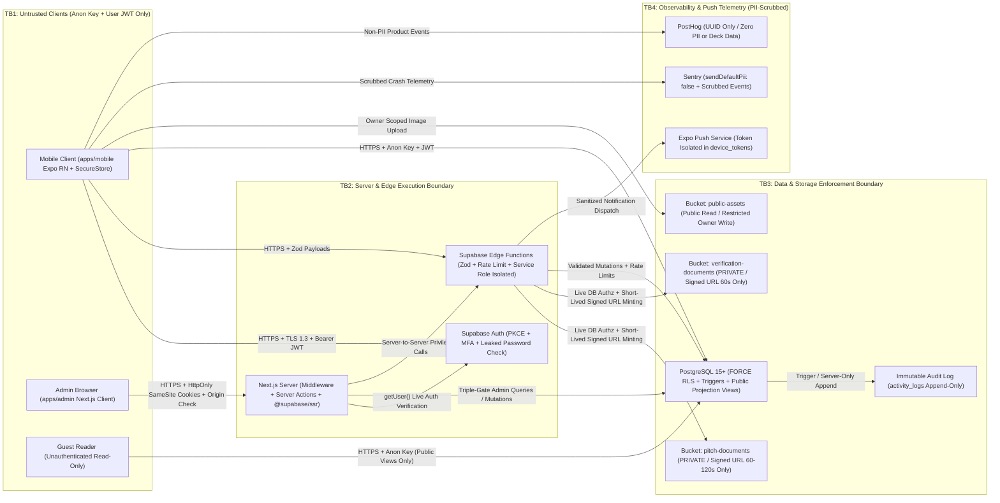

# SECURITY.md — SHARK Investment Network

> **Owner**: Agent 6 (Security & QA Engineer)  
> **Scope**: Defense-in-depth security architecture, STRIDE threat model, authentication & live-session hardening, PostgreSQL RLS & trigger invariants, confidential document isolation, admin RBAC & immutable audit logging, boundary validation, privacy/PII scrubbing, secrets governance, and backend security verification matrix for **SHARK Investment Network**.  
> **Stack**: Mobile (`apps/mobile` Expo React Native), Admin (`apps/admin` Next.js App Router), Backend (`supabase/` PostgreSQL, Supabase Auth, Supabase Storage, RLS, Edge Functions). **Zero Firebase.**

---

## 1. Security Architecture & Trust Boundaries

SHARK Investment Network processes high-sensitivity financial, corporate, and identity verification (KYC/KYB) data alongside bilingual (`ar` RTL default / `en` LTR) public investment discovery directories. The security architecture follows **Zero-Frontend-Trust Defense-in-Depth**: every security invariant is enforced independently at the database, storage, edge-function, and server-side web boundaries so that a compromised mobile binary, modified browser client, or replayed HTTP request cannot bypass authorization.

### Core Security Principles
1. **Zero Frontend-Only Authorization**: UI route guards (`Expo Router` redirects, `Next.js` client layout guards) exist purely for UX. All data visibility and mutations are enforced in PostgreSQL RLS, database triggers, Supabase Edge Functions, and Next.js Server Components/Actions/Route Handlers.
2. **Strict Separation of Role vs. Account Status**:
   - `user_role`: `investor` | `founder` | `member` | `admin`
   - `account_status`: `pending` | `approved` | `rejected` | `suspended`
   - Holding a role never grants access by itself. Every privileged operation requires an explicit combination of `account_status = 'approved'`, required `role`, and (for admins) active `admin_roles` membership and scope.
3. **Fail-Closed Defaults**: All 20 PostgreSQL tables enforce `ROW LEVEL SECURITY` (`FORCE ROW LEVEL SECURITY`). Private storage buckets (`pitch-documents`, `verification-documents`) deny all anonymous and unverified access. Missing policies or malformed requests fail closed (`401`/`403`).
4. **Live Database State Over Stale JWT Claims**: JWT access tokens are stateless until expiry. Every sensitive RLS policy, Edge Function, and Admin server check evaluates live `profiles` and `admin_roles` state in PostgreSQL so rejected, suspended, or deactivated users lose access immediately.
5. **Least Privilege & Secret Isolation**: `SUPABASE_SERVICE_ROLE_KEY` is never exposed to `apps/mobile`, `apps/admin` browser bundles, `EXPO_PUBLIC_*`, or `NEXT_PUBLIC_*` environment variables.

### Trust Boundaries Diagram



### Trust Boundary Summary

| Boundary | Components | Trusted Inputs | Untrusted Inputs | Mandatory Controls |
| :--- | :--- | :--- | :--- | :--- |
| **TB1 (Client Edge)** | `apps/mobile`, `apps/admin` client JS | None | All request payloads, headers, local storage, JWT metadata, deep links | Treat client as attacker-controlled; store tokens securely; never embed server secrets or authorization truth in client code |
| **TB2 (Server / Edge)** | Next.js Server Components/Actions/Middleware, Supabase Edge Functions, Supabase Auth | Verified `auth.getUser()`, server env secrets, Zod-validated DTOs | Cookies, `Authorization` header, JSON bodies, query params, URL params | Verify JWT via Auth server (`getUser()`), verify CSRF/Origin on web, Zod `.strict()` validation, rate limiting, live DB authorization |
| **TB3 (Data & Storage)** | PostgreSQL (20 tables), Storage (`public-assets`, `pitch-documents`, `verification-documents`) | `auth.uid()`, live `profiles`/`admin_roles` rows, `SECURITY DEFINER` helpers | Client `role`/`account_status` values, raw PostgREST filters, raw storage paths | `FORCE ROW LEVEL SECURITY`, immutable triggers, column-filtering public views, private buckets, append-only `activity_logs` |
| **TB4 (Telemetry / Push)** | Sentry, PostHog, Expo Notifications | Scrubbed error codes, user UUIDs, device push tokens | Raw HTTP headers, emails, phones, KYC files, Signed URLs | Mandatory PII scrubbers, disabled session replay on sensitive flows, no sensitive payload in push notifications |

---

## 2. Threat Model (STRIDE & Attack Surface Matrix)

### Platform Entities in Scope
- **Tables (20)**: `profiles`, `investors`, `founders`, `companies`, `company_members`, `pitches`, `pitch_documents`, `investment_interests`, `portfolio_companies`, `saved_items`, `notifications`, `verification_requests`, `admin_roles`, `activity_logs`, `sectors`, `device_tokens`, `pitch_reviews`, `pitch_access_grants`, `system_settings`, `support_requests`.
- **Storage Buckets (3)**: `public-assets` (public read), `pitch-documents` (private), `verification-documents` (private).

### STRIDE & Attack Surface Risk Matrix

| Threat ID | Threat Scenario | STRIDE Category | Attack Vector / Exploitation Path | Risk Level | Defense-in-Depth Mitigations | Verification Control |
| :--- | :--- | :--- | :--- | :--- | :--- | :--- |
| **T-01** | **Self-Approval & Privilege Escalation** | Elevation of Privilege / Tampering | Attacker sends `role: 'admin'` or `account_status: 'approved'` during `auth.signUp()`, or issues direct PostgREST `PATCH /profiles` or `POST /admin_roles` to elevate privileges. | **Critical** | `handle_new_user()` trigger ignores client `admin`/`approved` metadata and forces `account_status = 'pending'`; `BEFORE UPDATE` trigger blocks client edits to `role`, `account_status`, `verified_at`; `admin_roles` RLS restricts writes to active `super_admin` (`target != actor`) and server flows. | `SEC-02`, `SEC-09`, `SEC-10` |
| **T-02** | **IDOR on Pitches, Companies, Accounts & Interests** | Information Disclosure / Tampering | Authenticated user swaps UUIDs in PostgREST/API calls to read or modify another founder's `draft`/`pending`/`rejected` `pitches`, `companies`, `verification_requests`, `investment_interests`, `saved_items`, `notifications`, or `device_tokens`. | **Critical** | Ownership & membership predicates in RLS (`founder_id = auth.uid()`, `is_company_owner_or_member()`, `investor_id = auth.uid()`, `user_id = auth.uid()`) enforced on every row operation; Zod UUID validation; non-predictable UUIDv4 keys. | `SEC-06`, `SEC-07` |
| **T-03** | **Confidential Pitch, Deck & PII Leakage** | Information Disclosure | Guest, `pending`, or `rejected` user queries `profiles` (`phone`, `email`, `rejection_reason`), unapproved `companies`, `restricted` `pitches`, or `pitch_documents` metadata directly via Supabase anon key. | **Critical** | Direct `SELECT` on `profiles` restricted to `id = auth.uid()` or active admin; public discovery uses column-restricted projection views (`public_*_directory`) exposing zero private PII; `pitches` RLS hides non-`approved` pitches from non-owners and checks `pitch_access_grants` for `restricted` pitches; `pitch_documents` hidden unless authorized. | `SEC-01`, `SEC-03`, `SEC-04`, `SEC-07` |
| **T-04** | **Signed URL Leakage, Replay & Path Traversal** | Information Disclosure / Repudiation | User extracts a Signed URL from logs/browser history/analytics and shares it externally, guesses bucket object keys (`../other_company/deck.pdf`), or uses long-lived URLs after access revocation. | **High** | Private buckets deny public reads; Edge Function generates UUID-based canonical paths, verifies live DB permission + `pitch_access_grants`, sets TTL to **60–120s** (`Cache-Control: no-store`), scrubs URLs from Sentry/PostHog, and logs access events. | `SEC-08` |
| **T-05** | **Admin Dashboard Takeover, CSRF & Stored XSS** | Spoofing / Tampering / Elevation | Attacker exploits CSRF against Next.js admin endpoints, injects `<script>`/SVG XSS into company bio/pitch summary viewed by admins, or reuses a session after admin deactivation. | **Critical** | `@supabase/ssr` `HttpOnly` + `SameSite=Lax` + `Secure` cookies; `Origin`/`Host` validation on Server Actions/Route Handlers; strict CSP (`script-src 'self'`, no inline unsafe scripts); React escaped rendering; disallow `image/svg+xml` uploads; triple-gate live DB check (`role='admin'`, `account_status='approved'`, `admin_roles.is_active=true` + scope); mandatory MFA (AAL2) for admins. | `SEC-05`, `SEC-10` |
| **T-06** | **Brute-Force, Credential Stuffing & API Abuse / DoS** | Denial of Service / Spoofing | Automated bots flood login, password reset, `get-signed-document-url`, `investment_interests`, or `support_requests`, or execute unbounded `SELECT *` queries to exhaust DB connections. | **High** | Supabase Auth rate limits + breached-password protection; Edge Function / PostgreSQL sliding-window rate limits per `user_id`/`ip_hash`; bounded pagination (`limit <= 50`) enforced in Zod and SQL RPCs; statement timeouts (`statement_timeout`). | Load & rate-limit test suite |
| **T-07** | **Client Secret Leakage (`SERVICE_ROLE_KEY`)** | Information Disclosure | Developer accidentally prefixes `SUPABASE_SERVICE_ROLE_KEY`, DB password, or Sentry token with `EXPO_PUBLIC_` / `NEXT_PUBLIC_`, bundling it into the APK/IPA or browser JS. | **Critical** | Strict env schema separation (`@shark/config`); CI static AST/regex scan failing build if privileged keys appear in `apps/mobile` or client bundles; `.gitignore` + pre-commit Gitleaks secret scanner. | CI Secret & Bundle Gate |
| **T-08** | **Analytics & Error Telemetry PII Leakage** | Information Disclosure | Sentry crash dumps or PostHog events capture JWTs, Signed URLs, national IDs, phone numbers, email addresses, or confidential pitch financials. | **High** | `sendDefaultPii: false` in Sentry; custom `beforeSend`/`beforeBreadcrumb` redactors stripping tokens/PII/URL query strings; PostHog uses UUID `distinct_id` only with `autocapture: false` and zero text-input capture on sensitive screens. | Telemetry unit tests & payload inspection |
| **T-09** | **OneDrive / Windows Dev Environment Secret Exposure** | Information Disclosure / Repudiation | Workspace hosted under Windows OneDrive (`C:\Users\MS\OneDrive\...`) syncs `.env.local`, production service keys, or Android/iOS signing keystores to cloud storage, or leaks tokens via PowerShell command history (`ConsoleHost_history.txt`). | **High** | Production/staging secrets and mobile signing keystores MUST NEVER be stored inside OneDrive-synced workspace folders (store in `%USERPROFILE%\.shark-secrets\` or CI vault); local `.env.local` limited to disposable local Supabase dev credentials; enforce `.gitignore` + OneDrive folder exclusion + never pass secrets via CLI args. | Dev workstation & repo audit checklist |

---

## 3. Authentication & Session Hardening

### 3.1 Supabase Auth Configuration
- **Identity Provider**: Supabase Auth is the sole authentication service (email/password + optional admin TOTP MFA). No custom password hashing or Firebase Auth.
- **Signup Defaults**:
  - Public signup supports selecting initial applicant intent (`investor`, `founder`, or `member`) only.
  - Selecting `admin` during signup is **rejected** in Zod validation AND overridden/blocked in the PostgreSQL `handle_new_user()` trigger.
  - Every new user starts with `account_status = 'pending'` and requires explicit admin verification before unlocking approved capabilities.
- **Email Verification**: Enabled and mandatory (`email_confirm = true`) before any account can enter the verification/approval queue or submit sensitive requests.

### 3.2 Live Database State vs. JWT Claims (Critical Invariant)
> [!CAUTION]
> **Never rely on JWT `user_metadata` or `app_metadata` alone for authorization.** Standard Supabase JWTs remain cryptographically valid until `exp` (default 1 hour). If an admin suspends a malicious user or deactivates another admin, an unexpired JWT would still pass stateless signature checks!

To eliminate stale-claim privilege windows:
1. **PostgreSQL RLS & Edge Functions** evaluate **live database columns** (`profiles.account_status`, `profiles.role`, `admin_roles.is_active`, `admin_roles.permissions`) via `auth.uid()` on every query/request.
2. **Next.js Admin Server Layer** calls `await supabase.auth.getUser()` (which validates the session against Supabase Auth rather than reading unverified cookie payloads via `getSession()`), then immediately queries `profiles` + `admin_roles` in live PostgreSQL.
3. **Immediate Session Termination on Suspension / Rejection / Role Revocation**:
   - Whenever an admin suspends a user, rejects a previously active user, or deactivates an `admin_roles` entry, the backend Edge Function / Admin Server Action executes `supabase.auth.admin.signOut(targetUserId, 'global')` (with `service_role`) to revoke active refresh tokens, clears `device_tokens` for that user, and forces immediate client rejection (`403 ACCOUNT_SUSPENDED`) on any in-flight access token via live DB checks.

### 3.3 Password Policy, Reset Flow & Redirect Allowlists
- **Password Policy**:
  - Standard users (`investor`, `founder`, `member`): minimum **10 characters**, maximum **128 characters** (prevents bcrypt truncation/DoS), requires character diversity (letter + number/symbol), and blocks common/leaked passwords via Supabase Auth Leaked Password Protection.
  - Admins (`admin`): minimum **14 characters** + **mandatory TOTP MFA (AAL2)** in production.
- **Account Enumeration Resistance**:
  - Login failures return a localized generic invalid-credentials error without revealing whether an email exists or its `account_status` prior to authentication.
  - Password reset (`resetPasswordForEmail`) always returns a generic success message regardless of email existence.
- **Password Reset & Deep Link Hardening (PKCE)**:
  - Both Mobile and Admin use **PKCE flow** (`flowType: 'pkce'`), never implicit fragment tokens (`#access_token=...`) that leak via browser history or OS logs.
  - Supabase Auth `Redirect URLs` strictly allowlist exact URIs only (e.g., `shark://auth/callback`, `https://admin.shark-network.com/auth/callback`, local dev URLs in local config only) — **wildcards (`*`) are forbidden**.
  - Password update invalidates other active sessions via global sign-out / refresh token rotation.

### 3.4 Platform-Specific Session Storage

#### Mobile App (`apps/mobile` — Expo React Native)
- **Token Storage**: Custom Supabase client storage adapter backed exclusively by **`expo-secure-store`** (iOS Keychain Services / Android Keystore EncryptedSharedPreferences). **`AsyncStorage` must NEVER store access tokens, refresh tokens, or PII.**
- **2048-Byte `SecureStore` Constraint Handling**: Because Supabase session JSON can exceed `expo-secure-store`'s 2048-byte entry warning/limit on Android/iOS, implement a chunked `SecureStore` adapter or store an AES-256-GCM symmetric key in `expo-secure-store` for encrypted local storage without falling back to plaintext `AsyncStorage`.
- **Session Cleanup**: On sign-out, `401`, or `403 ACCOUNT_SUSPENDED`, clear `SecureStore` session keys, deactivate the current `device_tokens` row, wipe React Query in-memory cache (`queryClient.clear()`), and navigate to the localized unauthenticated/status screen.
- **Transport Security**: Enforce HTTPS-only endpoints (`usesCleartextTraffic: false` on Android except explicit local Metro dev; iOS ATS enabled).

#### Admin Dashboard (`apps/admin` — Next.js App Router)
- **Cookie Security**: Use `@supabase/ssr` exclusively so auth tokens live in **`HttpOnly`**, **`Secure`** (in HTTPS/production), **`SameSite=Lax`** cookies inaccessible to client-side `document.cookie` scripts.
- **Server Auth Pattern**:
  - Use `supabase.auth.getUser()` inside Next.js `middleware.ts`, Server Components, Server Actions, and Route Handlers. **Never trust `getSession()` on the server.**
  - Enforce idle session timeout / fresh re-authentication for destructive actions (`admin_roles` modifications, `system_settings` changes).

---

## 4. Authorization & PostgreSQL RLS Controls

### 4.1 Role vs. Account Status Enforcement Matrix

| Actor State (`profiles.role` + `account_status`) | Public Catalog Views | Own Profile & Onboarding Docs | Create/Edit Own Company & Pitch (`draft`/`pending`) | View Approved Pitches (Full Info) | View `restricted` Pitches & Request Signed Pitch Docs | Express `investment_interests` | Admin Portal & `activity_logs` |
| :--- | :--- | :--- | :--- | :--- | :--- | :--- | :--- |
| **Guest (Unauthenticated)** | **Allow** (Non-PII projections only) | Deny | Deny | Deny (summary only, no private pitch/investor/company contact) | Deny | Deny | Deny |
| **`pending` (`investor`/`founder`/`member`)** | **Allow** | **Allow** (Read own + upload KYC/KYB + edit safe profile fields only) | Deny (`founder` waits for `approved` status; or `draft` only if onboarding policy permits — **cannot submit/publish until `approved`**) | Deny | Deny | Deny | Deny |
| **`rejected`** | **Allow** (Read-only public) | **Read-only** own status/feedback + re-verify request if permitted; **cannot self-approve** | Deny | Deny | Deny | Deny | Deny |
| **`suspended`** | **Deny** (Authenticated requests immediately blocked -> forced sign-out) | **Deny** (Live DB check rejects all privileged/authenticated reads & writes) | Deny | Deny | Deny | Deny | Deny |
| **`approved` `investor`** | **Allow** | **Allow** (Safe fields only) | Deny (unless also authorized company member) | **Allow** | **Allow ONLY with active `pitch_access_grants` row** | **Allow** (Rate-limited) | Deny |
| **`approved` `founder`** | **Allow** | **Allow** (Safe fields only) | **Allow** (Own company/pitches; cannot self-approve or verify) | **Allow** (Own pitches + public approved pitches) | **Own pitches ONLY** (or granted via `pitch_access_grants`) | Deny (unless approved investor profile) | Deny |
| **`approved` `member`** | **Allow** | **Allow** (Safe fields only) | **Scoped** (`company_members` active membership on assigned company only) | **Allow** (Approved catalog) | **Assigned company pitches ONLY** (or granted) | Deny | Deny |
| **`approved` `admin` + active `admin_roles`** | **Allow** | **Allow** | **Review/Moderate** (Subject to RBAC scope & no self-approval) | **Allow** | **Allow** (With RBAC scope + audited in `activity_logs`) | **Read/Moderate** (With RBAC scope) | **Allow** (Scoped by `admin_roles.permissions`) |

### 4.2 Canonical PostgreSQL `SECURITY DEFINER` Helper Functions
All helper functions MUST define `SECURITY DEFINER`, `SET search_path = public, auth, pg_temp`, and `STABLE` (never `IMMUTABLE` because live DB state can change mid-session). Execute permissions are granted to `authenticated` (and `anon` only where explicitly safe) with `REVOKE ALL ON FUNCTION ... FROM PUBLIC`.

```sql
-- 1. Live check: caller exists and is approved
CREATE OR REPLACE FUNCTION public.is_approved_user()
RETURNS boolean
LANGUAGE sql
STABLE
SECURITY DEFINER
SET search_path = public, auth, pg_temp
AS $$
  SELECT EXISTS (
    SELECT 1
    FROM public.profiles p
    WHERE p.id = auth.uid()
      AND p.account_status = 'approved'
  );
$$;

-- 2. Live check: caller is NOT suspended (used for minimal self-read of pending/rejected status)
CREATE OR REPLACE FUNCTION public.is_not_suspended()
RETURNS boolean
LANGUAGE sql
STABLE
SECURITY DEFINER
SET search_path = public, auth, pg_temp
AS $$
  SELECT EXISTS (
    SELECT 1
    FROM public.profiles p
    WHERE p.id = auth.uid()
      AND p.account_status <> 'suspended'
  );
$$;

-- 3. Triple-gate Admin check: role='admin' + account_status='approved' + active admin_roles + scope
CREATE OR REPLACE FUNCTION public.is_active_admin(required_scope text DEFAULT NULL)
RETURNS boolean
LANGUAGE sql
STABLE
SECURITY DEFINER
SET search_path = public, auth, pg_temp
AS $$
  SELECT EXISTS (
    SELECT 1
    FROM public.profiles p
    JOIN public.admin_roles ar ON ar.user_id = p.id
    WHERE p.id = auth.uid()
      AND p.role = 'admin'
      AND p.account_status = 'approved'
      AND ar.is_active = true
      AND (
        required_scope IS NULL
        OR ar.role_name = 'super_admin'
        OR required_scope = ANY(ar.permissions)
      )
  );
$$;

-- 4. Company ownership or active verified membership check
CREATE OR REPLACE FUNCTION public.is_company_operator(target_company_id uuid)
RETURNS boolean
LANGUAGE sql
STABLE
SECURITY DEFINER
SET search_path = public, auth, pg_temp
AS $$
  SELECT public.is_approved_user()
    AND EXISTS (
      SELECT 1
      FROM public.companies c
      WHERE c.id = target_company_id
        AND (
          c.owner_id = auth.uid()
          OR EXISTS (
            SELECT 1
            FROM public.company_members cm
            WHERE cm.company_id = c.id
              AND cm.user_id = auth.uid()
              AND cm.status = 'active'
          )
        )
    );
$$;

-- 5. Confidential pitch visibility check (handles approved, restricted + grants, owner, active admin)
CREATE OR REPLACE FUNCTION public.can_view_pitch(target_pitch_id uuid)
RETURNS boolean
LANGUAGE sql
STABLE
SECURITY DEFINER
SET search_path = public, auth, pg_temp
AS $$
  SELECT EXISTS (
    SELECT 1
    FROM public.pitches pt
    WHERE pt.id = target_pitch_id
      AND (
        -- Active admin with moderation/read permission
        public.is_active_admin('pitches:read')
        -- Company owner or active member (sees own draft/pending/approved/rejected/restricted)
        OR public.is_company_operator(pt.company_id)
        -- Approved user viewing public approved pitch
        OR (pt.status = 'approved' AND public.is_approved_user())
        -- Approved user with valid, non-revoked, non-expired access grant for restricted pitch
        OR (
          pt.status = 'restricted'
          AND public.is_approved_user()
          AND EXISTS (
            SELECT 1
            FROM public.pitch_access_grants pag
            WHERE pag.pitch_id = pt.id
              AND pag.user_id = auth.uid()
              AND pag.revoked_at IS NULL
              AND (pag.expires_at IS NULL OR pag.expires_at > now())
          )
        )
      )
  );
$$;
```

### 4.3 Defense-in-Depth Database Triggers (Anti-Tampering)
Even when an RLS `UPDATE` policy permits a user to edit safe fields on their own `profiles`, `companies`, or `pitches` row, PostgreSQL RLS applies at the **row** level, not the **column** level. Mandatory `BEFORE INSERT / UPDATE / DELETE` triggers close every column-tampering path:

1. **`handle_new_user()` (`AFTER INSERT ON auth.users`)**:
   - Validates `raw_user_meta_data->>'role'` against `('investor', 'founder', 'member')`. Any `'admin'` or unknown value falls back or raises exception (never creates an admin).
   - Hardcodes `account_status = 'pending'`, ignoring any client-supplied status.
2. **`guard_profile_sensitive_columns()` (`BEFORE UPDATE ON public.profiles`)**:
   - If `current_setting('role', true) <> 'service_role'` and `NOT public.is_active_admin('users:review')`:
     - Rejects (`RAISE EXCEPTION 'insufficient_privilege'`) any change to `id`, `role`, `account_status`, `rejection_reason`, `verified_at`, `verified_by`, or `suspended_at`.
   - Even if caller IS an active admin, blocks self-approval or self-role modification (`NEW.id = auth.uid()` changing `role` or `account_status`).
3. **`guard_company_and_pitch_integrity()` (`BEFORE UPDATE ON public.companies`, `BEFORE UPDATE ON public.pitches`)**:
   - Non-admin founders/members CANNOT modify `companies.verification_status` / `is_verified` / `verified_at` or `pitches.status` into `'approved'`, `'rejected'`, or `'restricted'`.
   - Founders may only transition `pitches.status` from `draft -> pending` (submit for review) or `approved -> closed` (close fundraising).
4. **`guard_admin_roles_integrity()` (`BEFORE INSERT OR UPDATE OR DELETE ON public.admin_roles`)**:
   - Only `service_role` or `is_active_admin('roles:manage')` (specifically `super_admin`) may modify `admin_roles`.
   - Prevents any admin from modifying or escalating their own `admin_roles` record (`NEW.user_id = auth.uid()`).
5. **`prevent_activity_logs_mutation()` (`BEFORE UPDATE OR DELETE ON public.activity_logs`)**:
   - Unconditionally raises `insufficient_privilege` for **all** database roles (including `service_role` and `postgres` in normal application flow) so historical audit logs cannot be altered or purged.

### 4.4 Column Projection & Public PII Isolation
Because PostgreSQL RLS filters **rows** rather than **columns**, exposing `profiles`, `companies`, or `pitches` directly to `anon` or peer `authenticated` users would leak private fields (`email`, `phone`, `rejection_reason`, `suspension_reason`, private company financials, unapproved investment details).

**Mandatory Pattern**:
- Direct `SELECT` on `public.profiles` is restricted exclusively to `id = auth.uid()` (when not suspended) OR `is_active_admin('users:read')`.
- Guest and peer directory reads query **explicit public projection views / `SECURITY DEFINER` RPCs** that:
  1. Explicitly project ONLY non-sensitive columns (`id`, `full_name`, `avatar_url`, `role`, `country`, `bio`, `sector_ids`, `verification_badge`).
  2. Never project `email`, `phone`, `rejection_reason`, `admin_notes`, `suspension_reason`, or private KYC references.
  3. Hardcode `WHERE p.account_status = 'approved'` and `WHERE c.verification_status = 'verified'` (or approved status) and `WHERE pt.status = 'approved'`.
- All views created for directory reading use `security_invoker = false` ONLY via tightly scoped, read-only `SECURITY DEFINER` RPCs/views with zero dynamic SQL and bounded pagination (`LIMIT <= 50`).

### 4.5 RLS Policy Matrix Across All 20 Tables

| # | Table | `SELECT` Policy | `INSERT` Policy | `UPDATE` Policy | `DELETE` Policy | Special Guard / Trigger |
| :--- | :--- | :--- | :--- | :--- | :--- | :--- |
| 1 | `profiles` | Self (`id = auth.uid()` & not suspended) OR active admin (`users:read`); public via non-PII views only | Trigger from `auth.users` only (no direct client insert) | Self (`not suspended`, safe columns only) OR active admin (`users:review`, `target != self`) | Denied (`service_role` / compliance erase RPC only) | `guard_profile_sensitive_columns()` blocks self status/role changes |
| 2 | `investors` | Approved users (public non-PII profile projection) OR self (`user_id = auth.uid()`) OR active admin | Self (`user_id = auth.uid()`, `role = 'investor'`) | Self (`not suspended`, safe columns) OR active admin | Denied | Private ticket/accreditation fields hidden from guests |
| 3 | `founders` | Approved users (public non-PII projection) OR self OR active admin | Self (`user_id = auth.uid()`, `role = 'founder'`) | Self (`not suspended`) OR active admin | Denied | Private personal identifiers hidden from guests |
| 4 | `companies` | Public approved companies via safe view; full details to `is_company_operator()` OR `is_approved_user()` (approved only) OR active admin | Approved `founder` (`owner_id = auth.uid()`) | `is_company_operator()` (non-verification fields) OR active admin (`companies:verify`) | Denied (soft-archive / admin action) | Trigger blocks founder self-verification; unapproved company investment info hidden from guests |
| 5 | `company_members` | Same company operators (`is_company_operator()`) OR self (`user_id = auth.uid()`) OR active admin | Company owner (`companies.owner_id = auth.uid()` & approved) OR active admin | Company owner OR active admin | Company owner (excluding self-lockout) OR active admin | Cannot add `suspended` or `admin` user as unapproved bypass |
| 6 | `pitches` | `can_view_pitch(id)` (public view shows only `approved` summary; `restricted` requires `pitch_access_grants`) | Approved company operator (`is_company_operator(company_id)`) | Company operator (draft/pending/close only) OR active admin (`pitches:review`) | Owner only while `status = 'draft'`; otherwise denied | Trigger blocks non-admin status jump to `approved`/`restricted` |
| 7 | `pitch_documents` | `can_view_pitch(pitch_id)` AND (`is_approved_user()` or owner or admin); excludes sensitive internal admin notes | Approved pitch company operator | Company operator (metadata only while editable) OR active admin (`pitches:review`) | Company operator (while `draft`) OR active admin | Storage object download strictly requires Edge Function Signed URL |
| 8 | `investment_interests` | Expressing investor (`investor_id = auth.uid()`) OR target pitch company operator OR active admin (`interests:read`) | Approved `investor` only (`investor_id = auth.uid()`, target pitch `status = 'approved'` or granted `restricted`) | Expressing investor (withdraw) OR target company operator (response status) OR active admin | Denied (audit preservation) | Rate-limited via Edge Function/RPC; zero guest or cross-investor visibility |
| 9 | `portfolio_companies` | Public non-PII for approved investor portfolios; full details for owning investor OR active admin | Approved owning `investor` | Approved owning `investor` OR active admin | Approved owning `investor` OR active admin | Validated URLs only (`https://`) |
| 10 | `saved_items` | Self only (`user_id = auth.uid()` & `is_approved_user()`) | Self only (`user_id = auth.uid()` & `is_approved_user()` & `can_view_pitch` if pitch) | Denied | Self only (`user_id = auth.uid()`) | Prevents saving inaccessible/restricted pitches as side-channel |
| 11 | `notifications` | Self only (`user_id = auth.uid()` & `is_not_suspended()`) | Server / `service_role` / triggers ONLY (no direct client insert) | Self (`read_at` / `is_read` column only) | Self only (`user_id = auth.uid()`) | Trigger protects `title`, `body`, `type`, `payload` from user edit |
| 12 | `verification_requests` | Self (`user_id = auth.uid()`) OR active admin (`verifications:read`) | Self (`user_id = auth.uid()`, `status = 'pending'`) | Active admin (`verifications:review`, `target != self`) ONLY | Denied | Users cannot self-approve or alter `review_notes`/`reviewed_by` |
| 13 | `admin_roles` | Self (`user_id = auth.uid()` & active admin) OR `super_admin` (`roles:read`) | Active `super_admin` (`roles:manage`, `target != self`) or server setup | Active `super_admin` (`roles:manage`, `target != self`) | Active `super_admin` (`roles:manage`, `target != self`) | Trigger blocks self-granting or deactivating last `super_admin` |
| 14 | `activity_logs` | Active admin (`audit:read` / `super_admin`) ONLY | Server / `SECURITY DEFINER` triggers / `service_role` ONLY | **DENIED (All roles)** | **DENIED (All roles)** | Immutable trigger `prevent_activity_logs_mutation()` |
| 15 | `sectors` | Public (`anon` + `authenticated`, active sectors) | Active admin (`settings:write`) | Active admin (`settings:write`) | Active admin (`settings:write`, if unused) | Read-only catalog for clients |
| 16 | `device_tokens` | Self (`user_id = auth.uid()`) OR server dispatch | Self (`user_id = auth.uid()` & `is_not_suspended()`) | Self (`user_id = auth.uid()`) | Self (`user_id = auth.uid()`) | Scrubbed on logout / suspension |
| 17 | `pitch_reviews` | Target pitch company operator (non-internal feedback) OR active admin (`pitches:read`) | Active admin (`pitches:review`, `reviewer_id = auth.uid()`, `company_owner != auth.uid()`) | Denied (or admin append-only) | Denied | Prevents founders from reading internal moderator notes or forging reviews |
| 18 | `pitch_access_grants` | Target grantee (`user_id = auth.uid()` & `is_approved_user()`) OR pitch company operator OR active admin | Pitch company owner (`is_company_operator` + pitch owner) OR active admin (`pitches:restrict`) | Pitch company owner OR active admin (revoke/expiry) | Denied (prefer `revoked_at` audit trail) | Governs access to `restricted` pitches & their Signed URLs |
| 19 | `system_settings` | Active admin (`settings:read`); safe public feature flags via explicit non-secret RPC only | Active `super_admin` (`settings:write`) | Active `super_admin` (`settings:write`) | Denied | Never stores secrets/API keys; every change audited in `activity_logs` |
| 20 | `support_requests` | Submitter (`user_id = auth.uid()`) OR active admin (`support:read`) | Authenticated non-suspended user (`user_id = auth.uid()`) OR rate-limited public contact Edge Function | Active admin (`support:manage`) | Denied | Rate-limited; sanitized against XSS when displayed in Admin |

---

## 5. Confidential Document Security

### 5.1 Storage Bucket Isolation & Access Policy
| Bucket | Visibility | Contents | Read Mechanism | Upload Authorization |
| :--- | :--- | :--- | :--- | :--- |
| `public-assets` | Public Read | User avatars, approved public company logos, sector icons | Public CDN URL | Authenticated user into own scoped prefix (`avatars/{auth.uid()}/...` or owned company path); strict image MIME/size check |
| `pitch-documents` | **PRIVATE** (`public = false`) | Pitch decks (`.pdf`, `.pptx`), financial models (`.xlsx`), cap tables, data room files | **Short-lived Signed URL (60–120s)** issued ONLY by Edge Function after live DB authorization | Approved company operator into `{company_id}/{pitch_id}/{uuid}.{ext}` after ownership check |
| `verification-documents` | **PRIVATE** (`public = false`) | KYC IDs, commercial registration certificates, accreditation proofs, incorporation docs | **Short-lived Signed URL (60s)** issued ONLY by Edge Function to document owner OR active admin (`verifications:read`) | Authenticated non-suspended owner into `{auth.uid()}/{request_id}/{uuid}.{ext}` |

> [!IMPORTANT]
> Direct Storage `SELECT` policies on `pitch-documents` and `verification-documents` MUST be locked down so standard `anon` and `authenticated` clients cannot download objects via raw Storage URLs. Signed URLs are minted exclusively server-side inside the `get-signed-document-url` Edge Function using `SUPABASE_SERVICE_ROLE_KEY` **after** full authorization checks pass.

### 5.2 File Validation, Magic Bytes & Malware Controls
1. **Strict Allowlists (No Executables, No Macros, No SVG XSS)**:
   - `public-assets`: `image/jpeg`, `image/png`, `image/webp` (max **5 MB**). **`image/svg+xml` is explicitly forbidden** for user uploads to eliminate stored SVG script execution.
   - `pitch-documents`: `application/pdf`, `.pptx` (`application/vnd.openxmlformats-officedocument.presentationml.presentation`), `.xlsx` (`application/vnd.openxmlformats-officedocument.spreadsheetml.sheet`) (max **25 MB**). Macro-enabled formats (`.pptm`, `.xlsm`, `.docm`) are rejected.
   - `verification-documents`: `application/pdf`, `image/jpeg`, `image/png` (max **10 MB**).
2. **Server-Side Magic-Byte & Header Verification**:
   - Do not trust client `file.type` or filename extensions alone. An Edge Function / upload verification step inspects leading magic bytes (`%PDF-` for PDF, `FF D8 FF` for JPEG, `89 50 4E 47` for PNG, `50 4B 03 04` + Office content-type verification for `.pptx`/`.xlsx`).
3. **Canonical UUID Naming & Path Traversal Prevention**:
   - Client-supplied filenames are stored only as display metadata (HTML/control-char sanitized) in `pitch_documents.file_name` / `verification_requests`.
   - Actual object keys are generated server-side using UUIDv4 (`{company_id}/{pitch_id}/{doc_uuid}.{ext}`), rejecting `..`, `\`, URL-encoded slashes, or null bytes.
4. **Malware Scanning Readiness**:
   - `pitch_documents` and verification file records support a `scan_status` (`pending` | `clean` | `quarantined`) lifecycle so async AV/CDR webhooks can quarantine suspicious documents immediately and block Signed URL minting for any non-`clean` or `quarantined` file.

### 5.3 Short-Lived Signed URL Issuance Flow (`get-signed-document-url`)
1. Client sends `POST /functions/v1/get-signed-document-url` with Bearer JWT and Zod-validated `{ bucket: 'pitch-documents' | 'verification-documents', documentId: uuid }`.
2. Edge Function extracts user via `supabaseAuthClient.auth.getUser()` (reject `401` if invalid/expired).
3. **Live DB Check**: Queries `profiles` confirming `account_status <> 'suspended'` (and `account_status = 'approved'` for all `pitch-documents` access, unless the requester is the document's own founder viewing their draft/pending onboarding upload or an active admin).
4. **Resource Authorization**:
   - For `pitch-documents`: Checks `pitch_documents` + `pitches`:
     - Rejects if `pitches.status` is `rejected` or `draft` unless caller is the owning `is_company_operator()` or active admin (`pitches:read`).
     - If `pitches.status = 'restricted'`, verifies an active, non-revoked, non-expired `pitch_access_grants` row for `auth.uid()` (unless owner or active admin).
     - Verifies `document.is_restricted` / visibility flags match the caller's grant level.
   - For `verification-documents`: Allows ONLY `verification_requests.user_id = auth.uid()` OR active admin (`verifications:read`).
5. **Rate Limit Check**: Max **20 requests / minute / user** (returns `429` if exceeded).
6. **Signed URL Minting**: Service-role client inside the Edge Function calls `createSignedUrl(storagePath, ttlSeconds)` where:
   - `ttlSeconds = 60` for `verification-documents` and `restricted` pitch documents.
   - `ttlSeconds = 120` (maximum) for standard `approved` pitch documents.
7. **Audit & Response**:
   - Writes an entry to `activity_logs` when an admin views a `verification-documents` file or `restricted` pitch document (and records structured access log metadata).
   - Returns `{ signedUrl, expiresAt, contentType }` with `Cache-Control: no-store, no-cache, must-revalidate` and `Pragma: no-cache`.

### 5.4 Client Anti-Leakage Controls
- Mobile PDF/document viewers disable disk caching where supported, purge temporary downloaded viewer buffers on screen unmount and sign-out, and enforce `FLAG_SECURE` (Android screenshot/recording prevention) + iOS screenshot detection warning on `verification-documents` and `restricted` pitch deck screens.
- Signed URLs are never stored in React Query persistent storage, AsyncStorage, URL query strings, Sentry breadcrumbs, or PostHog events.

---

## 6. Administrative Action Security & Immutable Audit Logging

### 6.1 Triple-Gate Admin Authorization
Every Next.js Admin Server Action, Route Handler (`/api/admin/*`), and Admin Edge Function MUST execute and pass **all three gates** in order before reading or mutating any admin resource:
1. **Verified Auth Identity**: `const { data: { user }, error } = await supabase.auth.getUser()` succeeds and (in production) satisfies required MFA assurance (`aal2`).
2. **Live Approved Admin Profile**: Live query to `profiles` confirms `role = 'admin'` AND `account_status = 'approved'`.
3. **Live Active Role & Permission Scope**: Live query to `admin_roles` confirms `user_id = user.id`, `is_active = true`, AND `permissions` includes the exact required scope (or `role_name = 'super_admin'`).

### 6.2 Admin RBAC Role & Separation of Duties Matrix

| Admin Role (`admin_roles.role_name`) | Permitted Scopes (`permissions[]`) | Explicit Restrictions |
| :--- | :--- | :--- |
| `super_admin` | All scopes (`*`), including `roles:manage`, `settings:write`, `audit:read` | Cannot modify/approve own `profiles` status, own company, or own `admin_roles` row (`target_user_id != actor_id`); cannot delete `activity_logs` |
| `operations_admin` | `users:read`, `users:review`, `users:suspend`, `companies:read`, `companies:review`, `pitches:read`, `notifications:send`, `support:read`, `support:manage`, `analytics:read` | Cannot manage `admin_roles` or `system_settings`; cannot act on self |
| `compliance_reviewer` | `users:read`, `users:review`, `users:suspend`, `verifications:read`, `verifications:review`, `companies:verify`, `audit:read` | Cannot manage `admin_roles` or `system_settings`; cannot review own verification/company |
| `content_moderator` | `investors:moderate`, `companies:read`, `companies:review`, `pitches:read`, `pitches:review`, `pitches:restrict`, `documents:moderate`, `interests:read` | Cannot verify KYC/users or alter `admin_roles`/`system_settings` |
| `analyst_readonly` | `users:read`, `companies:read`, `pitches:read`, `audit:read`, `analytics:read`, `support:read` | Strictly read-only across all modules; zero mutation capabilities |

### 6.3 Immutable `activity_logs` Specification
- **Append-Only Enforcement**:
  - `activity_logs` RLS denies `UPDATE` and `DELETE` for all roles, denies direct `INSERT` from untrusted client roles (`anon`, standard `authenticated`), and reinforces immutability with the `prevent_activity_logs_mutation()` trigger.
  - Admin mutations execute inside atomic PostgreSQL `SECURITY DEFINER` RPCs or validated Edge Functions that perform the state change AND insert the `activity_logs` row in the **same transaction** — if audit logging fails, the mutation rolls back.
- **Mandatory Audited Actions**:
  - `user.approve`, `user.reject`, `user.suspend`, `user.reactivate`, `user.role_change`
  - `admin_role.grant`, `admin_role.update`, `admin_role.revoke`
  - `verification.approve`, `verification.reject`, `verification.document_viewed`
  - `company.verify`, `company.unverify`, `company.suspend`
  - `pitch.approve`, `pitch.reject`, `pitch.close`, `pitch.restrict`, `pitch.unrestrict`
  - `pitch_access.grant`, `pitch_access.revoke`, `pitch_document.restricted_viewed`
  - `system_settings.update`, `support_request.escalate`
- **Audit Record Schema Guarantees**:
  - Records `actor_id`, `actor_role`, `action`, `entity_type`, `entity_id`, `previous_state` (redacted JSONB), `new_state` (redacted JSONB), `reason` (required non-empty string for all `reject`, `suspend`, `restrict`, and `revoke` actions), `request_id`, `ip_hash` / server IP, and `created_at`.
  - **Redaction Rule**: Never store raw passwords, JWTs, Signed URLs, or full KYC file blobs inside `activity_logs`.

---

## 7. Input Validation, Rate Limiting, Error Handling & Privacy

### 7.1 Zod Boundary Validation (`@shark/validation`)
- Every form submission (Mobile & Admin), Next.js Server Action argument, API query filter, and Edge Function JSON body is parsed with **strict Zod schemas** (`z.object(...).strict()`).
- **Anti-Mass-Assignment**: Unexpected privilege fields (`role`, `account_status`, `is_verified`, `verified_at`, `owner_id`, `reviewer_id`) are stripped or rejected (`Unrecognized key(s)`) at the API/Server Action boundary before reaching Supabase.
- **URL & Rich-Text Sanitization**:
  - External links (`website_url`, `linkedin_url`, `video_url`) must match `https://` protocol only — `javascript:`, `data:`, `vbscript:`, and `file:` URIs are unconditionally rejected.
  - Text fields enforce explicit max lengths (`bio <= 1000`, `pitch_summary <= 2000`, `reason <= 500`), trim control characters, and are rendered as plain text (no `dangerouslySetInnerHTML` anywhere in `apps/admin` or webviews).
- **Pagination Bounds**: Every list endpoint enforces `limit: z.number().int().min(1).max(50).default(20)` and validated keyset/cursor parameters.

### 7.2 Rate Limiting & Abuse Controls
Implemented via Supabase Auth native protections + PostgreSQL/Edge Function sliding-window counter (`rate_limit_check(bucket_key, max_requests, window_seconds)` backed by indexed `rate_limit_events` or equivalent server store):

| Endpoint / Action | Key Scope | Limit | Enforcement Layer | Failure Behavior |
| :--- | :--- | :--- | :--- | :--- |
| Auth Login / OTP / Password Reset | IP + normalized email hash | Per Supabase Auth limits (strict brute-force lockout) | Supabase Auth + Edge WAF | `429 RATE_LIMITED` + localized retry message |
| `get-signed-document-url` | `user_id` | **20 req / min** | Edge Function | `429 RATE_LIMITED` + audit alert if repeated |
| `investment_interests` creation | `investor_id` | **10 req / hour** (and max 1 active per pitch) | Edge Function / RPC | `429` / `409` prevents founder spam |
| `verification_requests` submission | `user_id` | **5 req / day** | Edge Function / RPC | `429` prevents storage/review queue flooding |
| `support_requests` creation | `user_id` or `ip_hash` | **5 req / hour** | Edge Function | `429 RATE_LIMITED` |
| Public directory search queries | `ip_hash` / `user_id` | **60 req / min** | Edge/CDN + bounded SQL (`limit <= 50`) | `429` + `statement_timeout` (5s) |

### 7.3 Safe Error Responses & Structured Logging
- **Client-Safe Error Envelope**:
  ```json
  {
    "error": {
      "code": "FORBIDDEN",
      "messageKey": "errors.accountSuspended",
      "requestId": "req_01J..."
    }
  }
  ```
- **Prohibited in Client Responses**: Raw PostgreSQL error codes/messages, table/constraint names, SQL snippets, stack traces, internal hostnames, or distinguishing "wrong password" vs "user does not exist".
- **Server Structured Logs**: Edge Functions and Next.js Server Actions log JSON events containing `timestamp`, `requestId`, `route`, `actorId` (UUID only), `statusCode`, and `errorCode`, never full request bodies on auth/KYC routes.

### 7.4 Sentry & PostHog Privacy / PII Scrubbing
- **Sentry (`apps/mobile` & `apps/admin`)**:
  - Set `sendDefaultPii: false`.
  - Implement mandatory `beforeSend` and `beforeBreadcrumb` hooks that:
    - Strip `Authorization`, `Cookie`, `Set-Cookie`, `apikey`, and `x-supabase-auth` headers.
    - Redact Signed URL query parameters (`?token=...`) to `?[REDACTED]`.
    - Scrub email regexes, phone patterns, national IDs, and `request.data` on `/auth/*`, `/verification*`, and `/get-signed-document-url`.
  - Set `hideSourceMaps: true` in Next.js production builds; upload source maps privately during CI only (`SENTRY_AUTH_TOKEN` never shipped in builds).
- **PostHog (`apps/mobile` & `apps/admin`)**:
  - Identify authenticated users solely by opaque UUID (`profiles.id`) — **never** pass `email`, `phone`, `full_name`, `company_valuation`, `rejection_reason`, or document filenames/URLs as person or event properties.
  - Guests use ephemeral anonymous session IDs without cross-app PII linking.
  - Configure `autocapture: false` (explicit safe domain events only: e.g., `screen_viewed`, `filter_applied`), disable session replay on all Admin, Auth, Verification, and Confidential Document screens, and strip URL query parameters.

---

## 8. Environment Variable Separation & Secrets Management

### 8.1 Environment Variable Classification

| Variable | App Scope | Prefix Allowed | Visibility | Purpose & Guardrail |
| :--- | :--- | :--- | :--- | :--- |
| `EXPO_PUBLIC_SUPABASE_URL` | `apps/mobile` | `EXPO_PUBLIC_` | Client-safe | Supabase project HTTPS URL |
| `EXPO_PUBLIC_SUPABASE_ANON_KEY` | `apps/mobile` | `EXPO_PUBLIC_` | Client-safe | Public anon key; safe **only** because RLS governs all access |
| `NEXT_PUBLIC_SUPABASE_URL` | `apps/admin` | `NEXT_PUBLIC_` | Client-safe | Supabase project HTTPS URL |
| `NEXT_PUBLIC_SUPABASE_ANON_KEY` | `apps/admin` | `NEXT_PUBLIC_` | Client-safe | Public anon key; safe **only** because RLS governs all access |
| `EXPO_PUBLIC_SENTRY_DSN` / `NEXT_PUBLIC_SENTRY_DSN` | Mobile / Admin | Public prefix | Client-safe | Public Sentry ingest DSN only (write-only) |
| `EXPO_PUBLIC_POSTHOG_API_KEY` / `NEXT_PUBLIC_POSTHOG_API_KEY` | Mobile / Admin | Public prefix | Client-safe | Public analytics project key (no PII allowed) |
| `SUPABASE_SERVICE_ROLE_KEY` | Admin Server & Edge Functions ONLY | **NONE** | **CRITICAL SECRET** | Bypasses RLS! **Forbidden** in `apps/mobile`, client components, or `EXPO_PUBLIC_*`/`NEXT_PUBLIC_*` |
| `SUPABASE_DB_URL` / `POSTGRES_PASSWORD` | CI / Migrations ONLY | **NONE** | **CRITICAL SECRET** | Direct DB connection for migrations |
| `SENTRY_AUTH_TOKEN` | CI Build ONLY | **NONE** | **SECRET** | Private source-map upload only |
| `EXPO_ACCESS_TOKEN` / Keystores (`.jks`, `.p8`, `.p12`) | EAS / CI Secret Store ONLY | **NONE** | **CRITICAL SECRET** | Mobile signing credentials; never committed or synced |

### 8.2 CI/CD & Repository Secret Hygiene
- `.gitignore` MUST exclude: `.env`, `.env.*`, `!.env.example`, `*.pem`, `*.p8`, `*.p12`, `*.jks`, `*.keystore`, `supabase/.temp/`, `supabase/.branches/`.
- CI pipeline enforces:
  1. **Secret Scanning**: Gitleaks / TruffleHog check on every PR and push.
  2. **Bundle & Env AST Guard**: Fails the build if `SUPABASE_SERVICE_ROLE_KEY`, `SERVICE_ROLE`, or server-only env names appear anywhere in `apps/mobile/**`, `apps/admin` client bundles (`'use client'`), or `EXPO_PUBLIC_*` / `NEXT_PUBLIC_*` templates.

### 8.3 Windows & OneDrive Local Development Hardening
Because the workspace resides inside a OneDrive-synced Windows directory (`C:\Users\MS\OneDrive\...`):
1. **No Production Secrets in OneDrive**: Never place production or staging `.env.local` files, `SUPABASE_SERVICE_ROLE_KEY`, database dumps, or Android/iOS signing keystores inside OneDrive-synced folders. Store sensitive signing keys or non-local credentials outside OneDrive (e.g., `%USERPROFILE%\.shark-secrets\`) or fetch dynamically via CI/EAS secrets.
2. **Local Dev Isolation**: Local `.env.local` inside the workspace must point strictly to ephemeral local Supabase CLI instances (`supabase start`) or isolated sandbox keys with zero real user PII.
3. **PowerShell & Shell Hygiene**: Never pass secrets as inline command arguments (which persist in `%APPDATA%\Microsoft\Windows\PowerShell\PSReadLine\ConsoleHost_history.txt`). Load secrets via environment files or secure secret prompts only.
4. **Incident Rotation**: If any non-local secret or keystore is ever written to a OneDrive-synced folder, treat it as compromised, immediately rotate the credential in Supabase/Expo/Sentry, purge OneDrive file versions, and scrub git history if committed.

---

## 9. Security & Access-Control Verification Matrix (11 Mandatory Scenarios)

All 11 scenarios below are **mandatory automated backend tests** executed against real local/CI Supabase PostgreSQL RLS, triggers, Storage policies, Edge Functions, and Next.js Server Actions (`supabase/tests/*.sql` via pgTAP and `tests/security/*.test.ts`). **Frontend UI checks do not satisfy any scenario below.**

| Test ID | Scenario | Actor & Preconditions | Attack / Action Executed | Expected Backend Result | Target Enforcement Layer | Automated Suite |
| :--- | :--- | :--- | :--- | :--- | :--- | :--- |
| **SEC-01** | **Guest Read Scope & PII / Confidential Isolation** | Unauthenticated (`anon` key, no JWT); DB seeded with approved + pending + rejected + restricted pitches, approved + pending users with `phone`/`email`/`rejection_reason`. | 1) Query public directory views (`sectors`, approved non-PII directories).<br>2) Attempt `SELECT` on `profiles`, `verification_requests`, `investment_interests`, `activity_logs`, `pitch_documents`, and `draft`/`pending`/`rejected`/`restricted` `pitches`. | 1) Public directory views return ONLY approved non-PII columns (`phone`, `email`, `rejection_reason` absent).<br>2) All direct queries to private tables and non-approved/restricted pitches return **0 rows or `401`/`403`**. | PostgreSQL RLS + Column Projection Views | `supabase/tests/01_guest_isolation.sql` |
| **SEC-02** | **Signup Default Status & Self-Escalation Prevention** | New user signing up via Auth with crafted metadata `{"role": "admin", "account_status": "approved"}`, then attempting `UPDATE profiles SET role='admin', account_status='approved'` and `INSERT INTO admin_roles`. | Submit tampered signup metadata, then invoke PostgREST `PATCH /profiles` and `POST /admin_roles` using the new user's JWT. | 1) `profiles.account_status` is forced to `'pending'` and `role` is never `'admin'`.<br>2) `PATCH` to `role`/`account_status` fails via trigger (`403` / `insufficient_privilege`).<br>3) `INSERT` into `admin_roles` rejected (`42501` RLS violation). | `handle_new_user()`, `guard_profile_sensitive_columns()`, `admin_roles` RLS | `supabase/tests/02_privilege_escalation.sql` |
| **SEC-03** | **Pending Account Privilege Restriction** | Authenticated user with `role = 'investor'` (and separate user with `role = 'founder'`) and `account_status = 'pending'`. | 1) Attempt to insert `investment_interests`.<br>2) Attempt to publish a pitch (`status = 'pending'`/`'approved'`) or insert `saved_items`.<br>3) Call `get-signed-document-url` for an approved pitch deck. | All privileged investor/founder operations and Signed URL requests are rejected (`403 ACCOUNT_PENDING` / RLS `0` rows affected). User can only read own profile and manage own onboarding `verification_requests`. | PostgreSQL RLS + Edge Function live `is_approved_user()` | `tests/security/03_pending_account.test.ts` |
| **SEC-04** | **Rejected Account Restriction & Anti-Tampering** | Authenticated user whose `account_status` was updated by an admin to `'rejected'` with `rejection_reason` set. | Attempt to access approved investor/founder endpoints, request pitch Signed URLs, edit `profiles.account_status` back to `'pending'`/`'approved'`, or clear `rejection_reason`. | All privileged actions fail (`403 ACCOUNT_REJECTED`); self-update of `account_status` or `rejection_reason` fails at DB trigger (`insufficient_privilege`); peer users cannot read this user's `rejection_reason`. | `guard_profile_sensitive_columns()` + RLS + Edge Function | `tests/security/04_rejected_account.test.ts` |
| **SEC-05** | **Suspended Account Immediate Revocation (Live DB Check)** | Approved user (`investor` or `admin`) acquires a valid JWT (`exp` 55m remaining); admin immediately sets `account_status = 'suspended'` and calls `auth.admin.signOut(id, 'global')`. | Replay the still-unexpired access JWT against PostgreSQL RLS (`pitches`, `profiles`, `investment_interests`), Edge Function (`get-signed-document-url`), and Next.js Admin Server Action. | **Every** replay attempt fails **immediately** (`403 ACCOUNT_SUSPENDED` / `0` rows) because live DB state is checked on every request without waiting for JWT expiry; refresh token is invalid. | Live DB RLS helpers + Edge Function + Next.js Server check | `tests/security/05_suspended_immediate.test.ts` |
| **SEC-06** | **Cross-Tenant IDOR Prevention** | Two approved users: Founder A (owns Company A, Pitch A `draft`) and Founder B (owns Company B, Pitch B `draft` + `verification_requests` + `investment_interests` + `notifications` + `device_tokens`). | Founder A attempts `SELECT`/`UPDATE`/`DELETE` using Founder B's exact UUIDs on `companies`, `company_members`, `pitches`, `verification_requests`, `investment_interests`, `notifications`, `saved_items`, and `device_tokens`. | All cross-tenant reads return `0` rows and all cross-tenant mutations fail (`0` rows / `403` RLS violation). | Table RLS ownership & `is_company_operator()` policies | `supabase/tests/06_idor_isolation.sql` |
| **SEC-07** | **Restricted Pitch & `pitch_access_grants` Enforcement** | Pitch R has `status = 'restricted'`; Investor A has NO grant; Investor B has an active grant; Investor C has an expired or `revoked_at` grant. | Investors A, B, and C query `pitches`, `pitch_documents`, and call `get-signed-document-url` for Pitch R's deck. | Investor A and Investor C receive **0 rows** from `pitches`/`pitch_documents` and **`403`** from Signed URL Edge Function; ONLY Investor B (plus Pitch R owner & authorized admin) accesses Pitch R and receives a Signed URL. | `can_view_pitch()` + `pitch_access_grants` + Edge Function | `tests/security/07_restricted_pitch_grants.test.ts` |
| **SEC-08** | **Private Storage & Short-Lived Signed URL Authorization** | Files uploaded to `pitch-documents` and `verification-documents` private buckets; test with guest, ungranted investor, owner, and unauthorized file path traversal (`../other/doc.pdf`). | 1) Attempt direct Storage object `GET` without Signed URL.<br>2) Request Signed URL from Edge Function for unauthorized pitch/verification doc.<br>3) Request Signed URL with valid authorization and inspect TTL + `Cache-Control`.<br>4) Attempt invalid MIME/magic-byte upload (e.g., `.svg` renamed to `.png`). | 1) Direct bucket access returns `400`/`403`.<br>2) Unauthorized Edge Function request returns `403`.<br>3) Valid request returns Signed URL expiring in **60–120s** with `Cache-Control: no-store`.<br>4) Spoofed MIME/SVG upload rejected (`400`). | Storage Bucket Private Policy + Edge Function Signed URL Guard | `tests/security/08_storage_signed_urls.test.ts` |
| **SEC-09** | **Founder Self-Approval & Review Tampering Prevention** | Approved Founder owns Company A (`pending`) and Pitch A (`draft`/`pending`/`rejected`). | Founder attempts `PATCH /companies` (`is_verified = true` / `verification_status = 'verified'`), `PATCH /pitches` (`status = 'approved'`), and `INSERT INTO pitch_reviews`. | Company self-verification and pitch self-approval fail at DB trigger (`insufficient_privilege`); `INSERT` into `pitch_reviews` denied by RLS (`42501`). Founder can only move `draft -> pending` or `approved -> closed`. | `guard_company_and_pitch_integrity()` + `pitch_reviews` RLS | `supabase/tests/09_self_approval_blocked.sql` |
| **SEC-10** | **Admin Triple-Gate Verification & Out-of-Scope Rejection** | Test 4 actors against Admin endpoints/RPCs: (1) Approved `investor`, (2) `admin` with `admin_roles.is_active = false`, (3) `operations_admin` or `analyst_readonly` lacking `roles:manage`/`settings:write`, (4) Active `compliance_reviewer` attempting to approve their **own** company/verification. | All 4 actors invoke Admin Server Actions, Edge Functions, and direct SQL/PostgREST admin mutations (`approve user`, `update system_settings`, `grant admin_role`, `verify own company`). | All 4 attempts fail (`403 FORBIDDEN`) across PostgreSQL RLS, Edge Functions, and Next.js server handlers; only an active, approved, in-scope admin acting on a non-self target succeeds. | `is_active_admin(scope)` + Next.js Triple-Gate + Anti-self-approval checks | `tests/security/10_admin_triple_gate.test.ts` |
| **SEC-11** | **Immutable `activity_logs` & Audit Coverage + Zero Secret Leakage** | Active `super_admin` performs `user.suspend`, `pitch.restrict`, `system_settings.update`; attacker/admin then tries `UPDATE`/`DELETE` on `activity_logs`; CI runs bundle & telemetry inspection. | 1) Execute admin mutations and verify `activity_logs` rows.<br>2) Attempt direct client `INSERT`, `UPDATE`, and `DELETE` on `activity_logs`.<br>3) Inspect Next.js/Expo client bundles, Sentry payloads, and error responses for `SERVICE_ROLE_KEY`, PII, or stack traces. | 1) Every admin mutation atomically appends an accurate `activity_logs` record with redacted state + reason.<br>2) `UPDATE`/`DELETE` on `activity_logs` fails unconditionally at trigger (`insufficient_privilege`).<br>3) Zero service keys, zero private PII, and zero SQL stack traces appear in bundles, telemetry, or HTTP errors. | `prevent_activity_logs_mutation()` + Audit RPCs + CI Secret/PII Checks | `tests/security/11_audit_immutability_and_leaks.test.ts` |
